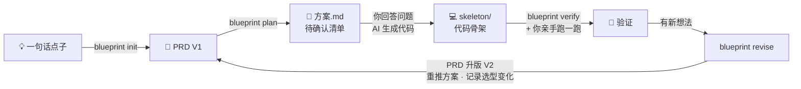

<div align="center">

# 🧭 Agent Blueprint

**一句话点子 → 可确认的 PRD 与架构方案 → 能跑的代码骨架 → 按新需求持续迭代**

一个本地运行的 Agent 产品推导引擎。它不替你写产品，而是先把「该做什么、该用哪些机制、哪里还没想清楚」推导清楚，再陪你一轮轮把骨架做对。

[](https://github.com/hubooooooo/agent-blueprint/actions/workflows/test.yml)
[](LICENSE)
[](https://www.python.org/downloads/)

[快速开始](#快速开始) · [先看效果](#先看效果) · [使用引导](使用引导.md) · [教程视频](https://www.bilibili.com/video/BV17RtD61ETm/)

</div>

---

## 它能帮你做什么

| 你手上有 | 你说 | 你拿到 |
|---|---|---|
| 💡 一个点子或半份 PRD | 「帮我出个方案」 | `方案.md`：待确认问题、需求拆解、组件选型及理由、七层架构图、工具清单、系统提示词草案、独立审稿意见 |
| 🔁 一个想认真做下去的产品 | 「按产品循环做，产品名 ……」 | `out/<产品名>/` 工作区：带版本的 PRD、方案、代码骨架、验证报告、迭代记录，之后每次加需求都在这里升版 |
| 🔍 一个已经写了的 Agent 项目 | 「检查这个项目缺什么」 | `差距报告.md`：缺哪些机制、先补什么、证据在哪一行 ＋ `本该有的PRD.md` |

## 核心：产品循环

做 Agent 产品最常见的坑，是骨架跑起来之后有了新想法，直接改代码，PRD 和方案从此跟代码对不上。产品循环把每一轮新需求都先落回 PRD，再推导、再改骨架：



三方各管一段，边界写死在规则里：

- **引擎**负责推导和记账：拆需求、按固定规则选组件、出方案、审稿、PRD 升版快照、记录每轮选型变化。
- **AI 助手**负责写代码：按方案生成骨架，按迭代记录增量修改，只能写进 `out/<产品名>/skeleton/`。
- **你**负责判断：回答待确认问题、亲手跑骨架、决定下一轮要什么。迭代记录里的「人工验证结论」只能由你来填。

## 先看效果

下面是引擎对一段话需求的真实输出节选，没有人工修改。输入是：「家长拍一张玩具合影，AI 生成可以亲子共同演绎的剧情脚本……照片涉及隐私，默认不保存……未来希望记住孩子的年龄和偏好。」

| 组件 | 选否 | 引擎给出的理由 |
|---|---|---|
| s03 权限系统 | ✅ 必选 | 照片涉及隐私，默认不保存，属于敏感数据操作 |
| s04 钩子系统 | ✅ 必选 | 生成内容必须过适龄审核，天然需要审核与拦截环节 |
| s09 记忆系统 | ⏸ 二期 | 未来希望记住孩子的年龄和偏好玩具做个性化 |
| s12 定时调度 | ❌ 放弃 | 由家长拍照触发，输入未提任何定时自动触发 |
| s13 Agent 团队 | ❌ 放弃 | 单人单次单脚本的产品形态，不涉及并行与隔离工作区 |

它同时会列出你还没想清楚的问题，例如「目标孩子的年龄段是多少」「交互形态是小程序、App 还是网页」，答不上来的就是风险点。

完整版：[正向方案](docs/examples/方案示例-玩具剧场-真实运行.md) · [反向差距报告](docs/examples/差距报告示例-minimal-bot-真实运行.md) · [示例说明](docs/examples/README.md)

---

## 快速开始

所有方式都需要一个模型 API Key，推荐 [DeepSeek](https://platform.deepseek.com)，便宜且国内可直连。配置方法见下一节。

### 🍎 方式一：Mac 双击（零命令行）

双击 **`启动引擎.command`**，终端里一问一答走完全程：

1. 选模型服务商，粘贴 API Key，自动测试连接。
2. 选「开始一个产品」，输入产品名和一句话想法。之后也可以选「加新需求」「检查骨架」「只生成方案」「检查外部项目」。
3. 推导完成后自动打开结果文件。

没装 Python 3.10+ 时，它会下载并打开 Python 安装器，装好后重新双击即可。

### 🤖 方式二：交给能读本地文件的 AI（零安装）

把下面任意一段交给 Claude Desktop、Claude Code、Cursor 这类能读写本地文件的 AI，替换路径和内容：

```text
引擎目录：/你的路径/agent-blueprint
先读这个目录里的《使用引导.md》，按「产品循环」工作。
产品名：酒馆搭子
我的点子是：……
请建立工作区、生成方案，列出要我回答的问题；我确认后再把代码骨架生成到 skeleton/。
```

```text
引擎目录：/你的路径/agent-blueprint
产品 酒馆搭子，新需求：……
请按产品循环升版 PRD、重推方案，再增量更新骨架。
```

```text
引擎目录：/你的路径/agent-blueprint
先读《使用引导.md》。请检查这个项目缺什么、先补什么：/你的路径/目标项目
先检查，不修改项目代码。
```

> 普通网页聊天窗口读不了本地文件，只给路径是不够的。

### 💻 方式三：命令行

```sh
bash setup.sh                         # 建虚拟环境、装依赖、生成 .env

# 产品循环
.venv/bin/python -m blueprint init "酒馆搭子" "一句话点子" --plan   # 建工作区并推导方案
.venv/bin/python -m blueprint verify out/酒馆搭子                  # 用 PRD 对照 skeleton/
.venv/bin/python -m blueprint revise out/酒馆搭子 "新需求：……"     # PRD 升版并重推方案
.venv/bin/python -m blueprint revise out/酒馆搭子 "……" --quick     # 只重算选型，1 次调用

# 单次使用
.venv/bin/python -m blueprint plan "一句话点子或 PRD 文件路径" -o out/my-plan
.venv/bin/python -m blueprint audit /目标项目路径 [--prd 需求.md] -o out/my-audit
```

任何一步中断，原命令加 `--resume` 续跑，已完成的阶段不重复调用模型。

---

## 配置模型

在 `.env` 里填三项即可，向导会帮你写好：

```ini
ANTHROPIC_API_KEY=你的 Key
MODEL_ID=deepseek-v4-flash
ANTHROPIC_BASE_URL=https://api.deepseek.com/anthropic
```

| 服务商 | 推荐模型 | 说明 |
|---|---|---|
| DeepSeek | `deepseek-v4-flash` | 推荐，项目的真实基线就是用它跑的 |
| 智谱 GLM | `glm-5.2` | |
| Kimi | `kimi-k2.7-code` | |
| MiniMax | `MiniMax-M3` | |
| Anthropic | `claude-sonnet-4-6` | 官方接口，不用填 Base URL |

各家完整的 Base URL 见 [.env.example](.env.example)。

参考用量：

| 操作 | 模型调用 | tokens |
|---|---|---|
| 一份完整方案，含一次审稿打回重写 | 6 次 | 约 4 万 |
| 一次反向检查 | 2 次 | 约 1 万 |
| `revise --quick` | 1 次 | 约 0.5 万 |

每次运行默认最多 16 次调用、40 万 tokens，超出会停下并提示续跑，不会无限扣费。

---

## 产出放在哪

引擎孵化的产品，所有东西都在一个文件夹里，不会写到桌面或别的地方：

```
out/酒馆搭子/
├── PRD.md              当前版本的需求文档，给 AI 看，带版本记录
├── prd/V1.md, V2.md …  每次升版前的快照
├── 方案.md, plan.json   引擎推导出的方案
├── skeleton/           代码骨架，唯一允许写产品代码的地方
├── verify/             用 PRD 对照骨架的差距报告
└── 迭代记录.md          每一轮：新需求、选型变化、骨架待办、人工验证结论
```

你已有的外部项目保持在原位，只把路径告诉引擎做检查。

---

## 17 个 Harness 组件

> **模型是驾驶者，Harness 是载具。** 你构建的是载具，不是智能。

引擎内置 17 个组件，每个都带说明、生产级要点和可运行的参考实现 `sNN_*/code.py`。选型由固定规则完成：模型只判断需求有没有某个特征，选不选哪个组件由 [rules.py](blueprint/rules.py) 决定，同样的判断永远得到同样的选型。原则是**只选需要的，不为完整而选**。

| 域 | 组件 | 什么时候需要 |
|---|---|---|
| 行动 | [s01 Agent Loop](s01_agent_loop/) · [s02 工具系统](s02_tool_use/) · [s14 MCP 插件](s14_mcp_plugin/) | 一切基础；需要接入外部工具生态时加 s14 |
| 约束 | [s03 权限系统](s03_permission/) · [s04 钩子系统](s04_hooks/) | 涉及删除、支付、隐私等敏感操作；需要审计、拦截、埋点 |
| 认知 | [s05 任务规划](s05_todo_write/) · [s07 技能加载](s07_skill_loading/) · [s09 记忆系统](s09_memory/) · [s17 目标闭环](s17_goal_loop/) | 需要跟踪进度；知识库庞大；跨会话记偏好；自动判断何时算完成 |
| 上下文 | [s06 子 Agent](s06_subagent/) · [s08 上下文压缩](s08_context_compact/) | 子任务会撑爆上下文或可并行；长会话、日志量大 |
| 协作 | [s10 任务系统](s10_task_system/) · [s11 后台任务](s11_background_tasks/) · [s12 定时调度](s12_cron_scheduler/) · [s13 Agent 团队](s13_agent_teams/) | 目标要持久化续跑；慢操作不能阻塞；定时触发；多任务并行且隔离 |
| 编排 | [s15 集成 Harness](s15_integrated_harness/) · [s16 工作流运行时](s16_workflow_runtime/) | 选了 3 个以上可选组件需要归一；流程固定可以写死 |

完整的推导方法和选型表见 [BLUEPRINT.md](BLUEPRINT.md)。

---

## 常见问题

**没有 API Key 能用吗？**
方式二可以：由你正在用的 AI 按手册分析，报告里会注明「未运行模型管线」。命令行的 `--mock` 只按关键词占位，用来检查流程能不能跑通，结论不能用于决策。

**我的代码会被上传吗？**
只会发给你在 `.env` 里配置的模型服务。正向推导发送你的点子或 PRD；反向检查发送 README、目录结构和扫描命中的代码片段，不会整库上传。`.env` 和 `out/` 都不进 git，学生打包工具也会排除它们。

**结果靠谱吗？**
特征判断在题库上的一致率约 90%，单次运行会有一两题波动。方案末尾的独立审稿经常给出「未通过」，这是设计如此：审稿就是要把方案里的矛盾挑出来，这些意见就是你下一轮要回答的问题。反向报告的「信号覆盖率」只是关键词命中比例，不是功能完成度。

**Windows 能用吗？**
引擎本身是纯 Python，但只在 macOS 和 Linux 上测试过。Windows 建议用 WSL 或方式二。s13、s15、s16 的参考实现依赖 `fcntl`，只能在 macOS 和 Linux 上运行。

---

## 项目结构

| 位置 | 用途 |
|---|---|
| [使用引导.md](使用引导.md) | 用户入口：任务模板、产品循环、给 AI 的执行规则 |
| [BLUEPRINT.md](BLUEPRINT.md) | 五步推导、五要素、七层架构与组件选型表 |
| [blueprint/](blueprint/) | 引擎：需求拆解、规则选型、方案渲染、源码扫描、产品工作区 |
| `s01`–`s17` | 17 个组件的说明、参考实现与图示 |
| [common/](common/) | 组件参考实现共用的启动层 |
| [scaffold/](scaffold/) · [skills/](skills/) | 项目模板；构建 Agent、代码检查等技能 |
| [docs/](docs/) | 入门指南、真实输出示例、维护手册 |
| [evals/](evals/) · [tests/](tests/) | 特征判断题库与回归测试 |
| [tools/](tools/) | 双击向导、示例刷新、学生打包 |

## 开发与维护

```sh
.venv/bin/python -m pytest -q                 # 全部测试，不需要 Key
.venv/bin/python -m blueprint eval            # 离线题库回归
.venv/bin/python -m blueprint eval --real     # 真实模型特征一致率
.venv/bin/python tools/refresh_examples.py    # 改提示词后重新生成示例
.venv/bin/python tools/package_student.py     # 生成 dist/agent-blueprint-student.zip
```

改规则、换模型、调提示词前先看 [维护手册](docs/维护手册.md)，题库口径见 [evals/README.md](evals/README.md)，提交 PR 前看 [贡献指南](CONTRIBUTING.md)。

## 文档导航

| 我想… | 看这里 |
|---|---|
| 第一次用 | [使用引导.md](使用引导.md) |
| 只有一个模糊想法，不知道怎么描述 | [小白入门指南](docs/beginner-guide.md) |
| 看一份完整方案和差距报告 | [真实输出示例](docs/examples/README.md) |
| 理解推导方法 | [BLUEPRINT.md](BLUEPRINT.md) |
| 改规则、换模型、分发给学生 | [维护手册](docs/维护手册.md) |

---

<div align="center">

作者：**Hubo** · [MIT 许可证](LICENSE) · [教程视频](https://www.bilibili.com/video/BV17RtD61ETm/)

</div>
