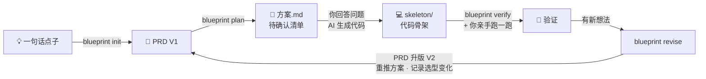
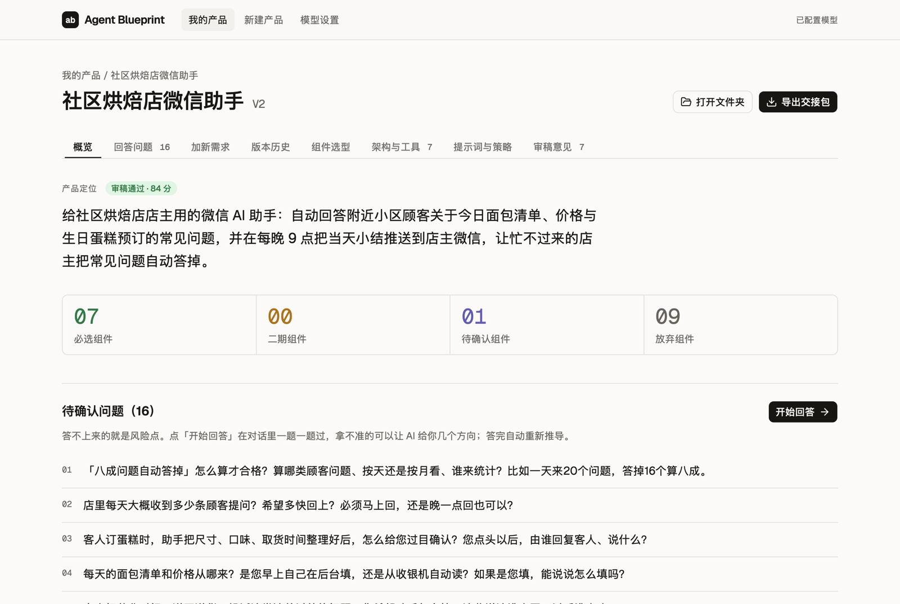
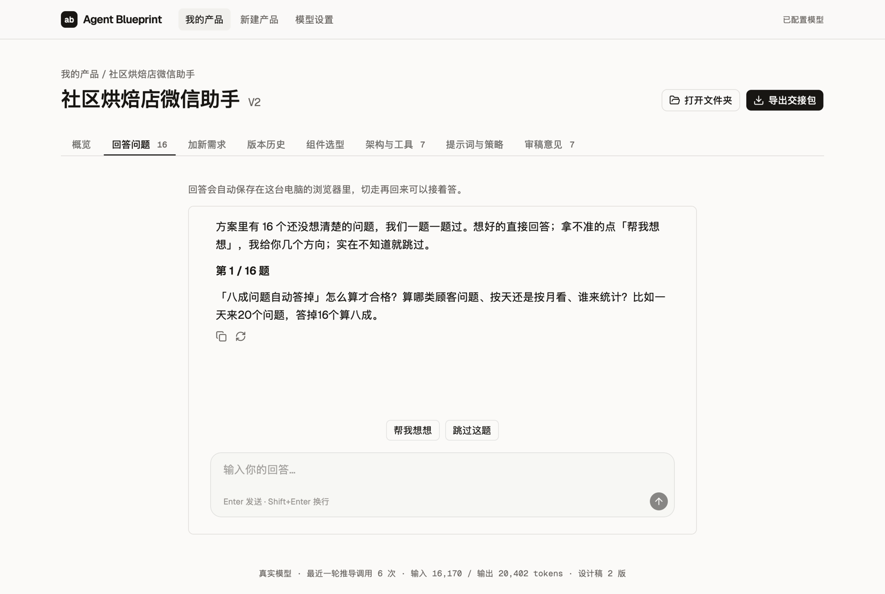

<div align="center">

<picture>
  <source media="(prefers-color-scheme: dark)" srcset="docs/images/logo-dark.png">
  
</picture>

# Agent Blueprint

**一句话点子 → 可确认的 PRD 与架构方案 → 你的 AI 写出能跑的骨架 → 引擎对照 PRD 验收 → 按新需求持续迭代**

一个本地运行的 Agent 产品推导引擎。它不替你写代码，而是先把「该做什么、该用哪些机制、哪里还没想清楚」推导清楚，交给你自己的 AI 编程工具去写骨架，再对照 PRD 验收，陪你一轮轮把骨架做对。

[](https://github.com/hubooooooo/agent-blueprint/actions/workflows/test.yml)
[](LICENSE)
[](https://www.python.org/downloads/)

[快速开始](#快速开始) · [先看效果](#先看效果) · [使用引导](使用引导.md) · [教程视频](https://www.bilibili.com/video/BV17RtD61ETm/)

</div>

---

## 两个版本

<table>
<tr><th align="left" width="16%">版本</th><th align="left" width="40%">是什么</th><th align="left" width="22%">适合</th><th align="left" width="22%">下载</th></tr>
<tr><td><b>v1.2 教学版</b></td><td>没有网页界面：项目文件夹、Python 引擎和命令行。用 AI 编程工具打开文件夹，让它全局阅读项目，再按引导一步步带你做到骨架验收</td><td>课堂上跟着老师学，看清项目里有什么、每一步怎么跑起来</td><td><a href="https://github.com/hubooooooo/agent-blueprint/releases/tag/v1.2">下载学生包</a> · <a href="https://github.com/hubooooooo/agent-blueprint/tree/v1.2">浏览源码</a></td></tr>
<tr><td><b>v2.1</b>（本页）</td><td>在 v1 的基础上加了本地网页界面：对话式新建产品、回答问题、试玩、导出交接包、检查外部项目</td><td>想直接用的普通用户：下载后双击启动，在网页上操作</td><td><a href="https://github.com/hubooooooo/agent-blueprint/releases/tag/v2.1">下载</a></td></tr>
</table>

两个版本都在自己电脑上运行，不是网站。v1.2 由 AI 在终端里运行命令，用法看 [v1.2 的 README](https://github.com/hubooooooo/agent-blueprint/blob/v1.2/README.md)「课堂上这样用」；v2 双击 `启动界面.command`，第一次双击如果被 macOS 拦下，看[常见问题](#常见问题)。

## 它能帮你做什么

<table>
<tr><th align="left" width="26%">你手上有</th><th align="left" width="22%">你说</th><th align="left" width="52%">你拿到</th></tr>
<tr><td>💡 一个点子或半份 PRD</td><td>「帮我出个方案」</td><td><code>方案.md</code>：待确认问题、需求拆解、组件选型及理由、七层架构图、工具清单、系统提示词草案、测试设计、独立审稿意见</td></tr>
<tr><td>🔁 一个想认真做下去的产品</td><td>「按产品循环做，产品名 ……」</td><td><code>out/&lt;产品名&gt;/</code> 工作区：带版本的 PRD、方案、验证报告、迭代记录，之后每次加需求都在这里升版；代码骨架由你的 AI 按方案写进 <code>skeleton/</code></td></tr>
<tr><td>🔍 一个已经写了的 Agent 项目</td><td>「检查这个项目缺什么」</td><td><code>差距报告.md</code>：缺哪些机制、先补什么、证据在哪一行 ＋ <code>本该有的PRD.md</code></td></tr>
</table>

## 核心：产品循环

做 Agent 产品最常见的坑，是骨架跑起来之后有了新想法，直接改代码，PRD 和方案从此跟代码对不上。产品循环把每一轮新需求都先落回 PRD，再推导、再改骨架：



三方各管一段，边界写死在规则里：

- **引擎**负责推导和记账：拆需求、按固定规则选组件、出方案、审稿、PRD 升版快照、记录每轮选型变化。浏览器界面里的「试玩」是引擎按方案模拟出来的对话，给你看看它大概会怎么表现；它不是代码，也不是产品原型，不能导出，不进交接包。
- **AI 助手**负责写代码：按方案生成骨架，按迭代记录增量修改，只能写进 `out/<产品名>/skeleton/`。
- **你**负责判断：回答待确认问题、亲手跑骨架、决定下一轮要什么。迭代记录里的「人工验证结论」只能由你来填。

## 引擎里的 agent

引擎外层是固定流程：步骤顺序写死，组件选型由规则计算，费用有上限。其中需要「自己判断下一步」的四处交给 agent，每一处都有代码兜底：

<table>
<tr><th align="left" width="18%">环节</th><th align="left" width="44%">agent 做什么</th><th align="left" width="38%">代码守住什么</th></tr>
<tr><td>新建产品的追问</td><td>自己判断还缺什么、问几轮；想法说完整了就不再问</td><td>目标、用户、核心闭环、红线四项都有了（或你说不确定）才能整理草稿；最多问 6 轮</td></tr>
<tr><td>方案推导</td><td>写五要素和架构设计，可以查组件说明，交卷前自检</td><td>组件选型由规则算，agent 改不了；工具与选型对不上、降级场景或测试设计漏写，不改好不能交卷</td></tr>
<tr><td>检查项目和骨架</td><td>自己翻代码，逐个核实组件，每条结论附读过的代码行</td><td>只读、只能看项目目录、不读 <code>.env</code> 和私钥；证据必须是真读过的文件和真实行号</td></tr>
<tr><td>试玩</td><td>按方案里的提示词和工具清单真的调用工具，卡片边跑边出现</td><td>标了「禁止」的工具调不了，标了「要确认」的操作不会被当成已完成</td></tr>
</table>

agent 需要模型支持工具调用。模型不支持、调用出错或费用上限快用完时，这一步自动退回固定流程，报告或方案开头会写明原因，不会让你卡住。

## 先看效果

下面是引擎对一段话需求的真实输出节选，没有人工修改。输入是：「家长拍一张玩具合影，AI 生成可以亲子共同演绎的剧情脚本……照片涉及隐私，默认不保存……未来希望记住孩子的年龄和偏好。」

<table>
<tr><th align="left" width="20%">组件</th><th align="left" width="14%">选否</th><th align="left" width="66%">引擎给出的理由</th></tr>
<tr><td>s03 权限系统</td><td>✅ 必选</td><td>照片涉及隐私，默认不保存，属于敏感数据操作</td></tr>
<tr><td>s04 钩子系统</td><td>✅ 必选</td><td>生成内容必须过适龄审核，天然需要审核与拦截环节</td></tr>
<tr><td>s09 记忆系统</td><td>⏸ 二期</td><td>未来希望记住孩子的年龄和偏好玩具做个性化</td></tr>
<tr><td>s12 定时调度</td><td>❌ 放弃</td><td>由家长拍照触发，输入未提任何定时自动触发</td></tr>
<tr><td>s13 Agent 团队</td><td>❌ 放弃</td><td>单人单次单脚本的产品形态，不涉及并行与隔离工作区</td></tr>
</table>

它同时会列出你还没想清楚的问题，例如「目标孩子的年龄段是多少」「交互形态是小程序、App 还是网页」，答不上来的就是风险点。

完整版：[正向方案](docs/examples/方案示例-玩具剧场-真实运行.md) · [反向差距报告](docs/examples/差距报告示例-minimal-bot-真实运行.md) · [示例说明](docs/examples/README.md)

---

## 快速开始

开始前准备两样东西：

<table>
<tr><th align="left" width="20%">准备</th><th align="left" width="28%">用来做什么</th><th align="left" width="52%">什么时候需要</th></tr>
<tr><td>模型 API Key</td><td>引擎推导方案、升版、验收</td><td>所有方式都要。推荐 <a href="https://platform.deepseek.com">DeepSeek</a>，便宜且国内可直连，配置方法见下一节</td></tr>
<tr><td>能读写本地文件的 AI 编程工具</td><td>按方案把代码骨架写进 <code>skeleton/</code></td><td>要代码时才需要，例如 Claude Code、Cursor。只要方案或差距报告可以不装</td></tr>
</table>

用方式一或方式三推导完方案后，把下面这段话交给你的 AI 编程工具，让它写骨架：

```text
引擎目录：/你的路径/agent-blueprint
先读这个目录里的《使用引导.md》，按「产品循环」工作。
产品 酒馆搭子 的方案已经在 out/酒馆搭子/方案.md，请按方案把代码骨架写进 out/酒馆搭子/skeleton/。
```

### 🍎 方式一：Mac 双击（零命令行）

**浏览器界面（推荐给不用终端的人）**：双击 **`启动界面.command`**，浏览器会自动打开引擎界面。第一次双击如果提示「无法打开」，按[常见问题](#常见问题)里的步骤放行一次即可。

1. 「模型设置」里选服务商、粘贴 API Key，点「测试连接并保存」。
2. 「新建产品」像聊天一样说出想法，AI 追问给谁用、怎么用、什么不能做，信息够了就停（想法说完整了就不再问，只说一句话的一般问三个左右），整理成需求草稿给你确认。确认后开始推导，进度直接显示在对话里。
3. 推导完在产品页看方案：组件选型及理由、七层架构、工具清单、系统提示词、测试设计、审稿意见。
4. 方案里还没想清楚的问题，在「回答问题」里一题一题答。问题都改成了大白话，只有工程师能判断的技术备注单独放着，不用你答；拿不准的点「帮我想想」，AI 给几个方向。答完自动写进 PRD 并重新推导。
5. 在「试玩」里扮演自己产品的使用者（比如来问面包的顾客）和它聊几句，看它按现在的方案会怎么回应。它会按方案里的工具清单一步步做事，每做一步就多一张卡片；查资料、通知店主这些工具不会真的执行，结果是模拟的。方案里要先问人的操作会停下来等确认，禁止的操作调不了，这些地方都单独标出来。哪里不对就点回复下面的「这里不对」记下，最后一起带去「加新需求」。
6. 点「导出交接包」，把 zip 发给帮你做产品的开发者：里面有需求、方案、还没定下来的问题、第一版组件的参考代码，以及一段交给 AI 编程工具的提示词。
7. 有了新想法，在「加新需求」里说一句，AI 最多再问一个问题，整理成草稿给你确认；确认后需求文档升一版、方案重新推导，自动跳到「版本历史」，告诉你哪些组件的选型变了。每一版的需求文档都能回看。
8. 手上已经有一个 Agent 项目，点左栏「检查一个项目」，选它的文件夹（会弹出 Mac 自带的选文件夹窗口，也可以粘贴路径），几分钟后得到差距报告和一份它本该有的需求文档，结果列在左栏「检查过的项目」里。代码改过后点「重新检查」再查一次：「这个项目该有什么」沿用上次的判断，两次的差别只来自代码；项目定位变了再点「重新判断」。

<table>
<tr>
<td width="50%"></td>
<td width="50%"></td>
</tr>
<tr>
<td align="center">产品页：方案概览和待确认问题</td>
<td align="center">回答问题：一题一题答，拿不准就「帮我想想」</td>
</tr>
</table>

产品页左栏底部会显示这个产品累计调用了多少次模型、用了多少 tokens（推导和对话都算，新建产品时的追问不算）。用的时候别关启动它的那个终端窗口。检查产品的代码骨架、对照 PRD 检查外部项目暂时还要用下面的终端问答。

**终端问答**：双击 **`启动引擎.command`**，终端里一问一答走完全程：

1. 选模型服务商，粘贴 API Key，自动测试连接。
2. 选「开始一个产品」，输入产品名和一句话想法。之后也可以选「加新需求」「检查骨架」「只生成方案」「检查外部项目」。
3. 推导完成后自动打开结果文件。

没装 Python 3.10+ 时，两个启动文件都会下载并打开 Python 安装器，装好后重新双击即可。

### 🤖 方式二：交给能读本地文件的 AI（零安装）

把下面任意一段交给 Claude Desktop、Claude Code、Cursor 这类能读写本地文件的 AI，替换路径和内容：

```text
引擎目录：/你的路径/agent-blueprint
先读这个目录里的《使用引导.md》，按「产品循环」工作。
产品名：酒馆搭子
我的点子是：……
请建立工作区、生成方案，列出要我回答的问题；我确认后再把代码骨架生成到 skeleton/。
```

```text
引擎目录：/你的路径/agent-blueprint
产品 酒馆搭子，新需求：……
请按产品循环升版 PRD、重推方案，再增量更新骨架。
```

```text
引擎目录：/你的路径/agent-blueprint
先读《使用引导.md》。请检查这个项目缺什么、先补什么：/你的路径/目标项目
先检查，不修改项目代码。
```

> 普通网页聊天窗口读不了本地文件，只给路径是不够的。

### 💻 方式三：命令行

```sh
bash setup.sh                         # 建虚拟环境、装依赖、生成 .env

# 产品循环
.venv/bin/python -m blueprint init "酒馆搭子" "一句话点子" --plan   # 建工作区并推导方案
.venv/bin/python -m blueprint verify out/酒馆搭子                  # 按方案和 PRD 检查 skeleton/
.venv/bin/python -m blueprint revise out/酒馆搭子 "新需求：……"     # PRD 升版并重推方案
.venv/bin/python -m blueprint revise out/酒馆搭子 "……" --quick     # 只重算选型，最多 3 次调用
.venv/bin/python -m blueprint handoff out/酒馆搭子                 # 打包交接包，交给会写代码的人

# 浏览器界面
.venv/bin/python -m blueprint ui                                  # 默认 http://127.0.0.1:8765（被占用就往后找），只允许本机访问

# 单次使用
.venv/bin/python -m blueprint plan "一句话点子或 PRD 文件路径" -o out/my-plan
.venv/bin/python -m blueprint audit /目标项目路径 [--prd 需求.md] -o out/my-audit
```

检查项目（`audit`、`verify`）默认由 agent 读代码核实，每条结论都附它读过的代码行；一次检查最多调用模型 40 次。想省钱或排查问题时加 `--fast`，只按关键词扫描，可能误判。

任何一步中断，原命令加 `--resume` 续跑，已完成的阶段不重复调用模型。

---

## 配置模型

在 `.env` 里填三项即可，向导会帮你写好：

```ini
ANTHROPIC_API_KEY=你的 Key
MODEL_ID=deepseek-v4-flash
ANTHROPIC_BASE_URL=https://api.deepseek.com/anthropic
```

<table>
<tr><th align="left" width="18%">服务商</th><th align="left" width="30%">推荐模型</th><th align="left" width="52%">说明</th></tr>
<tr><td>DeepSeek</td><td><code>deepseek-v4-flash</code></td><td>推荐，项目的真实基线就是用它跑的</td></tr>
<tr><td>智谱 GLM</td><td><code>glm-5.2</code></td><td></td></tr>
<tr><td>Kimi</td><td><code>kimi-k2.7-code</code></td><td></td></tr>
<tr><td>MiniMax</td><td><code>MiniMax-M3</code></td><td></td></tr>
<tr><td>Anthropic</td><td><code>claude-sonnet-4-6</code></td><td>官方接口，不用填 Base URL</td></tr>
</table>

各家完整的 Base URL 见 [.env.example](.env.example)。

agent 需要模型支持工具调用。DeepSeek 实测支持；其他服务商或模型中转可以先测一下，三项都通过就能用 agent：

```sh
.venv/bin/python tools/probe_tools.py                          # 测 .env 里配的模型
.venv/bin/python tools/probe_tools.py --model 模型名           # 换个模型测
```

几个开关，需要时在启动前设置：

<table>
<tr><th align="left" width="36%">环境变量</th><th align="left" width="64%">作用</th></tr>
<tr><td><code>BLUEPRINT_AGENT=off</code></td><td>推导方案、检查项目都不用 agent，走固定流程</td></tr>
<tr><td><code>BLUEPRINT_PLAY_AGENT=off</code></td><td>试玩不用 agent，改为一次调用编出整轮（更快，但规矩只靠提示词约束）</td></tr>
<tr><td><code>BLUEPRINT_TIMEOUT=300</code></td><td>单次请求超时秒数，默认 120；经中转的慢模型容易超时时调大</td></tr>
</table>

参考用量：

<table>
<tr><th align="left" width="56%">操作</th><th align="left" width="22%">模型调用</th><th align="left" width="22%">tokens</th></tr>
<tr><td>一份完整方案（agent 推导）</td><td>5–7 次</td><td>约 2.5–4 万</td></tr>
<tr><td>一次反向检查（agent 读代码）</td><td>4–9 次</td><td>约 1–3 万</td></tr>
<tr><td><code>revise --quick</code></td><td>1 次</td><td>约 0.5 万</td></tr>
<tr><td>新建产品时追问一轮</td><td>2–4 次</td><td>约 0.1–0.3 万</td></tr>
<tr><td>试玩里说一句话</td><td>2–9 次，看它要调几个工具</td><td>约 0.05–0.7 万</td></tr>
</table>

每次运行默认最多 40 次调用、150 万 tokens（检查项目加 `--fast` 时是 16 次、40 万），超出会停下并提示续跑，不会无限扣费。实际用量通常远低于上限。

---

## 产出放在哪

引擎孵化的产品，所有东西都在 `out/<产品名>/` 一个文件夹里，不会写到桌面或别的地方：

<table>
<tr><th align="left" width="24%">文件</th><th align="left" width="44%">内容</th><th align="left" width="32%">谁产出</th></tr>
<tr><td><code>PRD.md</code></td><td>当前版本的需求文档，给 AI 看，带版本记录</td><td>引擎建模板和升版，你回答待确认问题后补全</td></tr>
<tr><td><code>prd/V1.md</code>, <code>V2.md</code> …</td><td>每次升版前的快照</td><td>引擎</td></tr>
<tr><td><code>方案.md</code>, <code>plan.json</code></td><td>待确认清单、组件选型及理由、架构、工具清单、提示词草案、审稿意见</td><td>引擎</td></tr>
<tr><td><code>skeleton/</code></td><td>代码骨架，唯一允许写产品代码的地方</td><td><strong>你的 AI 编程工具</strong>，引擎不写</td></tr>
<tr><td><code>verify/</code></td><td>按方案的组件选型和 PRD 检查骨架的差距报告</td><td>引擎</td></tr>
<tr><td><code>迭代记录.md</code></td><td>每一轮：新需求、选型变化、骨架待办、人工验证结论</td><td>引擎记录；人工验证结论只能由你填</td></tr>
</table>

引擎不负责部署上线和上线后的运行。

你已有的外部项目保持在原位，只把路径告诉引擎做检查。

---

## 17 个 Harness 组件

> **模型是驾驶者，Harness 是载具。** 你构建的是载具，不是智能。

引擎内置 17 个组件，每个都带说明、生产级要点和可运行的参考实现 `sNN_*/code.py`。选型由固定规则完成：模型只判断需求有没有某个特征，选不选哪个组件由 [rules.py](blueprint/rules.py) 决定，同样的判断永远得到同样的选型。原则是**只选需要的，不为完整而选**。

<table>
<tr><th align="left" width="10%">域</th><th align="left" width="50%">组件</th><th align="left" width="40%">什么时候需要</th></tr>
<tr><td>行动</td><td><a href="s01_agent_loop/">s01 Agent Loop</a> · <a href="s02_tool_use/">s02 工具系统</a> · <a href="s14_mcp_plugin/">s14 MCP 插件</a></td><td>一切基础；需要接入外部工具生态时加 s14</td></tr>
<tr><td>约束</td><td><a href="s03_permission/">s03 权限系统</a> · <a href="s04_hooks/">s04 钩子系统</a></td><td>涉及删除、支付、隐私等敏感操作；需要审计、拦截、埋点</td></tr>
<tr><td>认知</td><td><a href="s05_todo_write/">s05 任务规划</a> · <a href="s07_skill_loading/">s07 技能加载</a> · <a href="s09_memory/">s09 记忆系统</a> · <a href="s17_goal_loop/">s17 目标闭环</a></td><td>需要跟踪进度；知识库庞大；跨会话记偏好；自动判断何时算完成</td></tr>
<tr><td>上下文</td><td><a href="s06_subagent/">s06 子 Agent</a> · <a href="s08_context_compact/">s08 上下文压缩</a></td><td>子任务会撑爆上下文或可并行；长会话、日志量大</td></tr>
<tr><td>协作</td><td><a href="s10_task_system/">s10 任务系统</a> · <a href="s11_background_tasks/">s11 后台任务</a> · <a href="s12_cron_scheduler/">s12 定时调度</a> · <a href="s13_agent_teams/">s13 Agent 团队</a></td><td>目标要持久化续跑；慢操作不能阻塞；定时触发；多任务并行且隔离</td></tr>
<tr><td>编排</td><td><a href="s15_integrated_harness/">s15 集成 Harness</a> · <a href="s16_workflow_runtime/">s16 工作流运行时</a></td><td>选了 3 个以上可选组件需要归一；流程固定可以写死</td></tr>
</table>

完整的推导方法和选型表见 [BLUEPRINT.md](BLUEPRINT.md)。

---

## 常见问题

**第一次双击提示「无法打开」怎么办？**
启动文件没有经过苹果签名，从浏览器下载后第一次双击，macOS 会拦下来，提示「Apple 无法验证……是否包含恶意软件」。放行一次，以后双击就正常了：

1. 在弹窗里点「完成」，不要点「移到废纸篓」。
2. 打开「系统设置」→ 左栏「隐私与安全性」，右边往下翻到「安全性」。
3. 那里会有一行「已阻止"启动界面.command"……」，点旁边的「仍要打开」。没看到这一行的话，先回去再双击一次启动文件，再回来看。
4. 输入开机密码（或按指纹），在再次弹出的窗口里点「仍要打开」。

macOS 14 及更早的版本更简单：按住 Control 键点启动文件，选「打开」，再点「打开」。

会用终端的话，也可以一次放行整个文件夹：`xattr -dr com.apple.quarantine 解压出来的文件夹路径`。用 `git clone` 下载的不会被拦。

**没有 API Key 能用吗？**
方式二可以：由你正在用的 AI 按手册分析，报告里会注明「未运行模型管线」。命令行的 `--mock` 只按关键词占位，用来检查流程能不能跑通，结论不能用于决策。

**我的代码会被上传吗？**
只会发给你在 `.env` 里配置的模型服务。正向推导发送你的点子或 PRD。反向检查默认由 agent 读代码，它读过的文件内容会发给模型；`.env`、私钥等密钥文件一律不读，依赖目录和隐藏目录也会跳过。加 `--fast` 时只发送 README、目录结构和扫描命中的代码片段。`.env` 和 `out/` 都不进 git，学生打包工具也会排除它们。

**结果靠谱吗？**
特征判断在题库上的一致率约 90%。模型每次判断会有一两题不一样，所以引擎会拿同一份原文另外判断两次、三票取多数（多 2 次小调用）；再次检查同一个项目时，沿用上次检查对「该有什么」的判断，两次报告的差别只来自代码变化，要重新判断加 `--rejudge`（网页上点「重新判断」）。方案末尾的独立审稿有时会给出「未通过」，这是设计如此：审稿就是要把方案里的矛盾挑出来，这些意见就是你下一轮要回答的问题。agent 推导时会先按规则自检一遍，实测三道题都一次过审，但样本还小。反向报告默认由 agent 读代码核实，「信号覆盖率」按核实结果计算；它没有运行被检查的项目，所以仍然不是功能完成度。

**我用的模型很便宜，或者不支持工具调用，会怎样？**
不支持工具调用的模型会自动退回固定流程，照样能出方案和报告，只是少了 agent 的自检和核实，试玩里的规矩也只能靠提示词约束。支持工具调用的便宜模型反而更该用 agent：试玩里「禁止」「要确认」由代码保证，不靠模型听不听话。用 `tools/probe_tools.py` 可以先测一下。

**Windows 能用吗？**
引擎本身是纯 Python，但只在 macOS 和 Linux 上测试过。Windows 建议用 WSL 或方式二。s13、s15、s16 的参考实现依赖 `fcntl`，只能在 macOS 和 Linux 上运行。

---

## 项目结构

<table>
<tr><th align="left" width="24%">位置</th><th align="left" width="76%">用途</th></tr>
<tr><td><a href="使用引导.md">使用引导.md</a></td><td>用户入口：任务模板、产品循环、给 AI 的执行规则</td></tr>
<tr><td><a href="BLUEPRINT.md">BLUEPRINT.md</a></td><td>五步推导、五要素、七层架构与组件选型表</td></tr>
<tr><td><a href="blueprint/">blueprint/</a></td><td>引擎：需求拆解、规则选型、方案渲染、源码扫描、产品工作区；<code>agent.py</code> 是 agent 循环，<code>intake_agent.py</code>、<code>plan_agent.py</code>、<code>audit_agent.py</code> 分别是追问、方案推导、检查用的 agent；<code>web/</code> 是浏览器界面的服务端，<code>chat.py</code> 是界面里的几段对话，<code>playground.py</code> 是「试玩」</td></tr>
<tr><td><a href="web/">web/</a></td><td>浏览器界面源码（React + assistant-ui），构建产物提交在 <code>blueprint/web/static/</code></td></tr>
<tr><td><code>s01</code>–<code>s17</code></td><td>17 个组件的说明、参考实现与图示</td></tr>
<tr><td><a href="common/">common/</a></td><td>组件参考实现共用的启动层</td></tr>
<tr><td><a href="scaffold/">scaffold/</a> · <a href="skills/">skills/</a></td><td>项目模板；构建 Agent、代码检查等技能</td></tr>
<tr><td><a href="docs/">docs/</a></td><td>入门指南、真实输出示例、维护手册</td></tr>
<tr><td><a href="evals/">evals/</a> · <a href="tests/">tests/</a></td><td>特征判断题库、反向检查题库（含两道关键词陷阱题）与回归测试</td></tr>
<tr><td><a href="tools/">tools/</a></td><td>双击向导及其环境脚本、示例刷新、学生打包、测模型能否调用工具</td></tr>
</table>

## 开发与维护

```sh
.venv/bin/python -m pytest -q                 # 全部测试，不需要 Key
.venv/bin/python -m blueprint eval            # 离线题库回归
.venv/bin/python -m blueprint eval --real     # 真实模型特征一致率
.venv/bin/python -m blueprint eval --real-audit --repeat 3   # 真实模型跑反向检查题库
.venv/bin/python tools/refresh_examples.py    # 改提示词后重新生成示例
.venv/bin/python tools/package_student.py     # 生成 dist/agent-blueprint-student.zip
```

改规则、换模型、调提示词前先看 [维护手册](docs/维护手册.md)，题库口径见 [evals/README.md](evals/README.md)，提交 PR 前看 [贡献指南](CONTRIBUTING.md)。

## 文档导航

<table>
<tr><th align="left" width="46%">我想…</th><th align="left" width="54%">看这里</th></tr>
<tr><td>第一次用</td><td><a href="使用引导.md">使用引导.md</a></td></tr>
<tr><td>只有一个模糊想法，不知道怎么描述</td><td><a href="docs/beginner-guide.md">小白入门指南</a></td></tr>
<tr><td>看一份完整方案和差距报告</td><td><a href="docs/examples/README.md">真实输出示例</a></td></tr>
<tr><td>理解推导方法</td><td><a href="BLUEPRINT.md">BLUEPRINT.md</a></td></tr>
<tr><td>改规则、换模型、分发给学生</td><td><a href="docs/维护手册.md">维护手册</a></td></tr>
</table>

---

<div align="center">

作者：**Hubo** · [MIT 许可证](LICENSE) · [教程视频](https://www.bilibili.com/video/BV17RtD61ETm/)

</div>
