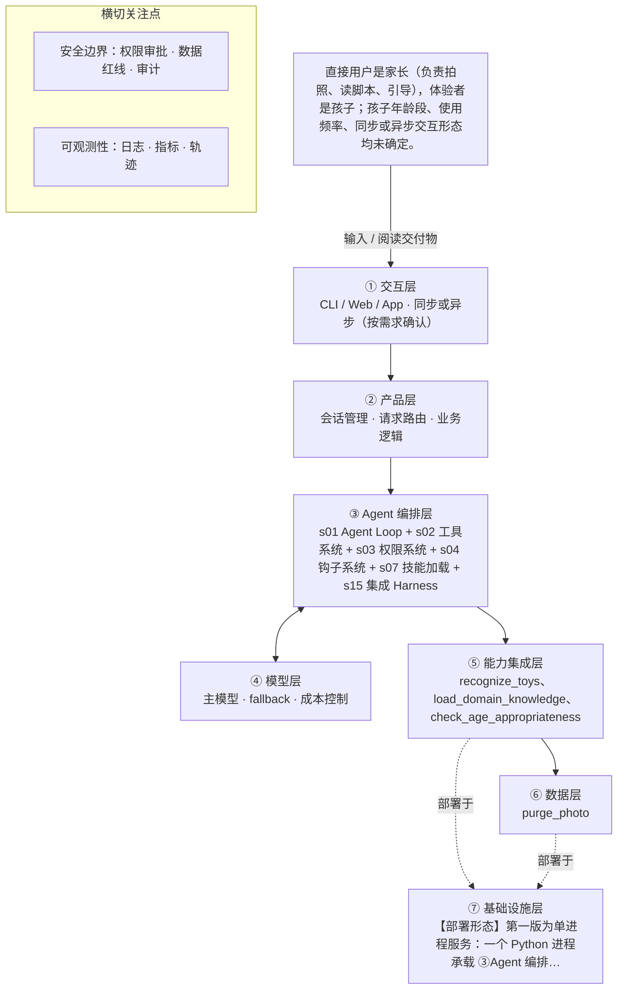

# PRD 推导方案 ——「玩具剧场」

> ⚠️ 本文件是引擎**真实运行产物**，未经人工修改：模型 deepseek-v4-flash，2026-10-31 生成，提示词指纹 `prompts:a38379000f8c`。
> 输入为 [evals/forward/toy-theater/input.md](../../evals/forward/toy-theater/input.md)，6 次调用、输入 13462 / 输出 21177 tokens。
> 审稿没有完全通过是正常的：独立审稿本来就该把方案里的矛盾挑出来，这些意见就是你下一轮要回答的问题。

> 状态：方案待确认（审稿未完全通过，见文末审稿意见）（Step 1–4 已完成，Step 5 代码生成需确认后启动）
> 推导引擎：Agent 工坊 · 模型：deepseek-v4-flash

## 产品定位（一句话）

**玩具剧场**：给家长用：拍一张玩具合影，AI 识别玩具并生成可亲子共演的互动剧情脚本，让旧玩具翻新，也帮家长读懂孩子、一起玩。

## ⚠️ 待确认清单（答不上就是风险点）

**需求问题**：请提出想法的人回答，这几条最要紧。

1. 这个产品要达成什么目标，怎样算做成？请给出一句话目标加可衡量的成功标准（例如家长愿意完整演完的比例、脚本合格率）。
2. 目标用户的具体画像是什么？孩子年龄段是多少，家长的使用频率大概如何，交互是同步出结果还是可以异步等通知？
3. 一次完整交付的具体形态是什么？脚本以纯文本、图文还是可打印卡片形式呈现，篇幅和分幕数量大概多少？
4. 需要调用哪些外部系统或数据源？具体用哪个视觉识别模型和生成模型，照片是否上云、上云后如何存储与删除？
5. 儿童适龄内容规范和玩具剧情范式库从哪里来？由谁维护、以什么格式提供给模型按需加载？
6. 适龄审核的具体标准和执行方式是什么？是模型自检、规则过滤还是人工抽检，拦截后如何重新生成？
7. 失败怎么办？识别不出玩具、生成内容不达标、模型超时或调用失败时，分别如何降级或提示家长？
8. 怎么算成功？请给出可度量指标，如脚本生成完成率、端到端时延、单次生成成本、内容审核通过率。

**方案推导时留下的问题**：多是上面问题的细化，也有写给开发者的备注。先答上面的，这里能答的再补。

9. 可量化成功标准仍缺：本版已把「家长可直接使用率、二次使用率、亲子演绎完成度」定义为可采集指标，但阈值（如 ≥X%）需产品侧确认后才能作为验收基线。
10. 交互形态（同步出脚本 vs 异步等待）仍未确定；若最终定为异步，s11 后台任务的「放弃」决策需重做评审。
11. 孩子年龄段未确定，适龄分级的判定规则与阈值无法落地，check_age_appropriateness 的判据只能先用通用儿童红线。
12. 照片是否上云未确定；候选视觉服务商是否承诺不留存照片、不用于训练，需在选型阶段取得书面说明。
13. 脚本载体（纯文本 / 图文 / 可打印卡片）未确定，直接影响 ①交互层 deliver_story_script 的呈现实现。
14. 识别出的玩具清单与照片实际内容的一致性核验方式未给出（人工抽检还是模型复核）。
15. s03 权限系统的触发特征标为 destructive_ops，但证据是照片隐私与默认不保存，属数据隐私约束而非破坏性操作，建议确认该组件的特征依据是否需要改为隐私类。
16. 时延目标、并发量级与成本预算未给出，P95 阈值、识别/生成超时阈值与重试次数上限均无法定值。
17. 模型供应商与视觉服务商均未指定，密钥注入方式已设计，但具体服务商与配额待确认。

## Step 1 · 需求拆解（提取硬事实）

| 维度 | 结论 | 状态 | 出处 |
|---|---|---|---|
| 目标 | 家长拍一张玩具合影，AI 识别照片里的玩具并生成一份可亲子共同演绎的互动剧情脚本，让旧玩具翻新，也帮家长读懂孩子、一起玩；可量化的成功标准输入中未给出。 | 待确认 | 家长拍一张玩具合影，AI 识别照片里的玩具，生成一份可以亲子共同演绎的互动剧情脚本（角色分配、场景搭建、分幕、对话、家长引导话术），让旧玩具翻新，也帮家长读懂孩子、一起玩。 |
| 用户 | 直接用户是家长（负责拍照、读脚本、引导），体验者是孩子；孩子年龄段、使用频率、同步或异步交互形态均未确定。 | 待确认 | 直接用户是家长（拍照、读脚本、引导），体验者是孩子。 / 孩子年龄段、交互形态、照片是否上云还没定。 |
| 核心闭环 | 家长拍玩具合影 → AI 识别照片中的玩具 → 生成互动剧情脚本（角色分配、场景搭建、分幕、对话、家长引导话术）→ 家长带孩子按脚本演绎。 | 明确 | 家长拍一张玩具合影，AI 识别照片里的玩具，生成一份可以亲子共同演绎的互动剧情脚本（角色分配、场景搭建、分幕、对话、家长引导话术） |
| 交付物 | 一份互动剧情脚本，内容包含角色分配、场景搭建、分幕、对话、家长引导话术；以何种载体呈现（纯文本、图文、可打印卡片等）未确定。 | 明确 | 生成一份可以亲子共同演绎的互动剧情脚本（角色分配、场景搭建、分幕、对话、家长引导话术） |
| 边界 | 绝不生成暴力、恐怖、成人、危险模仿内容；照片涉及隐私，默认不保存；生成内容必须过适龄审核。 | 明确 | 绝不生成暴力、恐怖、成人、危险模仿内容；照片涉及隐私，默认不保存。生成内容必须过适龄审核。 |
| 约束 | 已知约束为儿童适龄内容红线与照片默认不保存的隐私约束；需要儿童适龄内容规范和玩具剧情范式库作为领域知识。时延、并发、成本、可用模型均未确定。 | 待确认 | 生成内容必须过适龄审核。需要儿童适龄内容规范和玩具剧情范式库这样的领域知识库。 / 孩子年龄段、交互形态、照片是否上云还没定。 |

## Step 2 · 领域建模（映射 Harness 五要素）

| 要素 | 内容 |
|---|---|
| **工具** | 接收家长拍摄的玩具合影照片，作为整个流程的唯一输入（拍照或相册上传的具体交互形式待确认）。；调用图像识别能力，从合影中识别出有哪些玩具，输出可被后续脚本生成使用的玩具清单。；依据识别出的玩具清单生成互动剧情脚本，脚本内容须覆盖角色分配、场景搭建、分幕、对话、家长引导话术五个部分。；对生成内容执行适龄审核的检查能力，拦截不符合儿童适龄要求的内容。；照片处理完成后即时清理、不落盘的处置能力（照片是否上云尚未确定）。 |
| **知识** | 儿童适龄内容规范：判定脚本中暴力、恐怖、成人、危险模仿内容红线的依据。；玩具剧情范式库：把识别出的玩具组织成可演绎剧情的领域素材来源。；脚本产出结构规范：角色分配、场景搭建、分幕、对话、家长引导话术这五项为交付物的必备结构。；孩子年龄段对应的内容分级标准：待确认（年龄段尚未确定，无法定出分级阈值）。 |
| **观察** | 适龄审核的结果（通过或拦截、拦截原因）需在生成链路中可查看，用以确认「生成内容必须过适龄审核」确实被执行。；照片留存状态需可核查，用以确认「默认不保存」确实被执行（具体核查方式待确认）。；识别出的玩具清单是否与照片实际内容一致，核验方式输入中未给出，待确认。 |
| **行动** | 家长以拍照或上传一张玩具合影的形式发起一次生成请求（具体交互形态待确认）。；系统以请求—响应方式返回完整脚本，同步还是异步形态待确认。；家长在自有设备上阅读脚本，并在线下口头引导孩子按脚本演绎。；脚本以何种载体呈现（纯文本、图文、可打印卡片等）待确认。 |
| **权限** | 照片属隐私数据，默认不保存，处理完成后不得留存或挪作他用。；凡含暴力、恐怖、成人、危险模仿内容的生成结果，一律默认拒绝输出。；脚本必须经适龄审核通过后才可呈现给家长，审核未通过则拦截，不得直接下发。；照片是否上云尚未确定，确定前按不保存、不上云处理；任何留存或上传须先取得家长明确同意。；孩子年龄段未确定，适龄分级的判定规则待确认，确定前不得按任一年龄段放行内容。 |

## Step 3 · 组件选型（宁可少选）

| 组件 | 选否 | 理由 | 参考 |
|---|---|---|---|
| s01 Agent Loop | ✅ 必选 | 一切基础：循环 + 工具（一切基础，恒选） | s01_agent_loop/README.md |
| s02 工具系统 | ✅ 必选 | 需要调用外部系统/API/数据源（一切基础，恒选） | s02_tool_use/README.md |
| s03 权限系统 | ✅ 必选 | 产品闭环必然处理家长拍摄的玩具照片，原文明确「照片涉及隐私，默认不保存」，属于触碰用户隐私数据。 | s03_permission/README.md |
| s04 钩子系统 | ✅ 必选 | 原文明确「生成内容必须过适龄审核」，并列出暴力、恐怖、成人、危险模仿等内容红线。 | s04_hooks/README.md |
| s05 任务规划 | ❌ 放弃 | 闭环是拍照识别后一次性生成一份剧情脚本，未提及列计划、多轮推进、可中断或汇报进展。 | s05_todo_write/README.md |
| s06 子 Agent | ❌ 放弃 | 单张照片识别加一份剧情脚本生成，未提及上下文爆炸的子任务或可并行的探索型子任务。 | s06_subagent/README.md |
| s07 技能加载 | ✅ 必选 | 原文明确需要「儿童适龄内容规范和玩具剧情范式库这样的领域知识库」。 | s07_skill_loading/README.md |
| s08 上下文压缩 | ❌ 放弃 | 单次拍照生成一份脚本即结束，未提及长会话或大量工具输出、日志。 | s08_context_compact/README.md |
| s09 记忆系统 | ⏸ 二期 | 原文「未来希望记住孩子的年龄和偏好玩具做个性化」，属第一版可不做的未来需求。 | s09_memory/README.md |
| s10 任务系统 | ❌ 放弃 | 单次拍照到出脚本的一次性交付，未提及目标持久化或断点续跑。 | s10_task_system/README.md |
| s11 后台任务 | ❌ 放弃 | 闭环为拍一张照片即出脚本的同步体验，未提及几分钟以上的慢操作需后台承接。 | s11_background_tasks/README.md |
| s12 定时调度 | ❌ 放弃 | 由家长主动拍照触发，未提及任何定时自动触发需求。 | s12_cron_scheduler/README.md |
| s13 Agent 团队 | ❌ 放弃 | 面向单个家庭的单人单次使用闭环，未提及多任务并行或多 Agent 团队。 | s13_agent_teams/README.md |
| s14 MCP 插件 | ❌ 放弃 | 未提及接入 MCP、第三方插件等外部工具生态，闭环仅依赖自身生成能力。 | s14_mcp_plugin/README.md |
| s15 集成 Harness | ✅ 必选 | 第一版已选 3 个可选组件（s03, s04, s07），需归一到单一循环 | s15_integrated_harness/README.md |
| s16 工作流运行时 | ❌ 放弃 | 原文只描述产品体验（拍照、识别、生成脚本），未把流程写成固定阶段序列。 | s16_workflow_runtime/README.md |
| s17 目标闭环 | ⏸ 二期 | 原文「未来也希望自动判断剧情算不算合格」，属第一版可不做的未来需求。 | s17_goal_loop/README.md |

特征判定依据：

- `destructive_ops` = yes：产品闭环必然处理家长拍摄的玩具照片，原文明确「照片涉及隐私，默认不保存」，属于触碰用户隐私数据。
- `audit_needed` = yes：原文明确「生成内容必须过适龄审核」，并列出暴力、恐怖、成人、危险模仿等内容红线。
- `multi_step` = no：闭环是拍照识别后一次性生成一份剧情脚本，未提及列计划、多轮推进、可中断或汇报进展。
- `context_heavy` = no：单张照片识别加一份剧情脚本生成，未提及上下文爆炸的子任务或可并行的探索型子任务。
- `large_knowledge` = yes：原文明确需要「儿童适龄内容规范和玩具剧情范式库这样的领域知识库」。
- `long_sessions` = no：单次拍照生成一份脚本即结束，未提及长会话或大量工具输出、日志。
- `cross_session_memory` = later：原文「未来希望记住孩子的年龄和偏好玩具做个性化」，属第一版可不做的未来需求。
- `persistent_goals` = no：单次拍照到出脚本的一次性交付，未提及目标持久化或断点续跑。
- `slow_operations` = no：闭环为拍一张照片即出脚本的同步体验，未提及几分钟以上的慢操作需后台承接。
- `scheduled` = no：由家长主动拍照触发，未提及任何定时自动触发需求。
- `parallel_isolated` = no：面向单个家庭的单人单次使用闭环，未提及多任务并行或多 Agent 团队。
- `external_ecosystem` = no：未提及接入 MCP、第三方插件等外部工具生态，闭环仅依赖自身生成能力。
- `fixed_orchestration` = no：原文只描述产品体验（拍照、识别、生成脚本），未把流程写成固定阶段序列。
- `auto_completion` = later：原文「未来也希望自动判断剧情算不算合格」，属第一版可不做的未来需求。

## Step 4 · 架构设计

### 分层架构图（7 层 + 数据流）



| 层 | 名称 | 回答的问题 | 落地锚点 |
|---|---|---|---|
| ① | 交互层 | 谁在用、怎么用？ | CLI / Web / App / API；同步或异步；人机比 |
| ② | 产品层 | 产品外壳是什么？ | 会话管理、请求路由、账户、业务逻辑 |
| ③ | Agent 编排层 | Harness 如何运转？ | loop、工具分发、hooks、权限、记忆、任务、技能、压缩、子 agent / 团队、目标闭环 |
| ④ | 模型层 | 智能从哪来？ | 主模型、辅助模型、路由、fallback、成本 |
| ⑤ | 能力集成层 | 如何触达外部世界？ | 内部工具、MCP server、知识库、第三方 API |
| ⑥ | 数据层 | 什么需要持久化？ | 记忆、任务、会话历史、轨迹数据、日志指标 |
| ⑦ | 基础设施层 | 如何部署运行？ | 单进程 / 服务 / 团队、沙箱、队列、调度、监控 |

### 工具清单

| 工具 | 输入 | 输出 | 副作用 | 权限 | 归属层 |
|---|---|---|---|---|---|
| `capture_toy_photo` | 家长在客户端拍摄或从相册选择的一张玩具合影（格式与大小上限待确认） | 一张本次会话专用的照片句柄（内存态，供 recognize_toys 使用），不含持久化地址 | 读取家长设备相册或相机权限；不写入任何持久化存储 | allow | ①交互层 |
| `recognize_toys` | capture_toy_photo 返回的照片句柄 | 玩具清单（玩具名称/类别 + 在画面中的位置 + 识别置信度），供脚本生成使用 | 照片被送出本机至外部视觉服务；须家长明确同意后才执行；外部服务不得留存照片、不得用于模型训练 | ask | ⑤能力集成层 |
| `load_domain_knowledge` | 知识域标识（儿童适龄内容规范 / 玩具剧情范式库 / 脚本五段式结构规范）与检索关键词（如玩具清单、场景类型） | 命中的规范条文与剧情范式片段，作为生成时的约束与素材 | 只读，不修改知识库；不写入照片或家庭信息 | allow | ⑤能力集成层 |
| `generate_story_script` | 玩具清单 + 命中的知识片段 + 本轮家长补充信息（如有） | 结构化脚本草案：角色分配、场景搭建、分幕、对话、家长引导话术五部分齐全 | 仅生成文本，不写外部系统；产出未过审前不得直接下发 | allow | ④模型层 |
| `check_age_appropriateness` | 脚本草案全文 + 边界规则（暴力、恐怖、成人、危险模仿） | 审核结论（通过 / 拦截）与拦截原因码；拦截时附命中片段 | 无外部写入；审核结论写入本次轨迹日志 | allow | ⑤能力集成层 |
| `purge_photo` | 本次会话的照片句柄与外部视觉服务侧的任务标识 | 清理结果（成功 / 失败 + 失败原因） | 删除内存中的照片与临时文件，并触发外部服务侧删除或关闭留存；不可逆 | allow | ⑥数据层 |
| `deliver_story_script` | 已通过适龄审核的脚本 + 审核结论 | 呈现给家长的脚本（载体形态待确认：纯文本 / 图文 / 可打印卡片） | 在客户端渲染并留存本次会话的脚本视图；不做跨会话持久化 | allow | ①交互层 |

### 系统提示词草案

```
你是「玩具剧场」的剧情脚本生成 Agent，服务对象是家长，孩子是共同演绎者。输入是一张玩具合影的识别结果，输出一份家长能照着演的互动剧情脚本。

规则：一、角色只能来自照片识别出的玩具清单，不得虚构未出现的玩具，识别不确定时标注「待确认」。二、脚本必须含角色分配、场景搭建、分幕、对话、家长引导话术五部分，缺一不可。三、绝不生成暴力、恐怖、成人、危险模仿内容，不设计攀爬、明火、尖锐物、吞咽小件等动作。四、内容必须经适龄审核通过才可交付，未通过则重写或终止，不得绕过。五、照片只用于本次识别，不落盘、不入记忆、不引用历史照片；外部视觉服务不得留存照片或用于训练。六、信息不足时写「待确认」，不猜测。

工具：capture_toy_photo 接收合影；recognize_toys 识别玩具；load_domain_knowledge 取适龄规范与剧情范式；generate_story_script 生成脚本；check_age_appropriateness 适龄审核；purge_photo 清理照片；deliver_story_script 交付脚本。

知识目录：儿童适龄内容规范、玩具剧情范式库、脚本五段式结构规范、年龄段分级标准（待确认）。
```

### 上下文与记忆策略

会话内：只保留本轮链路所需的轻量上下文——玩具清单（类别名 + 置信度）、load_domain_knowledge 命中的规范与范式片段、脚本草案与审核结论；照片原图以句柄形式在内存中短暂存在，进入交付或异常分支后由 purge_photo 立即清理，不进入上下文文本、不写日志。跨会话：第一版不持久化任何内容（记忆系统选型为二期），会话结束即丢弃玩具清单与脚本；个性化（孩子年龄、偏好玩具）留待二期，且落地前须取得家长明确同意并说明留存范围。禁止把照片、家庭可识别信息写入上下文摘要或错误信息。

### 安全边界与降级策略

- 视觉服务调用失败或返回不可解析结果 → 不猜测玩具，提示家长重拍或重试（重试次数上限待确认）；仍失败则终止本次生成并立即执行 purge_photo，不返回任何脚本。
- 模型幻觉：脚本出现识别清单之外的玩具或凭空设定的场景道具 → 生成后执行「角色—识别清单」比对，不一致则重写；重写后仍不一致则标注「待确认」并提示家长，不静默放行。
- 识别或生成超时 → 超过阈值（阈值待确认）即中止，返回明确的失败提示，绝不返回半成品脚本；同时触发 purge_photo 与外部服务侧清理。
- 越权调用：模型试图调用注册表之外的工具、或在家长未同意时外发照片 → 由权限系统按 allow/ask/deny 拦截，未声明工具一律 deny，并且模型不得自行把 ask 升级为 allow。
- 适龄审核不通过 → 拦截不下发，允许重写一次；仍不通过则返回「本次无法生成」，记录拦截原因码，绝不降级放行。
- 审核服务不可用 → 按 fail-closed 处理，视为不通过，暂停交付并提示稍后重试。
- 外部视觉服务可能留存照片或用于训练 → 选型时优先选择承诺不留存的供应商，调用层关闭日志留存并约定数据用途；供应商承诺无法确认前，按「不保存、不上云」处理，功能降级为不可用而非放宽。
- 权限系统或清理工具自身异常导致照片清理结果未知 → 记录为高风险事件并告警，明确告知家长本次照片可能未被清理，不假装已清理。

### 可观测性

- 日志：每次请求记录 request_id、阶段（拍照/识别/知识加载/生成/审核/交付/清理）、耗时与结果状态；不记录照片原图、不做人脸或家庭身份描述。；记录脱敏后的玩具清单（类别名与数量）与识别置信度区间，用于回溯脚本角色来源。；记录适龄审核结论与拦截原因码、以及重写次数。；记录 purge_photo 的执行结果（成功/失败/未知），用于核查「照片默认不保存」是否被真正执行。；记录每次工具调用的权限决策（allow/ask/deny）与家长同意与否，用于越权排查。
- 指标：运行指标：请求成功率、端到端 P95 时延、适龄审核拦截率、单次生成 token 成本。；产品指标·家长可直接使用率：脚本下发后未触发重写的比例，叠加客户端「这份脚本能直接用」反馈按钮的点击率；由客户端埋点按 request_id 上报。；产品指标·二次使用率：同一家长在 7 日 / 30 日内再次发起拍摄的比例；由客户端匿名账号标识聚合，不关联照片内容。；产品指标·亲子演绎完成度：脚本末尾「演完了」自报按钮点击率与分幕打卡完成比例；由客户端埋点上报。；质量指标：脚本角色与玩具识别清单的一致率（人工抽检）、审核不通过后的重写次数分布。
- 轨迹：以 request_id 为单位，按「拍照→识别→知识加载→生成→审核→交付/清理」顺序记录每步的工具名、入参摘要（不含照片原图）、出参摘要、耗时、权限决策与审核结论，形成可回放轨迹，异常分支同样落轨迹。

### 技术栈与部署形态

【部署形态】第一版为单进程服务：一个 Python 进程承载 ③Agent 编排层（Agent Loop + 集成 Harness s15，把权限、钩子、技能加载归一到单一循环），对外暴露 ①交互层的拍照上传与脚本呈现接口，②产品层负责会话与呈现编排，④模型层调用脚本生成模型，⑤能力集成层对接视觉识别、内容审核与知识库，⑥数据层负责照片清理与（一期不做的）持久化，⑦基础设施层为进程运行环境与密钥配置。团队形态、多副本部署在一期不做。

【语言与依赖】语言输入未指定，第一版建议 Python 3.11 + FastAPI（待确认）；依赖清单写入 requirements.txt 并锁定版本。

【可运行】一条命令启动：`make run`（等价 `python -m toy_theater`）。全部配置与密钥外置，禁止硬编码：仓库只提交 config.example.env，实际 .env 由部署者填写，含 MODEL_API_KEY（脚本生成模型）、VISION_API_KEY（视觉识别服务）、AUDIT_API_KEY（适龄审核服务）、MODEL_BASE_URL、VISION_BASE_URL、超时与重试阈值。启动时做必需项校验，缺失即 fail-fast 并只打印缺失的键名、绝不打印键值；模型与视觉服务商通过配置切换，代码不绑定单一供应商。

【可部署·启动文档】前置条件：Python 3.11+、可访问模型/视觉/审核三个服务的网络、已填好的 .env。依赖安装：`pip install -r requirements.txt`。启动步骤：复制 config.example.env 为 .env 并填值 → `make run` → 健康检查 `/healthz` 返回 ok。失败排查：①启动即退出并提示缺失键名 → 补 .env；②端口占用 → 改 PORT 配置；③视觉服务不可达 → 检查 VISION_BASE_URL 与网络；④审核服务不可用 → 服务按 fail-closed 拒绝交付，属预期行为，需恢复审核服务而非关闭校验；⑤识别超时 → 调整超时配置并核对照片大小。

【可测试】一条命令跑全量测试：`pytest -q`，作为 CI 必过项。测试分层：①工具单测——7 个工具逐个覆盖正常、边界与错误分支，外部服务全部 mock，不打真实 API；②Agent 核心循环测试——注入假识别结果跑通全链路，断言产出脚本含角色分配、场景搭建、分幕、对话、家长引导话术五部分；③工具分派测试——断言只能调用注册表内工具，未注册工具返回 deny；④权限与安全边界测试——家长未同意时照片外发必须被拦截、审核不通过必须不下发、交付后 purge_photo 必须被调用；⑤红线回归集——暴力/恐怖/成人/危险模仿样例必须被审核拦截，模型幻觉样例（脚本出现清单外玩具）必须被比对逻辑拦下。

【工具—五要素映射】capture_toy_photo ← 工具第1条 + 行动第1条；recognize_toys ← 工具第2条；generate_story_script ← 工具第3条；check_age_appropriateness ← 工具第4条；purge_photo ← 工具第5条；load_domain_knowledge ← 知识第1、2、3条；deliver_story_script ← 行动第2、3、4条。上版元素清单只列 5 项工具，本版把知识类与交付类各显式落成一个工具，映射关系如上。

## 验收标准对照（可落地 vs demo）

| 标准 | 要求 | 本方案的对应设计 |
|---|---|---|
| 可运行 | 一条命令能起，配置与密钥外置（.env / config） | 【部署形态】第一版为单进程服务：一个 Python 进程承载 ③Agent 编排层（Agent Loop + 集成 Harness s15，把权限、钩子、技能加… |
| 可容错 | 工具失败、模型幻觉、超时、越权都有明确降级路径 | 视觉服务调用失败或返回不可解析结果 → 不猜测玩具，提示家长重拍或重试（重试次数上限待确认）；仍失败则终止本次生成并立即执行 purge_photo，不返回任何脚本。；模型幻觉：脚本出现识别清单之外的玩具或凭空设定的场景道具 → 生成后执行「角色—识别清单」比对，不一致则重写；重写后仍不一致则标注「待确认」并提示家长，不静默放行。；识别或生成超时 → 超过阈值（阈值待确认）即中止，返回明确的失败提示，绝不返回半成品脚本；同时触发 purge_photo 与外部服务侧清理。 |
| 可观测 | 有日志、有指标、有轨迹数据 | 每次请求记录 request_id、阶段（拍照/识别/知识加载/生成/审核/交付/清理）、耗时与结果状态；不记录照片原图、不做人脸或家庭身份描述。；记录脱敏后的玩具清单（类别名与数量）与识别置信度区间，用于回溯脚本角色来源。；运行指标：请求成功率、端到端 P95 时延、适龄审核拦截率、单次生成 token 成本。；产品指标·家长可直接使用率：脚本下发后未触发重写的比例，叠加客户端「这份脚本能直接用」反馈按钮的点击率；由客户端埋点按 request_id 上报。 |
| 可测试 | 核心循环与工具分派有单测，权限与安全有边界测试 | Step 5 骨架层需附核心循环与权限边界的单测 |
| 可部署 | 有明确的部署形态（单进程 / 服务 / 团队）与启动文档 | 见上文「技术栈与部署形态」 |
| 可度量 | 有对齐 PRD 的成功指标，并能采集 | 运行指标：请求成功率、端到端 P95 时延、适龄审核拦截率、单次生成 token 成本。；产品指标·家长可直接使用率：脚本下发后未触发重写的比例，叠加客户端「这份脚本能直接用」反馈按钮的点击率；由客户端埋点按 request_id 上报。；产品指标·二次使用率：同一家长在 7 日 / 30 日内再次发起拍摄的比例；由客户端匿名账号标识聚合，不关联照片内容。；产品指标·亲子演绎完成度：脚本末尾「演完了」自报按钮点击率与分幕打卡完成比例；由客户端埋点上报。；质量指标：脚本角色与玩具识别清单的一致率（人工抽检）、审核不通过后的重写次数分布。 |

## 独立审稿意见

- 结论：❌ 未通过（80 / 100），设计稿共 2 版
- 总评：方案结构完整，五要素、工具映射、安全降级四条路径（工具失败/幻觉/超时/越权）以及可运行、可测试、可部署三条均有扎实落点，绝大多数事实性陈述可回溯到原始输入，未定项也基本进了待确认与 open_questions。主要问题集中在一致性：照片上云的 ask 权限与「未定前不上云」的约束自相矛盾，触及隐私红线；另有工作流运行时放弃理由与实际固定流水线设计不符、权限系统特征标签与证据错配、幻觉比对逻辑缺工具落点。修正上述 high/medium 项后可判为通过。
- [high] design.tool_list / design.security_and_degradation：recognize_toys 的权限被设为 ask，等价于「家长同意后即可把照片外发给外部视觉服务」；但 elements.permissions 明确写「照片是否上云尚未确定，确定前按不保存、不上云处理」，降级条款也写「供应商承诺无法确认前，功能降级为不可用而非放宽」。三处口径互相冲突，且原始输入只说明「照片是否上云还没定」，方案不应在工具粒度替产品做上云决策。应把该工具的外发行为标为待确认，或在未决策前默认不调用外部视觉服务。
- [medium] components（s16 工作流运行时 / s04 钩子系统）：放弃 s16 的理由是「原文未把流程写成固定阶段序列」，但 system_prompt、security_and_degradation 与 observability.trajectory 都写死了「拍照→识别→知识加载→生成→审核→交付/清理」的顺序，且适龄审核按 fail-closed 必须在交付前执行，实质已是一条固定流水线。选型理由与实际设计不一致，需说明是靠 Agent Loop 内的顺序约束实现，还是应重新评估工作流运行时。
- [medium] components（s03 权限系统）：触发特征标为 destructive_ops，但给出的证据是「照片涉及隐私，默认不保存」，属数据隐私约束而非破坏性操作，特征与证据不匹配。方案已在 open_questions 中自陈此点，但正文未修正，选型理由与特征证据链仍不一致。
- [medium] design.security_and_degradation：模型幻觉的降级路径要求执行「角色—识别清单」比对，但 7 个工具中没有对应的校验工具，也未说明该逻辑落在钩子系统 s04 还是 Agent Loop 内部，导致这条降级路径缺乏可测试的落点（可测试性中的「模型幻觉样例必须被比对逻辑拦下」无对应实现说明）。
- [medium] design.observability.metrics：产品指标引入「匿名账号标识聚合」「客户端埋点」「脚本末尾『演完了』自报按钮」等机制，原始输入中均未提及，方案未标注为待确认或设计假设；同时所有指标阈值缺失（open_questions 只提阈值，未提埋点机制本身的可行性）。「可度量」一条因此只能算部分满足。
- [low] facts.goal：goal 的 value 中已复述了输入里明确的目标，status 却整体标为「待确认」，实际只有「可量化成功标准」这一项缺失。状态标注粒度混淆，易让下游误判目标本身未定。
- [low] facts.deliverable：status 标为「明确」，但同一字段内又写明载体形态（纯文本/图文/可打印卡片）未确定，一个字段内混合了明确与待确认两种状态。
- [low] design.tool_list（purge_photo）：入参包含「外部视觉服务侧的任务标识」，但照片是否上云尚未确定，在不上云场景下该入参并不存在，工具的边界条件与空值处理未说明。
- [low] components（s01、s02）：两个必选组件的 reason 为「一切基础，恒选」的模板话术，feature 为空，未给出与本产品特征（图像识别 + 脚本生成 + 适龄审核）的对应依据，不满足「选型理由与特征证据一致」的审查要求。

## 本次推导消耗

- 模型调用 6 次，输入 13462 tokens，输出 21177 tokens

## 下一步

回答上面的待确认清单，据此修订方案后，再进入 Step 5 代码生成（骨架 → 硬化 → 产品化）。
