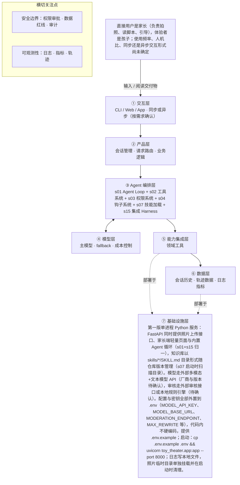

# PRD 推导方案 ——「玩具剧场」

> ⚠️ 本文件是引擎**真实运行产物**，未经人工修改：模型 deepseek-v4-flash，2026-10-29 生成，提示词指纹 `prompts:2bc7ebf3537d`。
> 输入为 [evals/forward/toy-theater/input.md](../../evals/forward/toy-theater/input.md)，7 次调用、输入 10712 / 输出 19312 tokens。
> 审稿没有完全通过是正常的：独立审稿本来就该把方案里的矛盾挑出来，这些意见就是你下一轮要回答的问题。

> 状态：方案待确认（Step 1–4 已完成，Step 5 代码生成需确认后启动）
> 推导引擎：Agent Blueprint · 模型：anthropic
> 领域建模与架构设计由 agent 完成：可查组件说明，交卷前用规则自检（工具与选型一致、四类降级场景齐全等）。

## 产品定位（一句话）

**玩具剧场**：给家长用：拍一张玩具合影，由 AI 识别玩具并生成亲子互动剧情脚本，让旧玩具重新发挥作用，也让家长和孩子一起演、一起玩。

## ⚠️ 待确认清单（答不上就是风险点）

1. 产品的可量化成功标准是什么？例如脚本可用率、家长满意度、复用旧玩具的比例，怎样算做成？
2. 目标孩子的具体年龄段是几岁？不同年龄对应不同的适龄内容和剧情复杂度。
3. 使用频率预期是多少？一次交互是同步等待脚本生成，还是异步生成后再回来查看？
4. 除了识别照片中的玩具，还需要调用哪些外部系统或 API？例如图像识别服务、内容审核服务。
5. 照片是否上传到云端处理？如果是，隐私和数据保留策略具体怎么定？
6. 当识别失败（照片模糊、玩具认不出）或生成内容审核不通过时，降级策略是什么？
7. 生成脚本的时延和成本上限是多少？可用模型的范围是否有限制？
8. 家长引导话术面向的家长是否需要先具备儿童戏剧或亲子共玩的经验？是否需要额外的使用说明？
9. 孩子年龄段怎么获取（家长每次选择还是长期填写），默认按哪个适龄档生成？直接影响审核规范与措辞尺度。
10. 交互形态未定：网页、小程序还是 App？是否需要语音朗读脚本给不识字的家庭成员。
11. 照片是否上云、用哪家多模态识别服务、第三方是否留存照片；本地识别是否满足效果要求。
12. 审核重写次数上限（当前假设 2 次，待确认）、识别与审核的超时阈值均未给出，需产品定值。
13. 识别结果是否先经家长确认/修正再生成脚本，还是直接生成后可编辑。
14. 二期记忆（s09）：孩子年龄与偏好玩具的保存范围、授权方式、删除入口如何设计。
15. 二期自动判定剧情是否合格（s17）：评测标准与标注数据集从哪来。
16. 照片里可能同框出现人脸或家庭成员，是否需要专门的检测与遮挡策略（原文只写照片涉及隐私默认不保存）。
17. 产品成功标准（可量化）未定义，如一次生成时长、家长实际完成一次亲子演绎的比例。
18. 多孩家庭是否需要同时保存多个孩子的年龄段与偏好（当前输入只说「记住孩子的年龄和偏好玩具」）。

## Step 1 · 需求拆解（提取硬事实）

| 维度 | 结论 | 状态 | 出处 |
|---|---|---|---|
| 目标 | 家长拍一张玩具合影，AI 识别照片里的玩具，生成一份可亲子共同演绎的互动剧情脚本（角色分配、场景搭建、分幕、对话、家长引导话术），让旧玩具重新发挥作用，帮家长读懂孩子、一起玩；可量化的成功标准未给出 | 明确 | 家长拍一张玩具合影，AI 识别照片里的玩具，生成一份可以亲子共同演绎的互动剧情脚本（角色分配、场景搭建、分幕、对话、家长引导话术），让旧玩具翻新，也帮家长读懂孩子、一起玩。 |
| 用户 | 直接用户是家长（负责拍照、读脚本、引导），体验者是孩子；使用频率、人机比、同步还是异步交互形式尚未确定 | 待确认 | 直接用户是家长（拍照、读脚本、引导），体验者是孩子。……孩子年龄段、交互形态、照片是否上云还没定。 |
| 核心闭环 | 家长拍摄玩具合影 → AI 识别照片中的玩具 → 生成互动剧情脚本（角色分配、场景搭建、分幕、对话、家长引导话术）→ 家长读脚本引导孩子共同演绎 | 明确 | 家长拍一张玩具合影，AI 识别照片里的玩具，生成一份可以亲子共同演绎的互动剧情脚本（角色分配、场景搭建、分幕、对话、家长引导话术） |
| 交付物 | 一份可亲子共同演绎的互动剧情脚本文档：包含角色分配、场景搭建、分幕、对话、家长引导话术 | 明确 | 生成一份可以亲子共同演绎的互动剧情脚本（角色分配、场景搭建、分幕、对话、家长引导话术） |
| 边界 | 绝不生成暴力、恐怖、成人、危险模仿内容；照片涉及隐私，默认不保存；生成内容必须过适龄审核 | 明确 | 绝不生成暴力、恐怖、成人、危险模仿内容；照片涉及隐私，默认不保存。生成内容必须过适龄审核。 |
| 约束 | 需要「儿童适龄内容规范」和「玩具剧情范式库」两类领域知识；孩子年龄段、是否将照片上传到云端、合规细则、时延、并发、成本、可用模型均未确定 | 待确认 | 需要儿童适龄内容规范和玩具剧情范式库这样的领域知识库。……孩子年龄段、交互形态、照片是否上云还没定。 |

## Step 2 · 领域建模（映射 Harness 五要素）

| 要素 | 内容 |
|---|---|
| **工具** | 多模态识别服务：对家长上传的玩具合影做玩具识别，返回玩具清单（名称、数量、颜色、可见特征）与不确定项。；内容审核接口/规则引擎：对生成的剧情脚本做暴力、恐怖、成人、危险模仿四类红线判定。；知识库读取：按名称读取「儿童适龄内容规范」与「玩具剧情范式库」的条目全文。；家长端页面：接收照片上传，并以角色分配、场景搭建、分幕、对话、家长引导话术五段结构展示脚本。 |
| **知识** | 儿童适龄内容规范：按年龄段界定可用的内容主题与措辞红线。；玩具剧情范式库：角色分配、场景搭建、分幕、对话、家长引导话术的模板范式。；四类禁止内容清单：暴力、恐怖、成人、危险模仿，来自原文边界要求。；脚本交付结构规范：角色分配、场景搭建、分幕、对话、家长引导话术五段必须齐全。 |
| **观察** | 识别工具返回的玩具清单与不确定项，作为后续脚本的唯一玩具来源。；适龄审核结果：通过/拦截、命中的红线类别与建议改写点。；结构自检结果：五段是否齐全、脚本里出现的玩具是否都在识别清单内。；工具调用与权限拒绝的轨迹记录，用于复盘与二期自动判定合格。 |
| **行动** | 家长在页面上传照片并阅读/保存脚本（人机交互动作）。；以同步请求调用识别 API 与审核 API，失败时把错误作为 tool_result 回传模型。；照片默认不落盘，仅在会话内存中临时持有，会话结束或异常退出时清理临时文件。；关键事件（上传、识别、审核、权限拒绝、清理）写入本地审计日志文件。 |
| **权限** | 默认拒绝：把照片或孩子身份信息写入持久化存储、或发送到非白名单第三方服务的操作，除家长显式同意外一律拒绝。；默认拒绝：未经适龄审核通过的脚本不得展示或导出给家长，审核服务不可用时视为不通过。；需要审批：照片上传到云端识别服务前，需向家长明示用途与「默认不保存」，家长确认后才执行。；硬拒绝：生成暴力、恐怖、成人、危险模仿内容，命中即拦截不输出。；只读：儿童适龄内容规范与玩具剧情范式库为只读资源，模型不得改写。；默认拒绝：保存孩子年龄与偏好玩具的写记忆接口在第一版关闭（二期），需家长显式授权后才开启。 |

## Step 3 · 组件选型（宁可少选）

| 组件 | 选否 | 理由 | 参考 |
|---|---|---|---|
| s01 Agent Loop | ✅ 必选 | 一切基础：循环 + 工具（一切基础，恒选） | s01_agent_loop/README.md |
| s02 工具系统 | ✅ 必选 | 需要调用外部系统/API/数据源（一切基础，恒选） | s02_tool_use/README.md |
| s03 权限系统 | ✅ 必选 | 产品闭环必然要处理家长拍摄的玩具合影，照片涉及儿童与家庭隐私，原文写明「照片涉及隐私，默认不保存」。 | s03_permission/README.md |
| s04 钩子系统 | ✅ 必选 | 原文明确要求「生成内容必须过适龄审核」，属于必须进行评估与拦截的合规环节。 | s04_hooks/README.md |
| s05 任务规划 | ❌ 放弃 | 单次交付就是生成一份剧情脚本，流程固定，不需要先列计划再逐步推进并跟踪进度。 | s05_todo_write/README.md |
| s06 子 Agent | ❌ 放弃 | 输入只有一张玩具合影和一次脚本生成，不存在需要并行探索或上下文爆炸的子任务。 | s06_subagent/README.md |
| s07 技能加载 | ✅ 必选 | 原文明确需要「儿童适龄内容规范和玩具剧情范式库这样的领域知识库」。 | s07_skill_loading/README.md |
| s08 上下文压缩 | ❌ 放弃 | 单个家庭单次生成脚本，会话短、工具输出量小，无长会话或大量日志需求。 | s08_context_compact/README.md |
| s09 记忆系统 | ⏸ 二期 | 原文写「未来希望记住孩子的年龄和偏好玩具做个性化」，属于以后再做。 | s09_memory/README.md |
| s10 任务系统 | ❌ 放弃 | 每次拍照片、生成脚本即可结束，无断点续跑或长期目标持久化需求。 | s10_task_system/README.md |
| s11 后台任务 | ❌ 放弃 | 闭环中无耗时几分钟以上、需要放到后台执行的慢操作，仅一次性脚本生成。 | s11_background_tasks/README.md |
| s12 定时调度 | ❌ 放弃 | 完全由家长拍照触发，原文未提及任何定时自动触发需求。 | s12_cron_scheduler/README.md |
| s13 Agent 团队 | ❌ 放弃 | 单人单次、面向一个家庭的同步产品闭环，不涉及多 Agent 并行隔离工作区。 | s13_agent_teams/README.md |
| s14 MCP 插件 | ❌ 放弃 | 原文未提及 MCP 或第三方插件生态，闭环只含拍照识别与脚本生成。 | s14_mcp_plugin/README.md |
| s15 集成 Harness | ✅ 必选 | 第一版已选 3 个可选组件（s03, s04, s07），需归一到单一循环 | s15_integrated_harness/README.md |
| s16 工作流运行时 | ❌ 放弃 | 「拍照→识别→生成脚本」属于产品体验描述，识别结果需要模型临场判断，不是预先固定、无需模型决策的阶段序列。 | s16_workflow_runtime/README.md |
| s17 目标闭环 | ⏸ 二期 | 原文写「未来也希望自动判断剧情算不算合格」，当前版本不做。 | s17_goal_loop/README.md |

特征判定依据：

- `destructive_ops` = yes：产品闭环必然要处理家长拍摄的玩具合影，照片涉及儿童与家庭隐私，原文写明「照片涉及隐私，默认不保存」。
- `audit_needed` = yes：原文明确要求「生成内容必须过适龄审核」，属于必须进行评估与拦截的合规环节。
- `multi_step` = no：单次交付就是生成一份剧情脚本，流程固定，不需要先列计划再逐步推进并跟踪进度。
- `context_heavy` = no：输入只有一张玩具合影和一次脚本生成，不存在需要并行探索或上下文爆炸的子任务。
- `large_knowledge` = yes：原文明确需要「儿童适龄内容规范和玩具剧情范式库这样的领域知识库」。
- `long_sessions` = no：单个家庭单次生成脚本，会话短、工具输出量小，无长会话或大量日志需求。
- `cross_session_memory` = later：原文写「未来希望记住孩子的年龄和偏好玩具做个性化」，属于以后再做。
- `persistent_goals` = no：每次拍照片、生成脚本即可结束，无断点续跑或长期目标持久化需求。
- `slow_operations` = no：闭环中无耗时几分钟以上、需要放到后台执行的慢操作，仅一次性脚本生成。
- `scheduled` = no：完全由家长拍照触发，原文未提及任何定时自动触发需求。
- `parallel_isolated` = no：单人单次、面向一个家庭的同步产品闭环，不涉及多 Agent 并行隔离工作区。
- `external_ecosystem` = no：原文未提及 MCP 或第三方插件生态，闭环只含拍照识别与脚本生成。
- `fixed_orchestration` = no：「拍照→识别→生成脚本」属于产品体验描述，识别结果需要模型临场判断，不是预先固定、无需模型决策的阶段序列。
- `auto_completion` = later：原文写「未来也希望自动判断剧情算不算合格」，当前版本不做。

## Step 4 · 架构设计

### 分层架构图（7 层 + 数据流）



| 层 | 名称 | 回答的问题 | 落地锚点 |
|---|---|---|---|
| ① | 交互层 | 谁在用、怎么用？ | CLI / Web / App / API；同步或异步；人机比 |
| ② | 产品层 | 产品外壳是什么？ | 会话管理、请求路由、账户、业务逻辑 |
| ③ | Agent 编排层 | Harness 如何运转？ | loop、工具分发、hooks、权限、记忆、任务、技能、压缩、子 agent / 团队、目标闭环 |
| ④ | 模型层 | 智能从哪来？ | 主模型、辅助模型、路由、fallback、成本 |
| ⑤ | 能力集成层 | 如何触达外部世界？ | 内部工具、MCP server、知识库、第三方 API |
| ⑥ | 数据层 | 什么需要持久化？ | 记忆、任务、会话历史、轨迹数据、日志指标 |
| ⑦ | 基础设施层 | 如何部署运行？ | 单进程 / 服务 / 团队、沙箱、队列、调度、监控 |

### 工具清单

| 工具 | 输入 | 输出 | 副作用 | 权限 | 归属层 |
|---|---|---|---|---|---|
| `recognize_toys` | 会话内临时照片引用 + 家长可选补充说明（如玩具名称） | 玩具清单：名称、数量、颜色、可见特征，以及识别不确定项 | 照片需传给多模态识别服务，默认不落盘，返回后即丢弃原图引用 | ask | ④工具层 |
| `load_guideline` | 知识条目名（儿童适龄内容规范 / 玩具剧情范式库） | 对应 SKILL 条目全文，作为 tool_result 进入上下文 | 无，只读本地知识库 | allow | ③认知层 |
| `check_script_structure` | 脚本草稿（角色分配、场景搭建、分幕、对话、家长引导话术）+ 本次识别出的玩具清单 | 缺项列表 + 脚本中出现但识别清单里没有的玩具（疑似幻觉） | 无 | allow | ⑤约束层 |
| `moderate_script` | 脚本全文 + 目标年龄段（当前待确认） | 通过/拦截 + 命中红线类别（暴力/恐怖/成人/危险模仿）+ 建议改写点 | 无，调用审核接口并写审核日志 | allow | ⑤约束层 |
| `render_script_card` | 已通过审核的脚本五段结构 | 家长端页面上的脚本文档卡片，可阅读与保存 | 在家长端页面渲染脚本文档，不写外部系统、不向第三方发送 | allow | ①交互层 |
| `purge_photo_temp` | 会话 ID | 清理结果（已删除的临时文件数/字节数） | 删除本次会话的临时照片与识别中间结果，属于隐私保护性删除，不涉及用户数据丢失 | allow | ④工具层 |
| `save_child_profile` | 孩子年龄、偏好玩具 | 写入结果 | 持久化孩子个人信息（二期能力，第一版关闭） | deny | ③认知层 |

### 系统提示词草案

```
你是「玩具剧场」的亲子剧情编剧，使用者是家长，体验者是孩子。
流程：家长上传玩具合影 → recognize_toys 识别玩具 → load_guideline 读取「儿童适龄内容规范」与「玩具剧情范式库」→ 写出含角色分配、场景搭建、分幕、对话、家长引导话术五段的脚本 → check_script_structure 自检 → moderate_script 过适龄审核 → render_script_card 呈现；结束用 purge_photo_temp 清理临时照片。save_child_profile 第一版禁用，不要保存孩子信息。
底线：绝不生成暴力、恐怖、成人、危险模仿内容；未过审的脚本不得输出，须改写后重审；照片默认不保存，不索取孩子姓名住址学校；只用识别到的玩具，不确定处标待家长确认，不得编造。
知识目录：儿童适龄内容规范、玩具剧情范式库。
```

### 上下文与记忆策略

单次会话内 messages 保存：照片的临时引用（不存图本身）、识别出的玩具清单与不确定项、已加载的知识条目全文、脚本各版本与对应的审核命中点。改脚本时只保留最近一版草稿 + 审核命中清单，便于定向重写而不整体重发；识别结果与知识条目在会话内复用，不重复加载。会话结束、超时或异常退出时清空照片临时文件与识别中间结果。跨会话默认不持久化；孩子年龄与偏好玩具的记忆属二期（s09），需家长显式授权后才落库，并提供查看与删除入口。

### 安全边界与降级策略

- 识别工具失败或超时（阈值待确认）→ 不臆造玩具，把错误回传给模型，提示家长补充玩具名称或换一张更清晰的合影重试。
- 模型幻觉：脚本里出现识别清单之外的玩具或与照片不符的特征 → check_script_structure 标为疑似幻觉，回退重写，不得带病输出。
- 审核不通过 → 以命中红线类别为约束定向重写，重写次数上限（假设 2 次，待确认）；仍不通过则降级为只含场景搭建与家长引导问题的安全脚本，并向家长说明原因。
- 审核服务不可用或超时 → fail-closed，视为不通过，不展示脚本，只提示稍后重试。
- 越权/隐私：任何照片外发到非白名单服务、写入持久化存储、导出分享的动作 → 权限层默认拒绝，需家长显式确认；purge_photo_temp 在正常结束与异常退出两条路径上都执行。
- 越权：模型试图改写知识库文件或写孩子档案 → 工具层没有写接口，save_child_profile 在第一版为 deny，二期再开。
- 家长或孩子在对话里要求生成越界内容（如让玩具打人、吓人）→ UserPromptSubmit 钩子拦截，改写为适龄替代情节。
- 孩子年龄段未确认 → 按已知最小适龄档保守生成（具体档位待确认），并在脚本里标注年龄适配提示。
- 家长反复上传同一张照片或超量上传（次数上限待确认）→ 限流并提示，防止识别成本与隐私面扩大。

### 可观测性

- 日志：每次工具调用：工具名、参数摘要（照片路径脱敏为会话 ID）、耗时、结果码。；审核结论：通过/拦截、命中红线类别、重写轮次。；权限事件：默认拒绝、需审批、家长同意与拒绝的记录。；照片生命周期：上传、临时引用生成、清理结果。；知识加载：加载了哪个知识条目的哪个段落。
- 指标：工具失败率与超时率（识别、审核分别统计）。；审核拦截率与脚本重写次数分布。；脚本五段结构一次通过率与玩具一致性校验失败率。；端到端生成时长（上传→脚本展示）分布。；会话结束后照片临时文件残留数（应为 0）。
- 轨迹：按会话 ID 记录完整 messages 轨迹（识别结果、加载的知识条目、各版脚本、审核结论与重写轮次、权限事件），不记录原始照片与孩子身份信息，供复盘与二期自动合格判定使用。

### 技术栈与部署形态

第一版单进程 Python 服务：FastAPI 同时提供照片上传接口、家长端轻量页面与内置 Agent 循环（s01+s15 归一），知识库以 skills/*/SKILL.md 目录形式随仓库版本管理（s07 启动时扫描目录）。模型走外部多模态+文本模型 API（厂商与版本待确认），审核走外部审核接口或本地规则引擎（待确认）。配置与密钥全部外置到 .env（MODEL_API_KEY、MODEL_BASE_URL、MODERATION_ENDPOINT、MAX_REWRITE 等），代码内不硬编码，提供 .env.example；启动：cp .env.example .env && uvicorn toy_theater.app:app --port 8000；日志写本地文件，照片临时目录单独挂载并在启动时清理。

### 测试设计

- 核心循环单测：mock 模型返回 tool_use 序列，断言 recognize_toys → load_guideline → check_script_structure → moderate_script → render_script_card 的分派顺序与 tool_result 正确回填。
- 工具分派单测：未知工具名返回错误而非崩溃；工具抛异常被捕获为 error tool_result，循环继续。
- 红线内容测试：构造暴力、恐怖、成人、危险模仿四类脚本文本，断言 moderate_script 拦截且 render_script_card 不被调用。
- 权限测试：照片外发到非白名单服务、写入持久化存储、调用 save_child_profile 的请求断言被默认拒绝；需审批动作未获家长确认时不得执行。
- 隐私测试：正常结束与异常退出两条路径后，断言临时照片文件与识别中间结果均已删除。
- 降级测试：识别清单外的玩具出现在脚本时断言标记待确认并重写；审核接口超时断言 fail-closed 不输出脚本。

## 验收标准对照（可落地 vs demo）

| 标准 | 要求 | 本方案的对应设计 |
|---|---|---|
| 可运行 | 一条命令能起，配置与密钥外置（.env / config） | 第一版单进程 Python 服务：FastAPI 同时提供照片上传接口、家长端轻量页面与内置 Agent 循环（s01+s15 归一），知识库以 skills/*/SKILL.md 目录形式随仓库版本管理（s07 启动时扫描目录）。模型走外部多模态+文本模型 API（厂商与版本待确认），审核走外部审核接口或本地规则引擎（待确认）。配置与密钥全部外置到 .env（MODEL_API_KEY、MODEL_BASE_URL、MODERATION_ENDPOINT、MAX_REWRITE 等），代码内不硬编码，提供 .env.example；启动：cp .env.example .env && uvicorn toy_theater.app:app --port 8000；日志写本地文件，照片临时目录单独挂载并在启动时清理。 |
| 可容错 | 工具失败、模型幻觉、超时、越权都有明确降级路径 | 识别工具失败或超时（阈值待确认）→ 不臆造玩具，把错误回传给模型，提示家长补充玩具名称或换一张更清晰的合影重试。；模型幻觉：脚本里出现识别清单之外的玩具或与照片不符的特征 → check_script_structure 标为疑似幻觉，回退重写，不得带病输出。；审核不通过 → 以命中红线类别为约束定向重写，重写次数上限（假设 2 次，待确认）；仍不通过则降级为只含场景搭建与家长引导问题的安全脚本，并向家长说明原因。 |
| 可观测 | 有日志、有指标、有轨迹数据 | 每次工具调用：工具名、参数摘要（照片路径脱敏为会话 ID）、耗时、结果码。；审核结论：通过/拦截、命中红线类别、重写轮次。；工具失败率与超时率（识别、审核分别统计）。；审核拦截率与脚本重写次数分布。 |
| 可测试 | 核心循环与工具分派有单测，权限与安全有边界测试 | 核心循环单测：mock 模型返回 tool_use 序列，断言 recognize_toys → load_guideline → check_script_structure → moderate_script → render_script_card 的分派顺序与 tool_result 正确回填。；工具分派单测：未知工具名返回错误而非崩溃；工具抛异常被捕获为 error tool_result，循环继续。；红线内容测试：构造暴力、恐怖、成人、危险模仿四类脚本文本，断言 moderate_script 拦截且 render_script_card 不被调用。；权限测试：照片外发到非白名单服务、写入持久化存储、调用 save_child_profile 的请求断言被默认拒绝；需审批动作未获家长确认时不得执行。；隐私测试：正常结束与异常退出两条路径后，断言临时照片文件与识别中间结果均已删除。；降级测试：识别清单外的玩具出现在脚本时断言标记待确认并重写；审核接口超时断言 fail-closed 不输出脚本。 |
| 可部署 | 有明确的部署形态（单进程 / 服务 / 团队）与启动文档 | 第一版单进程 Python 服务：FastAPI 同时提供照片上传接口、家长端轻量页面与内置 Agent 循环（s01+s15 归一），知识库以 skills/*/SKILL.md 目录形式随仓库版本管理（s07 启动时扫描目录）。模型走外部多模态+文本模型 API（厂商与版本待确认），审核走外部审核接口或本地规则引擎（待确认）。配置与密钥全部外置到 .env（MODEL_API_KEY、MODEL_BASE_URL、MODERATION_ENDPOINT、MAX_REWRITE 等），代码内不硬编码，提供 .env.example；启动：cp .env.example .env && uvicorn toy_theater.app:app --port 8000；日志写本地文件，照片临时目录单独挂载并在启动时清理。 |
| 可度量 | 有对齐 PRD 的成功指标，并能采集 | 工具失败率与超时率（识别、审核分别统计）。；审核拦截率与脚本重写次数分布。；脚本五段结构一次通过率与玩具一致性校验失败率。；端到端生成时长（上传→脚本展示）分布。；会话结束后照片临时文件残留数（应为 0）。 |

## 独立审稿意见

- 结论：✅ 通过（82 / 100），设计稿共 1 版
- 总评：整体质量较高：核心闭环、边界、安全降级（工具失败／幻觉／超时／越权）与六条验收标准中的可运行、可容错、可观测、可测试、可部署均有对应设计，待确认事项也大量显式列出，基本守住了不编造。主要短板有三处：可度量只有系统指标，缺少对齐产品目标的业务成功指标与采集设计；工具清单在五要素与 tool_list 两处口径不一致，layer 编号未定义导致一致性无法核验；「照片是否上云」这一关键未定项被默认按上云路径设计，未给不上云分支。未发现 high 级问题，建议修正上述 medium 项后再进入下一阶段。
- [medium] design.observability：metrics 全部是系统运行指标（工具失败率、审核拦截率、时长、临时文件残留数），没有对齐产品目标的业务成功指标，也没有对应的埋点采集设计（例如家长是否真的完成一次亲子演绎、脚本被实际使用的比例）。原始输入确实未给量化标准，方案也只在 open_questions 提了一句，未形成可采集的指标定义，因此「可度量：有对齐 PRD 的成功指标并能采集」只算部分满足。
- [medium] design.tech_stack_and_deployment：原始输入明确「照片是否上云还没定」，但闭环设计默认 recognize_toys 调用外部多模态识别服务、模型走外部 API，等于把未定前提当成既定路径；方案虽在 open_questions 里列出了本地识别是否满足效果的疑问，却没有给出「不上云」分支下的闭环设计与降级路径（例如本地识别不可用时的产品行为）。
- [medium] design.tool_list：每个工具的 layer 字段使用「①交互层／③认知层／④工具层／⑤约束层」编号，但方案未定义这套编号与五要素（工具／知识／观察／行动接口／权限）的映射关系；且没有任何工具被标为观察层，而 observation 中列出的识别结果、审核结果、结构自检结果实际都由工具产出。la5yer 体系不可核验，导致「工具清单与五要素一致」这条无法判定。
- [medium] elements.tools 与 design.tool_list：两处工具清单口径不一致：elements.tools 只列了多模态识别服务、内容审核接口、知识库读取、家长端页面 4 项，design.tool_list 却有 7 个工具，check_script_structure、purge_photo_temp、save_child_profile 未能在五要素的工具条目下找到对应，也未说明它们归属 knowledge 还是 observation，读者无法确认工具全集。
- [medium] components.s07：技能加载选「必选」的理由引用了 large_knowledge 特征，但原始输入只说「需要儿童适龄内容规范和玩具剧情范式库这样的领域知识库」，并未给出条目数量、篇幅或上下文占用规模，用 large_knowledge 作为特征证据属推断，选型理由与证据之间的链条不完整。
- [medium] design.security_and_degradation 与 design.testing：降级路径中多个关键参数仍是假设值：审核重写次数上限（假设 2 次）、识别与审核超时阈值、家长上传次数上限。这些参数直接决定降级行为是否可执行、可测试，testing 里的降级测试用例在没有这些定值前无法定型，建议在方案中给出可配置项与默认值来源。
- [low] components.s04 与 design.security_and_degradation：钩子系统的选型理由本身与「生成内容必须过适龄审核」能对上，但降级清单里直接出现「UserPromptSubmit 钩子」这一具体实现术语，而技术栈是自建 FastAPI 单进程服务，方案未说明这些钩子名在自建运行时中的落点与拦截时机，实现映射待确认。
- [low] facts.users：家长是直接用户、孩子是体验者，这两点在原始输入中是明确的；方案把整条 users 标为「待确认」，与其 value 内部的表述自相矛盾。建议拆成「角色分工（明确）」与「使用频率、交互形态（待确认）」两条，避免把已明确事实也稀释成待确认。
- [low] facts.constraints：把「需要儿童适龄内容规范与玩具剧情范式库」这一明确要求，与年龄段、上云、合规细则、时延、并发、成本等众多未定事项混为一条并整体标为「待确认」，导致已经明确的约束被弱化，也无法在后续设计里逐条回溯。
- [low] design.security_and_degradation：「孩子年龄段未确认 → 按已知最小适龄档保守生成」中的「最小适龄档」在原始输入里没有依据，属设计假设；虽标注了待确认，但未说明可选档位从何而来、由谁定义，实际执行时缺少可落地的取值。
- [low] elements.permissions：「把照片或孩子身份信息写入持久化存储」中的「孩子身份信息」在原始输入里没有出现，原始边界只写了照片隐私默认不保存；该项作为安全默认拒绝是合理设计，但未标注为设计外推。

## 本次推导消耗

- 模型调用 7 次，输入 10712 tokens，输出 19312 tokens

## 下一步

回答上面的待确认清单，据此修订方案后，再进入 Step 5 代码生成（骨架 → 硬化 → 产品化）。
