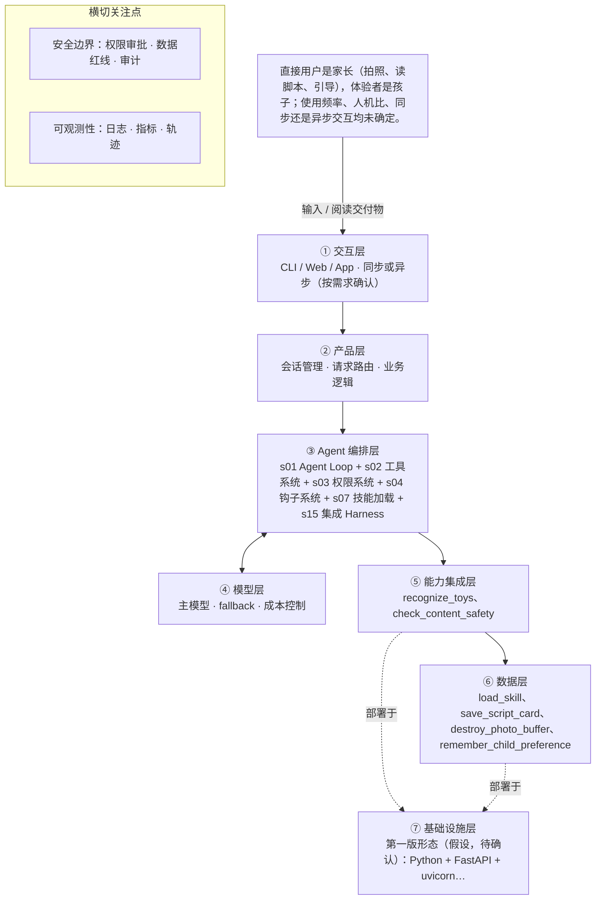

# PRD 推导方案 ——「玩具剧场」

> ⚠️ 本文件是引擎**真实运行产物**，未经人工修改：模型 deepseek-v4-flash，2026-10-31 生成，提示词指纹 `prompts:a5e2a6bc9a65`。
> 输入为 [evals/forward/toy-theater/input.md](../../evals/forward/toy-theater/input.md)，11 次调用、输入 36215 / 输出 43282 tokens，另有 34176 tokens 命中缓存。
> 审稿没有完全通过是正常的：独立审稿本来就该把方案里的矛盾挑出来，这些意见就是你下一轮要回答的问题。

> 状态：方案待确认（Step 1–4 已完成，Step 5 代码生成需确认后启动）
> 推导引擎：Agent Blueprint · 模型：deepseek-v4-flash
> 领域建模与架构设计由 agent 完成：可查组件说明，交卷前用规则自检（工具与选型一致、四类降级场景齐全等）。

## 产品定位（一句话）

**玩具剧场**：给家长用：拍一张玩具合影，AI 识别玩具并生成可亲子共演的互动剧情脚本，让旧玩具翻新，也让家长借剧情读懂孩子、陪孩子一起玩。

## ⚠️ 待确认清单（答不上就是风险点）

**需求问题**：请提出想法的人回答，这几条最要紧。

1. 产品的可量化成功标准是什么？例如脚本被家长实际采用演绎的比例、生成可用率、家长满意度？
2. 目标用户的具体画像与使用频率如何？交互是家长上传后同步等待，还是异步出结果再通知？
3. 孩子年龄段（如 3-5 岁、6-8 岁）范围是什么？不同年龄段直接决定适龄内容规范的档位。
4. 照片是否上云处理？如果上云，存储与删除策略、隐私合规如何界定？
5. 除照片识别外还需要调用哪些外部系统或数据源（如玩具识别模型、内容审核服务、用户账号体系）？
6. 儿童适龄内容规范和玩具剧情范式库的具体内容、来源与维护责任人是谁？以什么形式提供给模型（检索、提示词、规则表）？
7. 生成内容适龄审核由谁执行？是模型自检、独立审核模型，还是人工复核？判定不通过时的重试与降级策略是什么？
8. 工具失败（照片无法识别玩具、生成超时、审核不通过）时如何向家长反馈和降级？
9. 交付物的承载形态是什么（App、小程序、打印版 PDF、图片卡片）？是否支持导出或二次编辑？
10. 时延、并发与成本约束是什么？单次生成可接受的等待时间上限是多少？

**方案推导时留下的问题**：多是上面问题的细化，也有写给开发者的备注。先答上面的，这里能答的再补。

11. 【阻塞级】照片是否上云：一期按不出网的本地识别设计，是否允许接外部 API、由谁授权、隐私告知措辞与撤回方式均未定；此条未决前外部 provider 保持关闭。
12. 【阻塞级】孩子年龄段未定：影响话术难度与审核分档，当前做成可选输入，缺省按最保守档处理（假设，待确认）。
13. 交付形态未定（App 页面 / 可打印文档 / 纯文本卡片），直接决定①交互层页面与 save_script_card 的输出字段。
14. 交互形态未定（同步等结果还是先生成后通知），当前按单次同步交付设计，未做后台任务。
15. 成功标准未量化：共演完成率、玩具复用率等只是代理指标，目标值、统计口径与埋点字段待确认。
16. 审核不通过的改写重试上限、整体时延预算、识别重拍次数上限均未给定，当前只作为待确认参数占位。
17. 儿童适龄内容规范与玩具剧情范式库的落地来源（自建 / 采购 / 版权授权）、维护责任人与更新节奏未定。
18. 可用模型来源未定（本地部署还是外部 API、具体型号、审核器是否必须与生成模型分离），影响④模型层适配与成本。
19. s03 选型特征标签为破坏性操作，本设计的破坏性落点是覆盖已保存脚本（二次确认）与二期记忆清除；若产品需要更强的破坏性场景（如家长一键删除全部数据），需另行定义。

## Step 1 · 需求拆解（提取硬事实）

| 维度 | 结论 | 状态 | 出处 |
|---|---|---|---|
| 目标 | 家长拍摄一张玩具合影，AI 识别照片里的玩具，生成一份可以亲子共同演绎的互动剧情脚本（含角色分配、场景搭建、分幕、对话、家长引导话术），实现旧玩具翻新、帮助家长读懂孩子并一起玩；可量化的成功标准输入未给出。 | 明确 | 家长拍一张玩具合影，AI 识别照片里的玩具，生成一份可以亲子共同演绎的互动剧情脚本（角色分配、场景搭建、分幕、对话、家长引导话术），让旧玩具翻新，也帮家长读懂孩子、一起玩。 |
| 用户 | 直接用户是家长（拍照、读脚本、引导），体验者是孩子；使用频率、人机比、同步还是异步交互均未确定。 | 明确 | 直接用户是家长（拍照、读脚本、引导），体验者是孩子。孩子年龄段、交互形态、照片是否上云还没定。 |
| 核心闭环 | 家长拍玩具合影 → AI 识别照片中的玩具 → 生成互动剧情脚本（角色分配、场景搭建、分幕、对话、家长引导话术）→ 家长带孩子按脚本演绎。 | 明确 | 家长拍一张玩具合影，AI 识别照片里的玩具，生成一份可以亲子共同演绎的互动剧情脚本（角色分配、场景搭建、分幕、对话、家长引导话术） |
| 交付物 | 一份互动剧情脚本，包含：角色分配、场景搭建、分幕、对话、家长引导话术；交付形态（纯文本卡片、可打印文档、App 内页面）待确认。 | 明确 | 生成一份可以亲子共同演绎的互动剧情脚本（角色分配、场景搭建、分幕、对话、家长引导话术） |
| 边界 | 绝不生成暴力、恐怖、成人、危险模仿内容；照片涉及隐私，默认不保存；生成内容必须过适龄审核。 | 明确 | 绝不生成暴力、恐怖、成人、危险模仿内容；照片涉及隐私，默认不保存。生成内容必须过适龄审核。 |
| 约束 | 需要儿童适龄内容规范和玩具剧情范式库两类领域知识库；时延、并发、成本、可用模型、照片是否上云均未确定。 | 待确认 | 需要儿童适龄内容规范和玩具剧情范式库这样的领域知识库。孩子年龄段、交互形态、照片是否上云还没定。 |

## Step 2 · 领域建模（映射 Harness 五要素）

| 要素 | 内容 |
|---|---|
| **工具** | recognize_toys：调用识别能力，从家长上传的玩具合影（仅内存字节）中产出玩具清单，含名称、外观特征、数量与置信度。；load_skill：按名称加载「儿童适龄内容规范」与「玩具剧情范式库」全文，供组装脚本时遵循。；check_content_safety：把脚本草稿连同孩子年龄段交给独立的适龄审核器，取回通过/不通过、命中红线类别与改写建议。；save_script_card：把过审后的脚本卡片写入脚本存储，卡内含角色分配、场景搭建、分幕、对话、家长引导话术，不含照片与儿童身份信息。；destroy_photo_buffer：在识别完成后销毁本次请求内存中的照片字节与派生缩略图。；remember_child_preference：二期启用，在家长显式授权后写入孩子年龄段与偏好玩具。 |
| **知识** | 儿童适龄内容规范：红线类别（暴力、恐怖、成人、危险模仿）与年龄段分档的判定口径；落地来源待确认。；玩具剧情范式库：分幕结构、角色分配方法、家长引导话术范式的可复用套路。；脚本卡片的固定字段结构：角色分配 / 场景搭建 / 分幕 / 对话 / 家长引导话术，来自原始需求的交付物定义。；家长本次输入的边界偏好：孩子年龄段与希望的故事主题（年龄段是否采集待确认）。；识别结果的可靠性口径：低于置信度阈值的玩具只能用泛化角色名，并在脚本里提示家长替换。 |
| **观察** | recognize_toys 返回的玩具数量、名称与置信度，低置信度项必须在脚本中降级为泛化角色名。；check_content_safety 的审核结论与命中红线类别，作为脚本能否交付的放行凭据。；照片内存缓冲销毁事件：只记录会话 ID、时间戳、字节数，不记录任何图像内容。；家长在脚本卡片页的反馈（演完了 / 没用上 / 再演一次），作为亲子共演是否完成的信号。；结构化审计日志中的工具名、耗时、权限判定结果与重试轮次。 |
| **行动** | 以拍摄或上传表单承接家长提交的玩具合影，照片仅在内存中传给识别能力。；以脚本卡片页面向家长交付脚本，按角色、场景、分幕逐段可读（交付形态待确认）。；审核不通过或识别失败时，以家长可读的话术说明并引导换主题或重拍，不输出未过审内容。；二期：在设置页提供记忆写入的授权与撤回入口。 |
| **权限** | 默认拒绝：照片写入磁盘、对象存储、日志或轨迹中的任何图像内容。；默认拒绝：把照片发送到外部云 API；外部识别 provider 默认关闭，只有家长对本次上传逐次显式授权后才可调用（阻塞级未决项）。；需要审批：二期把孩子年龄段与偏好玩具写入跨会话记忆，必须家长显式授权，可随时撤回，撤回后按无记忆处理。；默认拒绝：生成或交付暴力、恐怖、成人、危险模仿内容；审核不通过即不交付，禁止以低龄模板等名义绕过审核。；允许：销毁照片内存缓冲自动执行，无需家长审批（保护性动作，方向是减少数据留存）。；需要审批：覆盖家长已保存的同名脚本卡片属于破坏性写入，执行前需二次确认。 |

## Step 3 · 组件选型（宁可少选）

| 组件 | 选否 | 理由 | 参考 |
|---|---|---|---|
| s01 Agent Loop | ✅ 必选 | 一切基础：循环 + 工具（一切基础，恒选） | s01_agent_loop/README.md |
| s02 工具系统 | ✅ 必选 | 需要调用外部系统/API/数据源（一切基础，恒选） | s02_tool_use/README.md |
| s03 权限系统 | ✅ 必选 | 需要家长上传玩具合影，涉及儿童与家庭隐私数据，故按敏感数据处理。 | s03_permission/README.md |
| s04 钩子系统 | ✅ 必选 | 原文明确「生成内容必须过适龄审核」，且照片涉及隐私默认不保存。 | s04_hooks/README.md |
| s05 任务规划 | ❌ 放弃 | 闭环为拍照→识别→生成脚本→家长演绎的单次同步交付，未提多轮计划推进或进度汇报。 | s05_todo_write/README.md |
| s06 子 Agent | ❌ 放弃 | 单张照片识别加一次脚本生成，未提上下文爆炸或可并行探索型子任务。 | s06_subagent/README.md |
| s07 技能加载 | ✅ 必选 | 原文明确需要儿童适龄内容规范和玩具剧情范式库这样的领域知识库。 | s07_skill_loading/README.md |
| s08 上下文压缩 | ❌ 放弃 | 单次拍照生成一次脚本，未提长会话或大体量工具输出、日志。 | s08_context_compact/README.md |
| s09 记忆系统 | ⏸ 二期 | 原文「未来希望记住孩子的年龄和偏好玩具做个性化」，第一版可不做。 | s09_memory/README.md |
| s10 任务系统 | ❌ 放弃 | 目标为单次生成脚本即完成，未提持久化目标或断点续跑。 | s10_task_system/README.md |
| s11 后台任务 | ❌ 放弃 | 未提耗时数分钟以上的慢操作，闭环为同步生成。 | s11_background_tasks/README.md |
| s12 定时调度 | ❌ 放弃 | 由家长拍照触发，未提定时自动触发。 | s12_cron_scheduler/README.md |
| s13 Agent 团队 | ❌ 放弃 | 单人单次亲子使用场景，未提多任务并行或独立工作区。 | s13_agent_teams/README.md |
| s14 MCP 插件 | ❌ 放弃 | 闭环只需照片识别与脚本生成，未提 MCP 或第三方插件生态接入。 | s14_mcp_plugin/README.md |
| s15 集成 Harness | ✅ 必选 | 第一版已选 3 个可选组件（s03, s04, s07），需归一到单一循环 | s15_integrated_harness/README.md |
| s16 工作流运行时 | ❌ 放弃 | 识别与脚本生成均依赖模型临场判断，未把流程写成无需模型决策的固定阶段序列。 | s16_workflow_runtime/README.md |
| s17 目标闭环 | ⏸ 二期 | 原文「未来也希望自动判断剧情算不算合格」，说明独立评估器不是第一版必需。 | s17_goal_loop/README.md |

特征判定依据：

- `destructive_ops` = yes：需要家长上传玩具合影，涉及儿童与家庭隐私数据，故按敏感数据处理。
- `audit_needed` = yes：原文明确「生成内容必须过适龄审核」，且照片涉及隐私默认不保存。
- `multi_step` = no：闭环为拍照→识别→生成脚本→家长演绎的单次同步交付，未提多轮计划推进或进度汇报。
- `context_heavy` = no：单张照片识别加一次脚本生成，未提上下文爆炸或可并行探索型子任务。
- `large_knowledge` = yes：原文明确需要儿童适龄内容规范和玩具剧情范式库这样的领域知识库。
- `long_sessions` = no：单次拍照生成一次脚本，未提长会话或大体量工具输出、日志。
- `cross_session_memory` = later：原文「未来希望记住孩子的年龄和偏好玩具做个性化」，第一版可不做。
- `persistent_goals` = no：目标为单次生成脚本即完成，未提持久化目标或断点续跑。
- `slow_operations` = no：未提耗时数分钟以上的慢操作，闭环为同步生成。
- `scheduled` = no：由家长拍照触发，未提定时自动触发。
- `parallel_isolated` = no：单人单次亲子使用场景，未提多任务并行或独立工作区。
- `external_ecosystem` = no：闭环只需照片识别与脚本生成，未提 MCP 或第三方插件生态接入。
- `fixed_orchestration` = no：识别与脚本生成均依赖模型临场判断，未把流程写成无需模型决策的固定阶段序列。
- `auto_completion` = later：原文「未来也希望自动判断剧情算不算合格」，说明独立评估器不是第一版必需。

## Step 4 · 架构设计

### 分层架构图（7 层 + 数据流）



| 层 | 名称 | 回答的问题 | 落地锚点 |
|---|---|---|---|
| ① | 交互层 | 谁在用、怎么用？ | CLI / Web / App / API；同步或异步；人机比 |
| ② | 产品层 | 产品外壳是什么？ | 会话管理、请求路由、账户、业务逻辑 |
| ③ | Agent 编排层 | Harness 如何运转？ | loop、工具分发、hooks、权限、记忆、任务、技能、压缩、子 agent / 团队、目标闭环 |
| ④ | 模型层 | 智能从哪来？ | 主模型、辅助模型、路由、fallback、成本 |
| ⑤ | 能力集成层 | 如何触达外部世界？ | 内部工具、MCP server、知识库、第三方 API |
| ⑥ | 数据层 | 什么需要持久化？ | 记忆、任务、会话历史、轨迹数据、日志指标 |
| ⑦ | 基础设施层 | 如何部署运行？ | 单进程 / 服务 / 团队、沙箱、队列、调度、监控 |

### 工具清单

| 工具 | 输入 | 输出 | 副作用 | 权限 | 归属层 |
|---|---|---|---|---|---|
| `recognize_toys` | 本次请求内存中的照片字节（不接受磁盘路径、不接受临时文件）、会话 ID；不含儿童身份信息。 | 结构化玩具清单：每项含名称、外观特征、数量、置信度；识别不出的项返回空列表而非猜测。 | 只读；照片字节仅在请求内存中流转，调用结束随请求释放，不写磁盘与任何存储。若 provider 被配置为外部云 API，该调用先由权限闸门拦截并转为需家长逐次授权（ask），默认配置为不出网的本地识别。 | allow | ⑤能力集成层 |
| `load_skill` | 技能名（如 child_age_content_rules、toy_play_pattern_lib）与版本号。 | 对应知识文档全文（儿童适龄内容规范 / 玩具剧情范式库）及其版本标识。 | 只读，读取⑥数据层的知识库文件，不写任何状态。 | allow | ⑥数据层 |
| `check_content_safety` | 脚本草稿全文（角色分配、场景搭建、分幕、对话、家长引导话术）与目标年龄段（缺省按最保守档）。 | 审核结论（通过/不通过）、命中红线类别、逐条改写建议、审核器版本。 | 只读，不改写脚本；审核结论写入审计日志作为放行凭据。 | allow | ⑤能力集成层 |
| `save_script_card` | 已过审的脚本卡片正文、玩具名称清单、会话 ID、家长指定标题；不含照片、不含儿童身份信息。 | 卡片 ID、保存时间、版本号。 | 写入⑥数据层脚本表；本调用只能由家长在卡片页主动点保存触发，执行前由钩子校验审核结论为通过，未过审一律拒绝落库；覆盖同名卡片时权限规则升为 ask 需家长二次确认。 | allow | ⑥数据层 |
| `destroy_photo_buffer` | 会话 ID。 | 销毁结果（已销毁/无需销毁）与字节数。 | 清零内存中的照片字节与派生缩略图引用，写一条不含图像内容、不含文件名的销毁审计；该动作只会减少数据留存，故无需家长审批。 | allow | ⑥数据层 |
| `remember_child_preference` | 孩子年龄段、偏好玩具列表、家长授权凭据（二期启用）。 | 写入结果与档案版本号；一期直接返回「未启用」。 | 二期写入⑥数据层孩子档案表；无授权凭据时拒绝写入，撤回后读取为空。 | ask | ⑥数据层 |

### 系统提示词草案

```
你是「玩具剧场」的脚本写手，使用者是家长，体验者是孩子。任务只有一件：按家长拍的玩具合影，产出一份能马上带孩子演起来的互动脚本——角色分配、场景搭建、分幕、对话、家长引导话术。
规则：只用照片里真实识别到的玩具，不确定就用泛化角色名请家长替换，不臆造；绝不写暴力、恐怖、成人、危险模仿，不写攀爬、明火、尖锐物、独自出门的动作；任何脚本交付前必须经 check_content_safety 过审，不通过就按建议改写重审，重审仍不过则不交付并说明原因，不允许降级直出（低龄版拼接后同样要重审）；引导话术要具体到说什么、问什么、孩子卡住怎么办，并按年龄段调难度。
工具：recognize_toys 识别玩具、load_skill 加载知识、check_content_safety 审核、save_script_card 保存过审脚本、destroy_photo_buffer 销毁照片内存、remember_child_preference 二期且需家长授权。
知识目录：儿童适龄内容规范、玩具剧情范式库，用 load_skill 按名加载，不凭记忆编造。
```

### 上下文与记忆策略

会话内只保留：家长输入（可选年龄段、主题）、recognize_toys 返回的结构化玩具清单、load_skill 取到的规范要点、当前脚本草稿，以及上一稿被驳回的审核理由。照片原始字节不进入消息历史，识别完即由 destroy_photo_buffer 销毁，历史里只出现识别结果 JSON。改写轮次只保留上一稿与驳回理由，不累积全部历史（单次会话量级小，一期不启用上下文压缩）。跨会话默认不持久化对话历史；只有家长点保存才把过审脚本卡片落库（脚本正文与玩具名称，不含照片、不含儿童身份信息）。二期在家长显式授权后才持久化孩子年龄段与偏好玩具，支持查看与撤回，未授权时按无记忆处理。

### 安全边界与降级策略

- 照片外发路径 → 一期默认关闭：recognize_toys 只绑定不出网的本地识别能力；若配置成外部云 API，PreToolUse 钩子拦截为需家长逐次授权，未授权不调用；该开关作为阻塞级未决项默认关闭，不得默认打开。
- 工具失败（识别超时或返回空清单）→ 不猜玩具，向家长提示这张照片没认出来并引导重拍或换角度，重拍次数上限（假设，待确认）用尽后结束，不生成空壳脚本。
- 模型幻觉（脚本里出现照片中没有的玩具，或角色与识别结果不符）→ PostToolUse 钩子比对脚本角色与 recognize_toys 结果，出现未识别玩具即退回重写，不允许模型自行补充角色。
- 适龄审核不通过 → 带命中类别与改写建议回给模型重写，改写稿必须重新过 check_content_safety；重试上限（假设，待确认）用尽仍不通过则不交付、不落库，向家长给出可读说明；任何形式的降级直出都不允许，包括低龄模板路径，模板拼接具体玩具与对话后同样要过审。
- 越权或越界调用 → 权限闸门默认拒绝：照片落盘、写对象存储、写日志、未授权的记忆写入、未过审即调 save_script_card 一律硬拒绝并记审计；拒绝结果回给模型让它改走合规路径，同一次调用重复尝试超过阈值即终止会话。
- 整体时延超出家长等待预算（阈值待确认）→ 返回已完成的识别结果与「先生成简版」选项，不静默长等待；一期不做后台任务与异步通知。
- 家长删除或撤回 → 清除本次会话内存缓冲与相关脚本卡片，二期同时清除孩子档案，删除动作记审计但不记内容。
- 审核器自身不可用 → 一律视为不通过处理，转家长可读提示并终止交付，不允许在无审核的情况下放行脚本。

### 可观测性

- 日志：每次工具调用记录工具名、入参摘要（照片只记字节数与识别成功与否，不记内容、不记文件名）、耗时、权限判定结果与钩子返回。；每次 check_content_safety 记录结论、命中红线类别、审核器版本与改写轮次；脚本全文只在家长侧可见，日志只记卡片 ID 与长度。；照片内存销毁事件：会话 ID、时间戳、字节数、销毁结果，不含任何图像内容。；权限拒绝审计：被硬拒绝的调用意图、命中规则名、会话 ID。；二期：家长授权与撤回记忆写入的事件，含授权凭据 ID 与撤回时间。
- 指标：过程指标：识别成功率、审核一次过审率、平均改写轮次、端到端时延 P50/P95、红线拦截次数、各规则权限拒绝次数。；结果指标（代理口径，待确认）：脚本卡片交付后家长点「我们演完了」的比例，度量亲子共演是否完成。；结果指标（代理口径，待确认）：同一批玩具被再次拍摄并生成新脚本的比例，作为旧玩具是否翻新的代理。；结果指标（代理口径，待确认）：家长填写孩子对本次脚本偏好反馈的比例与分布，作为读懂孩子的代理。；采集手段：前端在保存、删除、演完了、没用上、再演一次等动作上打结构化埋点，与服务端审计事件按会话 ID 关联，落到⑥数据层指标表，上报内容不含照片与儿童身份信息；目标值与统计口径待确认。
- 轨迹：按会话 ID 记录完整消息序列与每轮的工具调用、回执、权限判定、审核结论与改写轮次，形成可回放轨迹；轨迹由 s04 的 PostToolUse 与 Stop 钩子统一写入⑥数据层轨迹表，默认只保留结构化字段，不含照片字节与儿童身份信息。

### 技术栈与部署形态

第一版形态（假设，待确认）：Python + FastAPI + uvicorn 单进程服务（语言与框架均为假设，待确认），前端为移动端可用页面。模型来源外置为 provider 配置，默认绑定不出网的本地部署识别与生成能力；外部 API provider 属阻塞级未决项，配置项默认关闭（假设，待确认）。分层沿用：①交互层（拍照上传页与脚本卡片页）②产品层（会话与脚本卡片管理、家长反馈）③Agent 编排层（唯一 while 循环 + 权限闸门 + 钩子）④模型层（provider 适配，审核器与生成模型分开）⑤能力集成层（识别、适龄审核）⑥数据层（知识库文件、脚本表、审计与轨迹表、二期孩子档案）⑦基础设施层（进程、配置、密钥）。启动命令：uvicorn app.main:app --host 0.0.0.0 --port 8000。依赖锁定在 requirements.txt（含版本），配置与密钥全部外置于 .env（提供 .env.example：provider 选择、外部 API 开关默认 false、审核器地址、密钥占位），不入仓库；提供 /healthz 健康检查，README 写明依赖安装、环境变量、启动、日志位置与部署步骤。

### 测试设计

- 核心循环单测：固定识别结果与知识桩，验证 recognize_toys → load_skill → check_content_safety → save_script_card → destroy_photo_buffer 的分派顺序与回执结构；未调用 destroy_photo_buffer 时 Stop 钩子必须报警。
- 工具分派单测：未知工具名、缺参数、不存在的 skill 名、一期调用 remember_child_preference，都必须返回结构化错误而不是抛异常中断循环。
- 安全边界测试：构造含暴力、恐怖、成人、危险模仿的草稿，check_content_safety 必须阻断；低龄模板路径与改写稿同样必须阻断；断言代码中不存在任何跳过审核直出的分支。
- 隐私测试：断言照片字节从入进程到请求结束只存在于内存，任何写盘、写日志、写对象存储的尝试被权限闸门拒绝；断言审计日志与轨迹不含照片内容、文件名与儿童身份信息；验证 destroy_photo_buffer 执行后缓冲引用确实为空。
- 权限与授权测试：外部 API provider 未授权时被拦截为 ask 且不执行；二期 remember_child_preference 在无授权与已撤回两种状态下均拒绝写入，撤回后读取为空；覆盖同名脚本卡片需二次确认。
- 降级测试：识别超时、审核重试超限、总时延超预算、审核器不可用四条路径均返回家长可读的兜底话术，且未过审脚本绝不落库、不展示。

## 验收标准对照（可落地 vs demo）

| 标准 | 要求 | 本方案的对应设计 |
|---|---|---|
| 可运行 | 一条命令能起，配置与密钥外置（.env / config） | 第一版形态（假设，待确认）：Python + FastAPI + uvicorn 单进程服务（语言与框架均为假设，待确认），前端为移动端可用页面 |
| 可容错 | 工具失败、模型幻觉、超时、越权都有明确降级路径 | 照片外发路径 → 一期默认关闭：recognize_toys 只绑定不出网的本地识别能力；若配置成外部云 API，PreToolUse 钩子拦截为需家长逐次授权，未授权不调用；该开关作为阻塞级未决项默认关闭，不得默认打开。；工具失败（识别超时或返回空清单）→ 不猜玩具，向家长提示这张照片没认出来并引导重拍或换角度，重拍次数上限（假设，待确认）用尽后结束，不生成空壳脚本。；模型幻觉（脚本里出现照片中没有的玩具，或角色与识别结果不符）→ PostToolUse 钩子比对脚本角色与 recognize_toys 结果，出现未识别玩具即退回重写，不允许模型自行补充角色。 |
| 可观测 | 有日志、有指标、有轨迹数据 | 每次工具调用记录工具名、入参摘要（照片只记字节数与识别成功与否，不记内容、不记文件名）、耗时、权限判定结果与钩子返回。；每次 check_content_safety 记录结论、命中红线类别、审核器版本与改写轮次；脚本全文只在家长侧可见，日志只记卡片 ID 与长度。；过程指标：识别成功率、审核一次过审率、平均改写轮次、端到端时延 P50/P95、红线拦截次数、各规则权限拒绝次数。；结果指标（代理口径，待确认）：脚本卡片交付后家长点「我们演完了」的比例，度量亲子共演是否完成。 |
| 可测试 | 核心循环与工具分派有单测，权限与安全有边界测试 | 核心循环单测：固定识别结果与知识桩，验证 recognize_toys → load_skill → check_content_safety → save_script_card → destroy_photo_buffer 的分派顺序与回执结构；未调用 destroy_photo_buffer 时 Stop 钩子必须报警。；工具分派单测：未知工具名、缺参数、不存在的 skill 名、一期调用 remember_child_preference，都必须返回结构化错误而不是抛异常中断循环。；安全边界测试：构造含暴力、恐怖、成人、危险模仿的草稿，check_content_safety 必须阻断；低龄模板路径与改写稿同样必须阻断；断言代码中不存在任何跳过审核直出的分支。；隐私测试：断言照片字节从入进程到请求结束只存在于内存，任何写盘、写日志、写对象存储的尝试被权限闸门拒绝；断言审计日志与轨迹不含照片内容、文件名与儿童身份信息；验证 destroy_photo_buffer 执行后缓冲引用确实为空。；权限与授权测试：外部 API provider 未授权时被拦截为 ask 且不执行；二期 remember_child_preference 在无授权与已撤回两种状态下均拒绝写入，撤回后读取为空；覆盖同名脚本卡片需二次确认。；降级测试：识别超时、审核重试超限、总时延超预算、审核器不可用四条路径均返回家长可读的兜底话术，且未过审脚本绝不落库、不展示。 |
| 可部署 | 有明确的部署形态（单进程 / 服务 / 团队）与启动文档 | 见上文「技术栈与部署形态」 |
| 可度量 | 有对齐 PRD 的成功指标，并能采集 | 过程指标：识别成功率、审核一次过审率、平均改写轮次、端到端时延 P50/P95、红线拦截次数、各规则权限拒绝次数。；结果指标（代理口径，待确认）：脚本卡片交付后家长点「我们演完了」的比例，度量亲子共演是否完成。；结果指标（代理口径，待确认）：同一批玩具被再次拍摄并生成新脚本的比例，作为旧玩具是否翻新的代理。；结果指标（代理口径，待确认）：家长填写孩子对本次脚本偏好反馈的比例与分布，作为读懂孩子的代理。；采集手段：前端在保存、删除、演完了、没用上、再演一次等动作上打结构化埋点，与服务端审计事件按会话 ID 关联，落到⑥数据层指标表，上报内容不含照片与儿童身份信息；目标值与统计口径待确认。 |

## 独立审稿意见

- 结论：✅ 通过（85 / 100），设计稿共 2 版
- 总评：整体质量较高：事实层基本可逐条回溯到原始输入，未量化项普遍标了待确认；六条验收标准都有对应设计，工具清单与五要素一致，工具失败、模型幻觉、超时、越权（含审核器不可用）四条降级路径覆盖完整，隐私与审核约束都落在权限闸门和钩子上。主要问题集中在组件选型的理由与特征标签对不上（s03 的破坏性操作、s07 的知识体量、s04 的审计），以及个别权限字段与副作用描述不一致，均属可修正的表达或一致性问题，不影响方案主体成立。
- [medium] components.s03：权限系统的选型理由写的是「涉及儿童与家庭隐私数据，按敏感数据处理」，但特征标签是 destructive_ops（破坏性操作），理由与特征证据不一致：隐私敏感属于数据保护诉求，不能直接证明存在破坏性操作。方案在 open_questions 里已承认破坏性场景目前只有「覆盖同名脚本」与「二期记忆清除」这两点，力度偏弱。建议要么把特征改为敏感数据类，要么补充真正的破坏性操作证据。
- [medium] facts.constraints：constraints 整体标为「待确认」，但其中「需要儿童适龄内容规范和玩具剧情范式库两类领域知识库」在原始输入里是明确陈述，只有时延、并发、成本、模型、照片是否上云属于未定。把明确项和未定项混在同一个待确认字段里，会弱化这条明确约束的可追溯性，建议拆成两条，分别给出状态。
- [medium] design.tool_list.recognize_toys：该工具的 permission 字段直接写 allow，但 side_effect 里又说明「若 provider 配置为外部云 API，则先由权限闸门拦截并转为 ask」。权限声明与实际执行路径不一致，容易让实现方误以为照片外发永远是 allow。建议改为条件式权限（默认 allow，外部 provider 为 ask），或在 permission 字段注明条件。
- [low] components.s07：技能加载的理由引用原文「需要儿童适龄内容规范和玩具剧情范式库」，但特征是 large_knowledge（知识体量大）。原始输入只说需要这两类知识库，没有给出体量证据；如果两份文档不大，全量注入也能满足，未必需要技能加载。建议在理由中补充体量假设并标「待确认」。
- [low] components.s04：钩子系统的理由是「生成内容必须过适龄审核」，这与 audit_needed（需要审计）不是同一件事：适龄审核属于内容闸门，审计属于日志留存。原文并未要求审计日志。设计的实际用法（PreToolUse 拦截外发、PostToolUse 比对幻觉）是对的，但理由表述与特征标签对应不上，建议改写为「需在工具调用前后插入强制审核与拦截点，并留存可追溯记录」。
- [low] elements.observation：「家长在脚本卡片页的反馈（演完了 / 没用上 / 再演一次）」在原始输入里没有依据，属于设计新增，但此处未标「待确认」，只在 metrics 里标了「代理口径，待确认」。建议在观察项里同步标注，避免被误读为需求已确认。
- [low] facts.core_loop：闭环末段「家长带孩子按脚本演绎」是从原文「可以亲子共同演绎」「一起玩」推出的推断，并非原文直接给出的步骤描述。推断本身合理，但建议注明为推断，与原文明确陈述区分。
- [low] design.open_questions：facts.constraints 里列出「并发、成本」未定，但 open_questions 没有对应条目，设计里的降级路径与时延预算也没有涉及并发和成本口径。建议补入待确认清单，否则「可部署、可度量」在真实流量下缺少基线。
- [low] design.tool_list.destroy_photo_buffer：该工具被归到「⑥数据层」，但它操作的是请求内存缓冲与派生缩略图引用，属于运行时或基础设施层，与数据层（知识库、脚本表、审计表）职责不符，分层归属容易导致实现时把销毁逻辑放进持久化模块。

## 本次推导消耗

- 模型调用 11 次，输入 36215 tokens，输出 43282 tokens，另有 34176 tokens 命中缓存（按 1/10 计入上限）

## 下一步

回答上面的待确认清单，据此修订方案后，再进入 Step 5 代码生成（骨架 → 硬化 → 产品化）。
