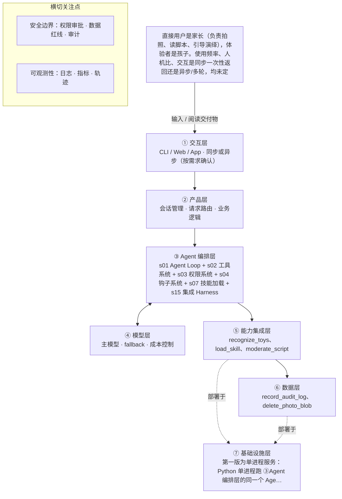

# PRD 推导方案 ——「玩具剧场」

> ⚠️ 本文件是引擎**真实运行产物**，未经人工修改：模型 deepseek-v4-flash，2026-10-31 生成，提示词指纹 `prompts:5aea3e2ac517`。
> 输入为 [evals/forward/toy-theater/input.md](../../evals/forward/toy-theater/input.md)，7 次调用、输入 14655 / 输出 16544 tokens，另有 16256 tokens 命中缓存。
> 审稿没有完全通过是正常的：独立审稿本来就该把方案里的矛盾挑出来，这些意见就是你下一轮要回答的问题。

> 状态：方案待确认（Step 1–4 已完成，Step 5 代码生成需确认后启动）
> 推导引擎：Agent 工坊 · 模型：deepseek-v4-flash
> 领域建模与架构设计由 agent 完成：可查组件说明，交卷前用规则自检（工具与选型一致、四类降级场景齐全等）。

## 产品定位（一句话）

**玩具剧场**：给家长用的亲子互动剧情生成器：拍一张玩具合影，AI 识别玩具并生成可全家演绎的分幕剧情脚本，让旧玩具翻新、帮家长读懂孩子、一起玩起来

## ⚠️ 待确认清单（答不上就是风险点）

**需求问题**：请提出想法的人回答，这几条最要紧。

1. 产品做成的可量化标准是什么？例如脚本采用率、亲子共玩时长、家长满意度、审核一次通过率，达标线分别是多少？
2. 孩子的年龄段具体是多少（决定适龄分级和剧情复杂度）？家长的使用频率大概怎样？交互是拍照后一次性同步返回整份脚本，还是多轮对话逐步细化？
3. 一次完整交付的交互形态是什么？是家长拍照后直接拿到整份分幕脚本，还是先确认玩具识别结果、再选择剧情类型、最后生成脚本？
4. 照片在哪里处理：是本地识别不上云，还是调用云端视觉模型？如果需要外部图像识别能力，具体用哪个模型或服务？
5. 儿童适龄内容规范和玩具剧情范式库分别从哪里来（自有整理、行业标准、采购）？以什么形式加载？是否需要一份玩具品类/schema 清单来支撑识别与角色分配？
6. 「危险模仿」的具体判定边界是什么？照片的保留与删除策略具体如何（默认不保存是即时删除还是根本不离开设备）？是否需要家长同意授权流程？
7. 识别不出玩具、生成内容审核不通过、模型超时或产出跑偏时，分别如何降级、重试或兜底？是否有备用剧情模板？
8. 成功指标怎么度量：单次生成时延上限、单次成本上限、内容审核通过率、家长复访率，各自的目标值是多少？

**方案推导时留下的问题**：多是上面问题的细化，也有写给开发者的备注。先答上面的，这里能答的再补。

9. 孩子年龄段未定：适龄标准的默认档位与年龄段取值需要产品确认。
10. 交互形态未定：是家长单向输入后一次性返回脚本，还是多轮调整（改角色、改分幕）？影响会话上下文与循环轮数设计。
11. 照片是否上云未定：影响权限门与「上云需逐次同意」的实现方式，当前按本地/端侧优先设计。
12. 脚本是否默认保存与可回看未定；当前设计为不持久化，由家长自行保存。
13. 大模型与适龄审核服务的具体提供方、调用方式与限额未定，影响 ⑤能力集成层适配器实现。
14. 审核不通过后的最大重试次数未定（不预设数值）。
15. 成功标准（脚本采用率、亲子共玩时长、家长满意度）输入未给出，观测指标暂按交付率与拦截率设计。
16. 是否需要同时服务同一家庭内的多个孩子（兄弟姐妹），输入未提及。

## Step 1 · 需求拆解（提取硬事实）

| 维度 | 结论 | 状态 | 出处 |
|---|---|---|---|
| 目标 | 家长拍摄玩具合影，AI 识别照片中的玩具并生成一份可亲子共同演绎的互动剧情脚本，让旧玩具翻新，同时帮家长读懂孩子、一起玩。可量化的成功标准（如脚本采用率、亲子共玩时长、家长满意度）输入未给出。 | 待确认 | 家长拍一张玩具合影，AI 识别照片里的玩具，生成一份可以亲子共同演绎的互动剧情脚本……让旧玩具翻新，也帮家长读懂孩子、一起玩。 |
| 用户 | 直接用户是家长（负责拍照、读脚本、引导演绎），体验者是孩子。使用频率、人机比、交互是同步一次性返回还是异步/多轮，均未定义。 | 待确认 | 直接用户是家长（拍照、读脚本、引导），体验者是孩子。 |
| 核心闭环 | 家长拍一张玩具合影 → AI 识别照片里的玩具 → 生成互动剧情脚本（角色分配、场景搭建、分幕、对话、家长引导话术）→ 家长带孩子按脚本演绎。交互形态尚未确定。 | 明确 | 家长拍一张玩具合影，AI 识别照片里的玩具，生成一份可以亲子共同演绎的互动剧情脚本（角色分配、场景搭建、分幕、对话、家长引导话术） |
| 交付物 | 一份文档形态的互动剧情脚本，包含角色分配、场景搭建、分幕、对话、家长引导话术五部分。 | 明确 | 生成一份可以亲子共同演绎的互动剧情脚本（角色分配、场景搭建、分幕、对话、家长引导话术） |
| 边界 | 绝不生成暴力、恐怖、成人、危险模仿内容；照片涉及隐私，默认不保存；生成内容必须过适龄审核。 | 明确 | 绝不生成暴力、恐怖、成人、危险模仿内容；照片涉及隐私，默认不保存。生成内容必须过适龄审核。 |
| 约束 | 需要儿童适龄内容规范、玩具剧情范式库这类领域知识支撑。时延、并发、成本、可用模型均未定义；孩子年龄段、交互形态、照片是否上云也未定。 | 待确认 | 需要儿童适龄内容规范和玩具剧情范式库这样的领域知识库。孩子年龄段、交互形态、照片是否上云还没定。 |

## Step 2 · 领域建模（映射 Harness 五要素）

| 要素 | 内容 |
|---|---|
| **工具** | 视觉识别工具：调用视觉模型识别家长上传的玩具合影，输出玩具品类、数量与外观特征清单。；知识加载工具：按名称加载「儿童适龄内容规范」与「玩具剧情范式库」两本领域知识库。；适龄审核工具：对生成脚本做暴力、恐怖、成人、危险模仿四类红线的适龄审核。；结构校验工具：按角色分配、场景搭建、分幕、对话、家长引导话术五部分校验脚本完整性。；审计写入工具：把每次授权、审核结论与拦截事件写入审计日志。；照片清除工具：识别完成后立即删除照片临时文件，并回写删除结果。 |
| **知识** | 儿童适龄内容规范知识库：年龄分级、禁用题材、家长引导话术的尺度。；玩具剧情范式库：角色分配方式、分幕结构、对话与可演绎动作的写法。；交付物 schema：脚本必须包含角色分配、场景搭建、分幕、对话、家长引导话术五部分。；内容红线清单：暴力、恐怖、成人、危险模仿四类绝对禁止题材。；系统提示词只放知识目录（名称+描述+版本），全文由 load_skill 按需加载。 |
| **观察** | 识别结果回喂给家长核对：识别出的玩具清单进入对话，家长可纠错后再生成。；审核结论回写：每版脚本的审核通过/拦截原因作为 tool_result 与审计记录。；结构校验结果：明确返回缺少哪一部分，驱动模型补全。；照片清除结果：删除工具返回的删除状态用于确认未留残余文件。 |
| **行动** | 在对话中以文档形态输出完整脚本，家长可直接照着念与演绎。；照片仅在会话内经家长授权后处理，识别完立即删除，不落盘、不外传。；审核不通过时向家长返回可读的拦截说明与改写后的新版本，而不是原始内容。；授权、审核、拦截事件写入审计日志，供后续合规检查。 |
| **权限** | 默认拒绝：未注册工具一律不可调用，工具池只包含本次选定的识别、知识加载、审核、结构校验、审计、照片清除六项。；需要审批：照片上传与识别前必须获得家长明确授权（二次确认），默认不保存、不用于训练。；需要审批：照片是否允许上传云端处理未定，默认按本地/端侧优先，上云需家长逐次同意。；默认拒绝：未经适龄审核通过的脚本禁止返回给家长，审核不通过一律拦截。；禁止：审计日志不得写入照片原始内容与可识别家庭身份的信息。 |

## Step 3 · 组件选型（宁可少选）

| 组件 | 选否 | 理由 | 参考 |
|---|---|---|---|
| s01 Agent Loop | ✅ 必选 | 一切基础：循环 + 工具（一切基础，恒选） | s01_agent_loop/README.md |
| s02 工具系统 | ✅ 必选 | 需要调用外部系统/API/数据源（一切基础，恒选） | s02_tool_use/README.md |
| s03 权限系统 | ✅ 必选 | 输入需要家长上传并识别玩具合影，照片涉及儿童与家庭隐私数据，属于敏感数据处理。 | s03_permission/README.md |
| s04 钩子系统 | ✅ 必选 | 原文明确「生成内容必须过适龄审核」，且设有暴力/恐怖/成人/危险模仿的内容红线，必然需要拦截与合规记录。 | s04_hooks/README.md |
| s05 任务规划 | ❌ 放弃 | 单次交付就是生成一份剧情脚本，一次性产出即可；脚本内的分幕是交付物内容，不是需要先列计划、可中断并汇报进展的任务编排。 | s05_todo_write/README.md |
| s06 子 Agent | ❌ 放弃 | 输入只有一张玩具合影和一次脚本生成，不存在上下文爆炸或可并行的探索型子任务。 | s06_subagent/README.md |
| s07 技能加载 | ✅ 必选 | 原文明确需要「儿童适龄内容规范和玩具剧情范式库这样的领域知识库」。 | s07_skill_loading/README.md |
| s08 上下文压缩 | ❌ 放弃 | 单次闭环为拍一张照片、生成一份脚本，会话短、无大量工具输出或日志。 | s08_context_compact/README.md |
| s09 记忆系统 | ⏸ 二期 | 原文「未来希望记住孩子的年龄和偏好玩具做个性化」，第一版可以不做。 | s09_memory/README.md |
| s10 任务系统 | ❌ 放弃 | 单次生成脚本即完成，输入未提出断点续跑或长期目标持久化需求。 | s10_task_system/README.md |
| s11 后台任务 | ❌ 放弃 | 输入未提及任何几分钟以上的慢操作，闭环为拍照后直接生成脚本。 | s11_background_tasks/README.md |
| s12 定时调度 | ❌ 放弃 | 由家长主动拍照触发，输入未提出任何定时自动触发需求。 | s12_cron_scheduler/README.md |
| s13 Agent 团队 | ❌ 放弃 | 单人单次的亲子场景，输入未涉及多任务并行或各自隔离工作区。 | s13_agent_teams/README.md |
| s14 MCP 插件 | ❌ 放弃 | 输入未提及 MCP、第三方插件或外部工具生态接入需求。 | s14_mcp_plugin/README.md |
| s15 集成 Harness | ✅ 必选 | 第一版已选 3 个可选组件（s03, s04, s07），需归一到单一循环 | s15_integrated_harness/README.md |
| s16 工作流运行时 | ❌ 放弃 | 「拍照 → 识别 → 生成脚本」是对产品体验的描述，且生成内容依赖识别结果做临场创作，不是固定阶段序列。 | s16_workflow_runtime/README.md |
| s17 目标闭环 | ⏸ 二期 | 原文「未来也希望自动判断剧情算不算合格」，第一版可以不做独立评估器。 | s17_goal_loop/README.md |

特征判定依据：

- `destructive_ops` = yes：输入需要家长上传并识别玩具合影，照片涉及儿童与家庭隐私数据，属于敏感数据处理。
- `audit_needed` = yes：原文明确「生成内容必须过适龄审核」，且设有暴力/恐怖/成人/危险模仿的内容红线，必然需要拦截与合规记录。
- `multi_step` = no：单次交付就是生成一份剧情脚本，一次性产出即可；脚本内的分幕是交付物内容，不是需要先列计划、可中断并汇报进展的任务编排。
- `context_heavy` = no：输入只有一张玩具合影和一次脚本生成，不存在上下文爆炸或可并行的探索型子任务。
- `large_knowledge` = yes：原文明确需要「儿童适龄内容规范和玩具剧情范式库这样的领域知识库」。
- `long_sessions` = no：单次闭环为拍一张照片、生成一份脚本，会话短、无大量工具输出或日志。
- `cross_session_memory` = later：原文「未来希望记住孩子的年龄和偏好玩具做个性化」，第一版可以不做。
- `persistent_goals` = no：单次生成脚本即完成，输入未提出断点续跑或长期目标持久化需求。
- `slow_operations` = no：输入未提及任何几分钟以上的慢操作，闭环为拍照后直接生成脚本。
- `scheduled` = no：由家长主动拍照触发，输入未提出任何定时自动触发需求。
- `parallel_isolated` = no：单人单次的亲子场景，输入未涉及多任务并行或各自隔离工作区。
- `external_ecosystem` = no：输入未提及 MCP、第三方插件或外部工具生态接入需求。
- `fixed_orchestration` = no：「拍照 → 识别 → 生成脚本」是对产品体验的描述，且生成内容依赖识别结果做临场创作，不是固定阶段序列。
- `auto_completion` = later：原文「未来也希望自动判断剧情算不算合格」，第一版可以不做独立评估器。

## Step 4 · 架构设计

### 分层架构图（7 层 + 数据流）



| 层 | 名称 | 回答的问题 | 落地锚点 |
|---|---|---|---|
| ① | 交互层 | 谁在用、怎么用？ | CLI / Web / App / API；同步或异步；人机比 |
| ② | 产品层 | 产品外壳是什么？ | 会话管理、请求路由、账户、业务逻辑 |
| ③ | Agent 编排层 | Harness 如何运转？ | loop、工具分发、hooks、权限、记忆、任务、技能、压缩、子 agent / 团队、目标闭环 |
| ④ | 模型层 | 智能从哪来？ | 主模型、辅助模型、路由、fallback、成本 |
| ⑤ | 能力集成层 | 如何触达外部世界？ | 内部工具、MCP server、知识库、第三方 API |
| ⑥ | 数据层 | 什么需要持久化？ | 记忆、任务、会话历史、轨迹数据、日志指标 |
| ⑦ | 基础设施层 | 如何部署运行？ | 单进程 / 服务 / 团队、沙箱、队列、调度、监控 |

### 工具清单

| 工具 | 输入 | 输出 | 副作用 | 权限 | 归属层 |
|---|---|---|---|---|---|
| `request_photo_consent` | 照片用途说明、处理方式（本地/云端，待确认）、是否保存 | 家长的选择：允许本次识别 / 拒绝 | 产生一次需要留痕的授权事件 | ask | ①交互层 |
| `recognize_toys` | 经家长授权的玩具合影（图像）+ 无其他个人信息 | 玩具清单：品类、数量、外观与颜色特征，附识别置信度 | 无持久化；调用视觉模型产生一次外部请求 | allow | ⑤能力集成层 |
| `load_skill` | 知识库名称（child_age_guidelines / toy_play_patterns） | 对应知识库全文，附带知识库版本号 | 只读，无副作用 | allow | ⑤能力集成层 |
| `moderate_script` | 待审核的剧本文本或结构化脚本 | 审核结论：通过 / 拦截，含命中的红线类别与家长可读说明 | 只读审核，不修改脚本；仅产生调用记录与拦截记录 | allow | ⑤能力集成层 |
| `validate_script_structure` | 结构化脚本 JSON | 五部分齐全性检查结果（角色分配、场景搭建、分幕、对话、家长引导话术）与缺失项列表 | 只读校验，无副作用 | allow | ②产品层 |
| `record_audit_log` | 事件类型（授权/审核/拦截/清除）、时间戳、结论；不含照片与家庭身份信息 | 写入成功与否的确认 | 追加写入审计日志，仅追加不可修改 | allow | ⑥数据层 |
| `delete_photo_blob` | 本次会话的照片临时文件标识 | 删除状态（已删除 / 不存在 / 失败） | 删除本地临时文件，不可恢复（鉴于是隐私保护默认动作，无需家长额外确认） | allow | ⑥数据层 |

### 系统提示词草案

```
你是「玩具剧场」的亲子剧情设计助手，服务家长，孩子是体验者而非对话对象。
知识目录（用 load_skill 按需加载）：child_age_guidelines 儿童适龄内容规范；toy_play_patterns 玩具剧情范式库。
规则：
1. 只按 recognize_toys 返回的清单创作，不虚构照片里没有的玩具，识别不确定先问家长。
2. 脚本必须含角色分配、场景搭建、分幕、对话、家长引导话术五部分，交付前用 validate_script_structure 校验。
3. 绝不生成暴力、恐怖、成人、危险模仿内容；脚本须经 moderate_script 审核通过才交给家长，不通过则改写重生成。
4. 照片属隐私：先经 request_photo_consent 获家长授权，识别完立即用 delete_photo_blob 删除，不外传、不用于训练。
5. 授权、审核与拦截都用 record_audit_log 留痕，不记照片内容。
6. 家长未说孩子年龄时不假设，按通用适龄标准执行。
```

### 上下文与记忆策略

单次会话内上下文只保留四类内容：家长的需求描述、识别出的文字化玩具清单（含置信度）、家长补充的孩子年龄与偏好（若家长主动提供）、已生成脚本的版本与每次审核结论。图像本身不进入消息序列，识别完只以文本清单形式留在上下文里，原始照片临时文件交给 delete_photo_blob 清除。识别接口的原始响应若有大量冗余字段，落成结构化清单后再进入上下文，避免占窗口。因未选 s08 上下文压缩，会话长度靠「一图一脚本」的自然闭环控制，不做历史压缩。跨会话不持久化：孩子年龄与偏好个性化属二期 s09 记忆系统，第一版每次会话由家长重新提供；脚本是否留存由家长自行保存（平台默认存储策略待确认）。

### 安全边界与降级策略

- 家长拒绝照片授权 → 不执行 recognize_toys，改为引导家长用文字描述玩具，继续生成脚本。
- 识别工具失败或置信度过低 → 重试一次，仍失败则向家长列出无法确认的玩具并请其口述补充，不猜测、不虚构玩具。
- 模型幻觉（脚本出现识别清单里没有的玩具或角色）→ PostToolUse 钩子比对脚本角色与识别清单，出现无来源玩具则要求重写并记录。
- 适龄审核不通过 → 不返回原始内容，按红线类别改写重生成；连续多次仍不通过则返回拒答说明与家长引导建议（重试次数待确认）。
- 审核服务超时或不可用 → 采用失败关闭（fail-closed），本次不输出脚本，提示家长稍后重试并记录降级事件。
- 越权尝试（上传照片到云端、调用未注册工具、改写审计日志、把照片内容写入日志）→ 权限系统在 PreToolUse 直接拒绝并记审计。
- 输出超时或生成中断 → 返回已完成部分并标注未完成，不把半成品当完整脚本交付。
- 结构校验缺项 → 明确指出缺少的部分，回到生成步骤补全，不静默通过。

### 可观测性

- 日志：每次会话记录：授权结果、识别出的玩具清单摘要、加载了哪个知识库及版本、结构校验结论、审核结论与命中红线类别。；拦截与降级事件日志：越权工具调用、审核不通过、审核服务超时、照片删除失败。；审计日志只记事件与结论，不记照片内容与可识别家庭身份的信息。
- 指标：脚本交付率：一次会话中通过结构校验与适龄审核并最终交付给家长的脚本比例。；审核拦截率与红线分布：暴力/恐怖/成人/危险模仿各类命中次数。；工具失败与超时率：recognize_toys、moderate_script 的失败与超时次数。；授权拒绝率与照片删除成功率。
- 轨迹：按会话记录完整的 messages 轨迹（家长输入、tool_use 与 tool_result、审核结论、最终脚本版本号），照片只保留占位标识不保留图像，轨迹与审计日志分离存储。

### 技术栈与部署形态

第一版为单进程服务：Python 单进程跑 ③Agent 编排层的同一个 Agent Loop（s01 + s15 集成），工具在 ②产品层组装成工具池，⑤能力集成层以适配器形式分别对接视觉模型、内容审核能力、知识库文件加载，⑥数据层只落审计日志与照片临时文件目录，①交互层是给家长的移动端/网页上传与阅读页（具体形态待确认）。大模型来源与审核服务提供方待确认，不写死供应商，统一在配置里指定。启动：`python -m toy_theater.harness --config config/app.toml`。密钥（模型 API Key、审核服务 Key）与开关（是否允许上云处理照片）全部外置到 .env 与 config 文件，仓库内只保留 .env.example；知识库与提示词作为带版本号的资源文件随包发布，不硬编码在代码里。

### 测试设计

- 核心循环单元测试：用假模型响应验证「拍照 → 识别 → 生成 → 结构校验 → 审核 → 交付」这一条主链路能被同一个 Agent Loop 走完。
- 工具分派测试：校验每个 tool_use 被路由到正确的 handler，未注册工具名被拒绝；同时验证工具入参 schema 校验。
- 权限边界测试：未授权照片不得触发 recognize_toys；未通过审核的脚本不得出现在最终输出；越权上传照片、改写审计日志的调用必须被拒绝并留痕。
- 内容红线测试：构造暴力、恐怖、成人、危险模仿四类样本脚本，断言 moderate_script 拦截且不返回原文。
- 隐私测试：断言照片临时文件在识别后被删除、审计日志中不出现照片内容与家庭身份字段、图像不进入 messages。
- 降级测试：模拟识别超时、审核服务 500、审核不通过多种情况，验证 fail-closed 行为与家长可读的提示文案。

## 验收标准对照（可落地 vs demo）

| 标准 | 要求 | 本方案的对应设计 |
|---|---|---|
| 可运行 | 一条命令能起，配置与密钥外置（.env / config） | 第一版为单进程服务：Python 单进程跑 ③Agent 编排层的同一个 Agent Loop（s01 + s15 集成），工具在 ②产品层组装成工具池，⑤能力… |
| 可容错 | 工具失败、模型幻觉、超时、越权都有明确降级路径 | 家长拒绝照片授权 → 不执行 recognize_toys，改为引导家长用文字描述玩具，继续生成脚本。；识别工具失败或置信度过低 → 重试一次，仍失败则向家长列出无法确认的玩具并请其口述补充，不猜测、不虚构玩具。；模型幻觉（脚本出现识别清单里没有的玩具或角色）→ PostToolUse 钩子比对脚本角色与识别清单，出现无来源玩具则要求重写并记录。 |
| 可观测 | 有日志、有指标、有轨迹数据 | 每次会话记录：授权结果、识别出的玩具清单摘要、加载了哪个知识库及版本、结构校验结论、审核结论与命中红线类别。；拦截与降级事件日志：越权工具调用、审核不通过、审核服务超时、照片删除失败。；脚本交付率：一次会话中通过结构校验与适龄审核并最终交付给家长的脚本比例。；审核拦截率与红线分布：暴力/恐怖/成人/危险模仿各类命中次数。 |
| 可测试 | 核心循环与工具分派有单测，权限与安全有边界测试 | 核心循环单元测试：用假模型响应验证「拍照 → 识别 → 生成 → 结构校验 → 审核 → 交付」这一条主链路能被同一个 Agent Loop 走完。；工具分派测试：校验每个 tool_use 被路由到正确的 handler，未注册工具名被拒绝；同时验证工具入参 schema 校验。；权限边界测试：未授权照片不得触发 recognize_toys；未通过审核的脚本不得出现在最终输出；越权上传照片、改写审计日志的调用必须被拒绝并留痕。；内容红线测试：构造暴力、恐怖、成人、危险模仿四类样本脚本，断言 moderate_script 拦截且不返回原文。；隐私测试：断言照片临时文件在识别后被删除、审计日志中不出现照片内容与家庭身份字段、图像不进入 messages。；降级测试：模拟识别超时、审核服务 500、审核不通过多种情况，验证 fail-closed 行为与家长可读的提示文案。 |
| 可部署 | 有明确的部署形态（单进程 / 服务 / 团队）与启动文档 | 见上文「技术栈与部署形态」 |
| 可度量 | 有对齐 PRD 的成功指标，并能采集 | 脚本交付率：一次会话中通过结构校验与适龄审核并最终交付给家长的脚本比例。；审核拦截率与红线分布：暴力/恐怖/成人/危险模仿各类命中次数。；工具失败与超时率：recognize_toys、moderate_script 的失败与超时次数。；授权拒绝率与照片删除成功率。 |

## 独立审稿意见

- 结论：✅ 通过（86 / 100），设计稿共 1 版
- 总评：方案整体扎实：六条验收标准中，可运行、可容错、可观测、可测试、可部署均有具体设计；工具失败、模型幻觉、审核超时、越权四条降级路径全部覆盖；组件取舍与原始输入的证据大体对得上，未来能力（记忆、自动评估）被正确划为二期。主要扣分点在于工具清单两处口径不一致、交付「文档形态」缺少输入依据，以及可度量仍停留在系统运行指标、未给出 PRD 成功指标的采集口径。未发现 high 级编造问题。
- [medium] elements.tools 与 design.tool_list：两处工具清单口径不一致：design.tool_list 有 7 个工具，elements.tools 只有 6 个，缺少 request_photo_consent。该工具虽可在 permissions 的「需要审批：照片上传与识别前必须获得家长明确授权」找到依据，但五要素的工具清单应与之同步补齐，否则「每个工具对应五要素某一条」的核对会在两处得到不同答案。
- [medium] facts.deliverable 与 design.action：「一份文档形态的互动剧情脚本」中的「文档形态」在原始输入里没有依据，输入只说「生成一份可以亲子共同演绎的互动剧情脚本」。交付形态（对话内文本 / 可打印卡片 / 阅读页）属于尚未确定的信息，应标注待确认或列入 open_questions，而不是直接写成事实。
- [medium] design.observability.metrics：现有指标（脚本交付率、审核拦截率、工具失败率、授权拒绝率）都是系统运行指标，未覆盖 PRD 层面的成功指标（脚本采用率、亲子共玩时长、家长满意度）及其采集口径。虽然 facts.goal 与 open_questions 已把这些标为待确认，但「可度量」这一条目前只完成了一半，建议至少给出一个可采集的产品侧代理指标（例如脚本被保存、分享或再次生成的比例）。
- [low] components.s03：权限系统选型理由写的是「照片涉及儿童与家庭隐私数据」，但特征证据标为 destructive_ops。真正的破坏性动作只有 delete_photo_blob 一项，隐私数据处理与 destructive_ops 并不完全对应，特征标签与理由之间的证据链偏弱。建议在理由中补一句「含不可恢复的照片删除操作」以对齐。
- [low] components.s04：钩子系统理由为「必须过适龄审核」的拦截需求，但特征证据标为 audit_needed；audit_needed 只覆盖留痕，拦截属于策略强制，特征标签只解释了一半理由。建议把审核拦截与审计留痕两条依据分别写清。
- [low] design.security_and_degradation：审核不通过后的降级写的是「按红线类别改写重生成」，但未说明改写时如何把命中的红线类别强制注入提示、改写后是否重新走 validate_script_structure 与 moderate_script 的完整回路。重试次数虽已标为待确认，但重试链路的必经步骤仍应写全，否则容易出现改写版绕过结构校验的漏洞。
- [low] design.tech_stack_and_deployment：部署形态定为单进程服务，但①交互层写的是移动端或网页上传与阅读页，前端产物如何随单进程一起起、监听端口、健康检查都未说明；启动文档只给了一条启动命令。按「可部署」标准，建议补充端口与健康检查说明，并把前端形态列入 open_questions。
- [low] facts.goal：goal 的主体内容（拍照、识别、生成可亲子演绎的脚本、旧玩具翻新、读懂孩子）在原始输入里是明确的，仅「可量化成功标准」缺失，整条标为「待确认」略偏保守，容易让下游误以为目标本身不确定。建议拆为主体「明确」与成功标准「待确认」两项。

## 本次推导消耗

- 模型调用 7 次，输入 14655 tokens，输出 16544 tokens，另有 16256 tokens 命中缓存（按 1/10 计入上限）

## 下一步

回答上面的待确认清单，据此修订方案后，再进入 Step 5 代码生成（骨架 → 硬化 → 产品化）。
