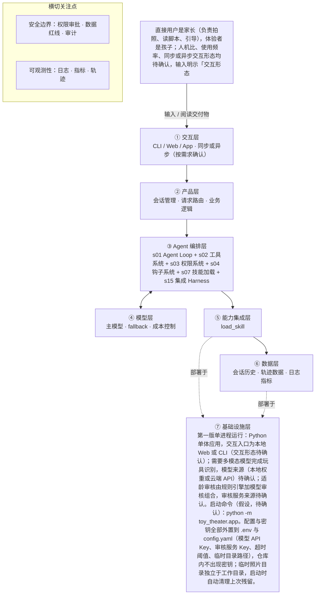

# PRD 推导方案 ——「玩具剧场」

> ⚠️ 本文件是引擎**真实运行产物**，未经人工修改：模型 deepseek-v4-flash，2026-10-27 生成，提示词指纹 `prompts:e7f6f5d42fb3`。
> 输入为 [evals/forward/toy-theater/input.md](../../evals/forward/toy-theater/input.md)，5 次调用、输入 11219 / 输出 12595 tokens。
> 审稿没有完全通过是正常的：独立审稿本来就该把方案里的矛盾挑出来，这些意见就是你下一轮要回答的问题。

> 状态：方案待确认（Step 1–4 已完成，Step 5 代码生成需确认后启动）
> 推导引擎：Agent Blueprint · 模型：anthropic
> 领域建模与架构设计由 agent 完成：可查组件说明，交卷前用规则自检（工具与选型一致、四类降级场景齐全等）。

## 产品定位（一句话）

**玩具剧场**：给家长用：拍一张玩具合影，AI 识别玩具并生成可亲子共同演绎的互动剧情脚本，解决旧玩具闲置、家长不会陪玩的痛点，最终得到含角色分配、场景搭建、分幕、对话与家长引导话术的脚本。

## ⚠️ 待确认清单（答不上就是风险点）

1. 产品目标怎样算做成？请给出可度量的成功标准，例如脚本生成成功率、家长实际照着演出的比例、单次生成时延或成本上限。
2. 目标用户的具体画像是什么？孩子的年龄段是多少，家长大概多久用一次（每天、每周），交互是同步等结果还是可以异步回看？
3. 一次完整交付的边界在哪里？是只出一份静态脚本，还是要支持重新生成、按角色调整、保存与二次编辑？
4. 必须接入哪些外部系统或数据源？玩具识别是走自建视觉模型还是现成多模态 API，是否有指定的模型供应商？
5. 领域知识以什么形式提供？儿童适龄内容规范和玩具剧情范式库现成可用，还是需要我们先从零整理，规模多大？
6. 照片是否上云、存多久、是否允许留存孩子正脸，这些隐私边界如何界定？哪些数据绝对不能出端？
7. 失败时怎么办？照片里没识别出玩具、生成内容被适龄审核拦下、模型超时或输出跑偏时，应该重试、降级还是直接提示家长？
8. 适龄审核由什么来执行？是规则过滤、独立审查模型，还是人工抽检，判定不通过时的处理策略是什么？
9. 孩子年龄段未定，直接影响适龄尺度与知识库内容，需产品先给分级方案。
10. 交互形态未定（App、小程序、Web、CLI），影响拍照上传与澄清提问的实现方式。
11. 照片是否上云未定，决定 recognize_toys 用本地模型还是云端视觉 API，以及隐私声明怎么写。
12. 适龄审核是自建规则、外接审核服务还是模型自审，输入未给出。
13. 成功标准缺失：生成成功率、家长采用率、亲子共玩时长等指标未定义。
14. 脚本能否对外分享（发班级群、社交媒体）输入未确认，当前按默认拒绝处理。
15. 单份脚本的分幕数、篇幅、生成时延与超时阈值输入未给出，均按假设处理，待确认。
16. 二期记忆与二期自动评估（判断剧情是否合格）的触发条件与存储位置待确认。

## Step 1 · 需求拆解（提取硬事实）

| 维度 | 结论 | 状态 | 出处 |
|---|---|---|---|
| 目标 | 家长拍一张玩具合影，AI 识别照片里的玩具，生成一份可亲子共同演绎的互动剧情脚本，让旧玩具翻新，并帮家长读懂孩子、一起玩；可量化的成功标准（如生成成功率、家长采用率、亲子共玩时长）输入未给出。 | 明确 | 家长拍一张玩具合影，AI 识别照片里的玩具，生成一份可以亲子共同演绎的互动剧情脚本（角色分配、场景搭建、分幕、对话、家长引导话术），让旧玩具翻新，也帮家长读懂孩子、一起玩。 |
| 用户 | 直接用户是家长（负责拍照、读脚本、引导），体验者是孩子；人机比、使用频率、同步或异步交互形态均待确认，输入明示「交互形态……还没定」。 | 明确 | 直接用户是家长（拍照、读脚本、引导），体验者是孩子。 / 孩子年龄段、交互形态、照片是否上云还没定。 |
| 核心闭环 | 家长拍摄玩具合影并提交 → AI 识别照片中的玩具 → 生成含角色分配、场景搭建、分幕、对话、家长引导话术的剧情脚本 → 家长读脚本引导孩子共同演绎。采集方式（是否上云）、识别与生成的时延要求待确认。 | 明确 | 家长拍一张玩具合影，AI 识别照片里的玩具，生成一份可以亲子共同演绎的互动剧情脚本（角色分配、场景搭建、分幕、对话、家长引导话术） |
| 交付物 | 一份互动剧情脚本（文档形态），包含角色分配、场景搭建、分幕、对话、家长引导话术五类内容。 | 明确 | 生成一份可以亲子共同演绎的互动剧情脚本（角色分配、场景搭建、分幕、对话、家长引导话术） |
| 边界 | 绝不生成暴力、恐怖、成人、危险模仿内容；照片涉及隐私，默认不保存；生成内容必须过适龄审核。除此之外的其他红线（如是否允许家长上传孩子正脸、是否允许对外分享脚本）待确认。 | 明确 | 绝不生成暴力、恐怖、成人、危险模仿内容；照片涉及隐私，默认不保存。生成内容必须过适龄审核。 |
| 约束 | 需要儿童适龄内容规范和玩具剧情范式库两类领域知识；孩子年龄段未定（影响适龄尺度）；照片是否上云未定（影响隐私与部署形态）；交互形态未定；时延、并发、成本、可用模型均未提出。 | 待确认 | 需要儿童适龄内容规范和玩具剧情范式库这样的领域知识库。 / 孩子年龄段、交互形态、照片是否上云还没定。 |

## Step 2 · 领域建模（映射 Harness 五要素）

| 要素 | 内容 |
|---|---|
| **工具** | 玩具识别：把家长拍摄的玩具合影交给多模态视觉模型（本地还是云端待确认），返回照片中玩具的名称、外观特征、数量与位置清单。；领域知识读取：按名称加载「儿童适龄内容规范」与「玩具剧情范式库」两份知识文档的完整内容。；脚本交付：把结构化的分幕脚本渲染成一份可阅读的文档文件交给家长，仅在本地会话目录内写入，不对外发送。；照片销毁：识别完成后立即删除本次照片的临时文件，并返回删除结果。；适龄审核：对生成的脚本做违禁项扫描（暴力、恐怖、成人、危险模仿），命中即拦截，不允许交付。；向家长澄清：孩子年龄段等关键信息缺失时，以对话形式向家长提问并等待回答。 |
| **知识** | 儿童适龄内容规范：适龄分级尺度与禁列内容清单（暴力、恐怖、成人、危险模仿）。；玩具剧情范式库：角色分配、场景搭建、分幕、对话、家长引导话术这五类内容的可复用写法范式。；交付物固定结构：脚本必须包含角色分配、场景搭建、分幕、对话、家长引导话术五个部分。；红线清单：绝不生成暴力、恐怖、成人、危险模仿内容，作为生成与审核的共同判据。；年龄段到适龄尺度的对应关系：孩子年龄段未定，该映射表内容待确认。 |
| **观察** | 玩具识别结果：识别出的玩具清单与照片中的对应位置，需向家长展示以便判断是否识别正确。；适龄审核结果：审核通过或命中违禁项的具体条目，是脚本能否交付的前置状态。；照片清理状态：临时照片文件删除成功或失败的返回结果。；脚本产出状态：脚本文件是否成功写入、路径与分幕数量。；工具调用轨迹：每次工具调用的入参、出参与耗时。 |
| **行动** | 以对话形式在会话内向家长提出澄清问题并接收回答。；以本地文档文件的形式产出并展示剧情脚本。；以拍照或相册上传的方式把玩具合影送入会话。；以 HTTP 调用方式请求视觉识别服务与内容审核服务（是否出网待确认）。 |
| **权限** | 照片默认不保存：只允许写入会话临时目录，识别完成后立即删除；任何持久化保存默认拒绝，需家长显式授权。；生成内容命中暴力、恐怖、成人、危险模仿禁列时直接拒绝输出，模型不得自行放行或降级处理。；脚本对外分享、上传到任何外部系统默认拒绝，未获家长授权前不发起。；读取系统配置、密钥或会话临时目录以外的路径一律拒绝。；把孩子的年龄与偏好玩具写入跨会话记忆（二期能力）默认拒绝，需家长显式同意。；照片删除失败时不得静默通过，必须向家长明示残留位置。 |

## Step 3 · 组件选型（宁可少选）

| 组件 | 选否 | 理由 | 参考 |
|---|---|---|---|
| s01 Agent Loop | ✅ 必选 | 一切基础：循环 + 工具（一切基础，恒选） | s01_agent_loop/README.md |
| s02 工具系统 | ✅ 必选 | 需要调用外部系统/API/数据源（一切基础，恒选） | s02_tool_use/README.md |
| s03 权限系统 | ✅ 必选 | 核心输入是家长拍摄的玩具合影，属用户照片类隐私数据，虽「默认不保存」但仍需处理敏感数据并做保存与否的决策。 | s03_permission/README.md |
| s04 钩子系统 | ✅ 必选 | 原文明确「生成内容必须过适龄审核」，需要有内容拦截与合规校验环节。 | s04_hooks/README.md |
| s05 任务规划 | ❌ 放弃 | 单次交付是生成一份剧情脚本，属一次性生成，原文未要求先列计划、逐步推进或汇报进度。 | s05_todo_write/README.md |
| s06 子 Agent | ❌ 放弃 | 输入为一张玩具合影加简短诉求，输出为一份脚本，原文未涉及大范围探索或可并行子任务。 | s06_subagent/README.md |
| s07 技能加载 | ✅ 必选 | 原文明确需要「儿童适龄内容规范和玩具剧情范式库这样的领域知识库」。 | s07_skill_loading/README.md |
| s08 上下文压缩 | ❌ 放弃 | 产品闭环是拍照到出脚本的单次短交互，原文未提及长会话或大量工具输出日志。 | s08_context_compact/README.md |
| s09 记忆系统 | ⏸ 二期 | 原文「未来希望记住孩子的年龄和偏好玩具做个性化」，属后续规划。 | s09_memory/README.md |
| s10 任务系统 | ❌ 放弃 | 目标是一次性产出一份剧情脚本，原文未提及目标持久化或断点续跑。 | s10_task_system/README.md |
| s11 后台任务 | ❌ 放弃 | 原文未提及分钟级慢操作；识别与生成均在单次闭环内完成。 | s11_background_tasks/README.md |
| s12 定时调度 | ❌ 放弃 | 由家长拍照主动触发，原文未提及任何定时自动触发需求。 | s12_cron_scheduler/README.md |
| s13 Agent 团队 | ❌ 放弃 | 面向单个家庭的一次性脚本生成，原文未提及多任务并行或独立工作区。 | s13_agent_teams/README.md |
| s14 MCP 插件 | ❌ 放弃 | 原文未提及 MCP、第三方插件或外部工具生态接入。 | s14_mcp_plugin/README.md |
| s15 集成 Harness | ✅ 必选 | 第一版已选 3 个可选组件（s03, s04, s07），需归一到单一循环 | s15_integrated_harness/README.md |
| s16 工作流运行时 | ❌ 放弃 | 原文描述的是产品体验（拍照→识别→生成脚本），各阶段需模型临场识别玩具并创作剧情，不是无需模型判断的固定阶段序列。 | s16_workflow_runtime/README.md |
| s17 目标闭环 | ⏸ 二期 | 原文「未来也希望自动判断剧情算不算合格」，即后续再引入独立评估器。 | s17_goal_loop/README.md |

特征判定依据：

- `destructive_ops` = yes：核心输入是家长拍摄的玩具合影，属用户照片类隐私数据，虽「默认不保存」但仍需处理敏感数据并做保存与否的决策。
- `audit_needed` = yes：原文明确「生成内容必须过适龄审核」，需要有内容拦截与合规校验环节。
- `multi_step` = no：单次交付是生成一份剧情脚本，属一次性生成，原文未要求先列计划、逐步推进或汇报进度。
- `context_heavy` = no：输入为一张玩具合影加简短诉求，输出为一份脚本，原文未涉及大范围探索或可并行子任务。
- `large_knowledge` = yes：原文明确需要「儿童适龄内容规范和玩具剧情范式库这样的领域知识库」。
- `long_sessions` = no：产品闭环是拍照到出脚本的单次短交互，原文未提及长会话或大量工具输出日志。
- `cross_session_memory` = later：原文「未来希望记住孩子的年龄和偏好玩具做个性化」，属后续规划。
- `persistent_goals` = no：目标是一次性产出一份剧情脚本，原文未提及目标持久化或断点续跑。
- `slow_operations` = no：原文未提及分钟级慢操作；识别与生成均在单次闭环内完成。
- `scheduled` = no：由家长拍照主动触发，原文未提及任何定时自动触发需求。
- `parallel_isolated` = no：面向单个家庭的一次性脚本生成，原文未提及多任务并行或独立工作区。
- `external_ecosystem` = no：原文未提及 MCP、第三方插件或外部工具生态接入。
- `fixed_orchestration` = no：原文描述的是产品体验（拍照→识别→生成脚本），各阶段需模型临场识别玩具并创作剧情，不是无需模型判断的固定阶段序列。
- `auto_completion` = later：原文「未来也希望自动判断剧情算不算合格」，即后续再引入独立评估器。

## Step 4 · 架构设计

### 分层架构图（7 层 + 数据流）



| 层 | 名称 | 回答的问题 | 落地锚点 |
|---|---|---|---|
| ① | 交互层 | 谁在用、怎么用？ | CLI / Web / App / API；同步或异步；人机比 |
| ② | 产品层 | 产品外壳是什么？ | 会话管理、请求路由、账户、业务逻辑 |
| ③ | Agent 编排层 | Harness 如何运转？ | loop、工具分发、hooks、权限、记忆、任务、技能、压缩、子 agent / 团队、目标闭环 |
| ④ | 模型层 | 智能从哪来？ | 主模型、辅助模型、路由、fallback、成本 |
| ⑤ | 能力集成层 | 如何触达外部世界？ | 内部工具、MCP server、知识库、第三方 API |
| ⑥ | 数据层 | 什么需要持久化？ | 记忆、任务、会话历史、轨迹数据、日志指标 |
| ⑦ | 基础设施层 | 如何部署运行？ | 单进程 / 服务 / 团队、沙箱、队列、调度、监控 |

### 工具清单

| 工具 | 输入 | 输出 | 副作用 | 权限 | 归属层 |
|---|---|---|---|---|---|
| `recognize_toys` | 本次会话临时目录中的玩具合影文件路径 | 玩具清单：名称、外观特征、数量、在照片中的大致位置、置信度；无法确认时返回不确定项 | 无副作用，只读本次临时图片，不上传不落库（是否需调外部视觉服务待确认） | allow | ② |
| `ask_user_clarification` | 问题文本与候选项（如孩子年龄段、希望的故事风格） | 家长的回答文本 | 无副作用，仅在会话内等待家长输入，不修改任何文件 | allow | ① |
| `load_skill` | 技能名：child_age_content_rules 或 toy_story_patterns | 对应 SKILL.md 的完整内容（儿童适龄内容规范或玩具剧情范式库） | 无副作用，只读 | allow | ⑤ |
| `moderate_script` | 待交付的剧情脚本全文 | 审核结论（通过/不通过）、命中条目与改写建议 | 无副作用，只读入参；审核留痕由 PostToolUse 钩子统一记录 | allow | ③ |
| `export_script` | 结构化脚本：角色分配、场景搭建、分幕、对话、家长引导话术 | 写入的脚本文件路径与内容摘要（分幕数、字数） | 在会话工作目录内写入一份脚本文件，家长可保存或丢弃；未过审核时被钩子阻断 | ask | ② |
| `purge_photo` | 本次会话照片的临时文件路径 | 删除结果（成功/失败及残留路径） | 删除临时照片文件，不可恢复；属于隐私保护动作，由权限层在识别后自动触发，无需家长确认 | allow | ③ |

### 系统提示词草案

```
你是「玩具剧场」的亲子剧情设计师，服务对象是家长，体验者是孩子。家长上传玩具合影后，你要识别其中的玩具，产出可亲子共演的互动剧情脚本，必须含【角色分配】【场景搭建】【分幕】【对话】【家长引导话术】五部分。
规则：一、绝不生成暴力、恐怖、成人、危险模仿内容，命中即改写或拒绝。二、脚本须经 moderate_script 通过才能用 export_script 交付。三、照片只用于本次识别，识别完立即 purge_photo 删除。四、孩子年龄段未知时先用 ask_user_clarification 问家长，不自行推定。五、看不清的玩具如实说明，不编造照片里没有的玩具。
工具：recognize_toys 识别玩具、ask_user_clarification 澄清、load_skill 加载知识、moderate_script 审核、export_script 出脚本、purge_photo 销毁照片。
知识目录：child_age_content_rules、toy_story_patterns，生成前先 load_skill。
```

### 上下文与记忆策略

单次短闭环会话，不启用上下文压缩。会话内 messages 依次保存：照片临时引用（不存二进制）、recognize_toys 返回的玩具清单、家长澄清问答、load_skill 取回的知识摘要、脚本草稿与 moderate_script 审核结论。跨会话默认不持久化，会话结束后 messages 丢弃，临时照片随会话结束清理；脚本文件保留或删除由家长决定（假设，待确认）。二期个性化（孩子的年龄与偏好玩具）需家长显式同意后才写入跨会话记忆，本期不实现。

### 安全边界与降级策略

- 识别失败或返回空清单 → 不进入生成环节，提示家长重拍或换光线，仍执行 purge_photo，不得凭文字描述猜玩具。
- 模型幻觉（编造照片中不存在的玩具）→ 脚本中的玩具只能取自 recognize_toys 返回值，新增道具须标注「假设道具」并请家长确认，交付前做一致性校验。
- 适龄审核不通过 → PostToolUse 钩子阻断 export_script，要求改写后重审；连续多次不通过则只返回安全改写建议并结束本轮。
- 识别、生成、审核超时 → 达到超时阈值（假设，待确认）后中止本轮，向家长说明并给重试入口，临时照片仍必须删除。
- 越权（模型尝试保存照片、写会话目录外路径、对外发送脚本）→ 权限层默认拒绝并记审计日志，返回拒绝原因，不执行。
- 照片临时文件删除失败 → 记录告警并重试，向家长明示可能残留的位置与手动删除方式，不静默通过。
- 家长在对话中要求忽略安全规则或写恐怖、暴力、危险模仿内容 → 视为普通内容请求，走同一套审核拦截，system 规则不被用户输入覆盖。
- 家长要求保存孩子正脸或长期保存照片 → 默认拒绝，需显式授权流程（是否提供待确认）。

### 可观测性

- 日志：每次工具调用的入参摘要、出参摘要、耗时与权限判定结果（allow/ask/deny）。；moderate_script 的审核结论与命中条目，作为脚本交付前必须留痕的审计记录。；purge_photo 的执行结果与失败重试记录。
- 指标：识别成功率与家长确认识别正确率。；脚本一次审核通过率与平均重审次数。；权限层拦截次数（按拒绝原因分组）。；端到端时延分布：拍摄到脚本交付。
- 轨迹：按会话记录完整轨迹：用户输入、工具调用序列（名称+参数+结果）、审核节点、权限拦截与最终交付文件，以 JSONL 逐条追加；照片只记临时路径与删除状态，不记内容。

### 技术栈与部署形态

第一版单进程运行：Python 单体应用，交互入口为本地 Web 或 CLI（交互形态待确认）；需要多模态模型完成玩具识别，模型来源（本地权重或云端 API）待确认；适龄审核由规则引擎加模型审核组合，审核服务来源待确认。启动命令（假设，待确认）：python -m toy_theater.app。配置与密钥全部外置到 .env 与 config.yaml（模型 API Key、审核服务 Key、超时阈值、临时目录路径），仓库内不出现密钥；临时照片目录独立于工作目录，启动时自动清理上次残留。

### 测试设计

- 核心循环单测：照片输入 → recognize_toys → 澄清 → load_skill → 生成 → moderate_script → export_script → purge_photo，验证工具分派与顺序正确。
- 工具契约单测：每个工具的入参与出参，以及异常分支（识别为空、审核服务 5xx、文件写入失败、删除失败）。
- 红线与权限测试：命中暴力、恐怖、成人、危险模仿禁列的脚本必须被拦截，export_script 不得执行。
- 隐私测试：识别完成后临时照片必须被删除；未获授权时持久化保存、对外分享、写临时目录外路径一律被拒绝。
- 幻觉测试：脚本中出现的玩具必须全部来自 recognize_toys 返回值，注入不存在的玩具时被一致性校验拦下。
- 端到端测试：正常家庭场景下一次完整运行，产出含角色分配、场景搭建、分幕、对话、家长引导话术五部分的脚本文件。

## 验收标准对照（可落地 vs demo）

| 标准 | 要求 | 本方案的对应设计 |
|---|---|---|
| 可运行 | 一条命令能起，配置与密钥外置（.env / config） | 第一版单进程运行：Python 单体应用，交互入口为本地 Web 或 CLI（交互形态待确认）；需要多模态模型完成玩具识别，模型来源（本地权重或云端 API）待确认；适龄审核由规则引擎加模型审核组合，审核服务来源待确认。启动命令（假设，待确认）：python -m toy_theater.app。配置与密钥全部外置到 .env 与 config.yaml（模型 API Key、审核服务 Key、超时阈值、临时目录路径），仓库内不出现密钥；临时照片目录独立于工作目录，启动时自动清理上次残留。 |
| 可容错 | 工具失败、模型幻觉、超时、越权都有明确降级路径 | 识别失败或返回空清单 → 不进入生成环节，提示家长重拍或换光线，仍执行 purge_photo，不得凭文字描述猜玩具。；模型幻觉（编造照片中不存在的玩具）→ 脚本中的玩具只能取自 recognize_toys 返回值，新增道具须标注「假设道具」并请家长确认，交付前做一致性校验。；适龄审核不通过 → PostToolUse 钩子阻断 export_script，要求改写后重审；连续多次不通过则只返回安全改写建议并结束本轮。 |
| 可观测 | 有日志、有指标、有轨迹数据 | 每次工具调用的入参摘要、出参摘要、耗时与权限判定结果（allow/ask/deny）。；moderate_script 的审核结论与命中条目，作为脚本交付前必须留痕的审计记录。；识别成功率与家长确认识别正确率。；脚本一次审核通过率与平均重审次数。 |
| 可测试 | 核心循环与工具分派有单测，权限与安全有边界测试 | 核心循环单测：照片输入 → recognize_toys → 澄清 → load_skill → 生成 → moderate_script → export_script → purge_photo，验证工具分派与顺序正确。；工具契约单测：每个工具的入参与出参，以及异常分支（识别为空、审核服务 5xx、文件写入失败、删除失败）。；红线与权限测试：命中暴力、恐怖、成人、危险模仿禁列的脚本必须被拦截，export_script 不得执行。；隐私测试：识别完成后临时照片必须被删除；未获授权时持久化保存、对外分享、写临时目录外路径一律被拒绝。；幻觉测试：脚本中出现的玩具必须全部来自 recognize_toys 返回值，注入不存在的玩具时被一致性校验拦下。；端到端测试：正常家庭场景下一次完整运行，产出含角色分配、场景搭建、分幕、对话、家长引导话术五部分的脚本文件。 |
| 可部署 | 有明确的部署形态（单进程 / 服务 / 团队）与启动文档 | 第一版单进程运行：Python 单体应用，交互入口为本地 Web 或 CLI（交互形态待确认）；需要多模态模型完成玩具识别，模型来源（本地权重或云端 API）待确认；适龄审核由规则引擎加模型审核组合，审核服务来源待确认。启动命令（假设，待确认）：python -m toy_theater.app。配置与密钥全部外置到 .env 与 config.yaml（模型 API Key、审核服务 Key、超时阈值、临时目录路径），仓库内不出现密钥；临时照片目录独立于工作目录，启动时自动清理上次残留。 |
| 可度量 | 有对齐 PRD 的成功指标，并能采集 | 识别成功率与家长确认识别正确率。；脚本一次审核通过率与平均重审次数。；权限层拦截次数（按拒绝原因分组）。；端到端时延分布：拍摄到脚本交付。 |

## 独立审稿意见

- 结论：✅ 通过（84 / 100），设计稿共 1 版
- 总评：整体质量较高：五要素、工具清单与设计侧 tool_list 一一对应，安全降级完整覆盖工具失败、模型幻觉、超时、越权四类，可观测与可测试项基本齐备，大部分结论都能追溯到原始输入且未定项已进入 open_questions。主要不足在三处：成功指标与产品目标不对齐（可度量未完全落实）、s03 的 feature 与论证理由不匹配、s16 的结论与 system_prompt、单测所描述的固定流程自相矛盾；这三处都属于需要修订的一致性问题，但未发现编造或安全缺口这类高危问题。
- [medium] design.observability.metrics / 可度量：指标清单只有工程侧指标（识别成功率、一次审核通过率、时延、拦截次数），缺少与产品目标对齐的成功指标（如家长采用率、亲子共玩时长）；open_questions 已承认「成功标准缺失」，但方案未给出这些指标的采集方式或替代方案，因此「可度量：有对齐 PRD 的成功指标并能采集」未完全满足。
- [medium] components.s03 权限系统：decision=必选、feature=destructive_ops，但 reason 只论证了「照片属隐私数据、需做保存与否的决策」，未指出 purge_photo 是不可恢复的删除操作（destructive）才需要权限层；理由与特征证据不匹配，且 s03 与 purge_photo「由权限层自动触发、无需家长确认」的描述之间缺少显式对应。
- [medium] components.s16 工作流运行时 vs design.system_prompt / testing：放弃 s16 的理由是「不是无需模型判断的固定阶段序列」，但 system_prompt 与核心循环单测都把「识别→澄清→load_skill→生成→moderate_script→export_script→purge_photo」写成了固定顺序流水线，二者自相矛盾；应说明这是否属于软性流程约束（由提示词与钩子保证），或修正 s16 的结论。
- [low] facts.users / facts.constraints：facts.users 的 status 标为「明确」，但 value 中混入「交互形态……待确认」等未定项；facts.constraints 的 status 标为「待确认」，但其中包含输入已明示的明确约束（两类知识库需求）。状态标注与内容颗粒度不一致，削弱了「待确认」标记的可追溯性。
- [low] design.tool_list.ask_user_clarification：候选项中出现「希望的故事风格」这一澄清维度，原始输入只提到孩子年龄段与偏好玩具（二期），未提及故事风格；该细节无输入依据，也未标注待确认，属轻度超出输入。
- [low] design.tech_stack_and_deployment / 可运行：部署章节已给出配置外置（.env、config.yaml）与启动命令，但启动命令被标注为「假设，待确认」，且交互入口是 Web 还是 CLI 仍受「交互形态未定」影响；「一条命令能起」目前仍是假设，缺少可验证的判定方式。

## 本次推导消耗

- 模型调用 5 次，输入 11219 tokens，输出 12595 tokens

## 下一步

回答上面的待确认清单，据此修订方案后，再进入 Step 5 代码生成（骨架 → 硬化 → 产品化）。
