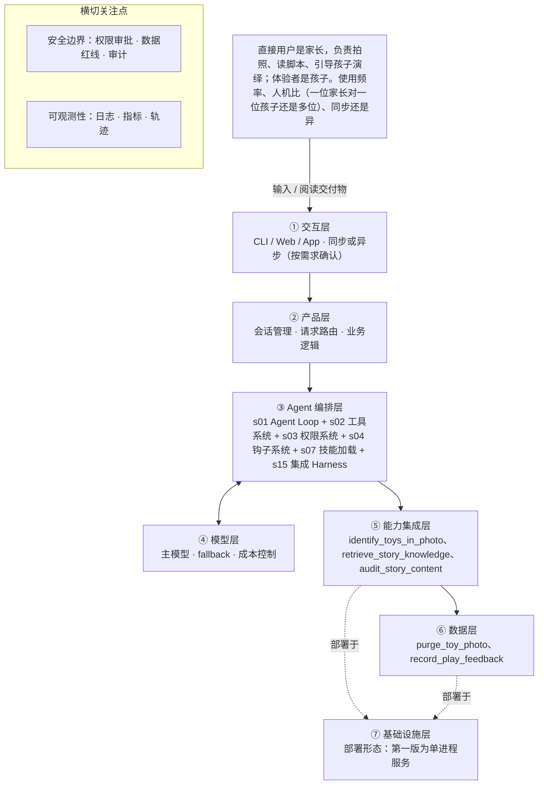

# PRD 推导方案 ——「玩具剧场」

> ⚠️ 本文件是引擎**真实运行产物**，未经人工修改：模型 deepseek-v4-flash，2026-10-31 生成，提示词指纹 `prompts:7fd85ac82956`。
> 输入为 [evals/forward/toy-theater/input.md](../../evals/forward/toy-theater/input.md)，6 次调用、输入 13741 / 输出 21994 tokens。
> 审稿没有完全通过是正常的：独立审稿本来就该把方案里的矛盾挑出来，这些意见就是你下一轮要回答的问题。

> 状态：方案待确认（审稿未完全通过，见文末审稿意见）（Step 1–4 已完成，Step 5 代码生成需确认后启动）
> 推导引擎：Agent Blueprint · 模型：deepseek-v4-flash

## 产品定位（一句话）

**玩具剧场**：给家长用：拍一张家里玩具的合影，由 AI 识别出玩具并生成一份亲子共同演绎的互动剧情脚本，让旧玩具翻新玩法，也帮家长读懂孩子、陪孩子一起玩。

## ⚠️ 待确认清单（答不上就是风险点）

**需求问题**：请提出想法的人回答，这几条最要紧。

1. 产品要达成什么可量化的成功标准？例如脚本可用率、家长完成一次亲子演绎的比例、次周留存等，目前只写了价值描述，没有指标。
2. 目标孩子的年龄段是多少？这直接决定适龄分级与剧情复杂度。
3. 家长与孩子的人机比、使用频率如何？交互是同步（当场生成当场用）还是异步（生成后稍后使用）？
4. 照片是否上云？在端侧做玩具识别还是调云端视觉模型？「默认不保存」的具体策略是什么（本地缓存时长、如何一键删除）？
5. 除了拍照与视觉识别，还必须调用哪些外部系统或接口？例如独立的内容审核服务、图像识别模型、脚本生成模型分别是哪些？
6. 儿童适龄内容规范与玩具剧情范式库的具体形式、来源与规模是什么（自建规则表、行业标准、人工整理的范式集）？如何更新？
7. 一次完整交付的形态是什么？纯文本卡片、可打印文档还是语音朗读？脚本篇幅、分幕数量、单次生成的期望时延是多少？
8. 失败怎么办？识别不出玩具、照片模糊、生成内容未通过适龄审核、模型超时或输出不合结构时，分别的重试与降级策略是什么？
9. 家长能否对生成的脚本做反馈或调整（例如换主角、加一幕）？是否需要埋点记录使用与满意度？

**方案推导时留下的问题**：多是上面问题的细化，也有写给开发者的备注。先答上面的，这里能答的再补。

10. 量化成功标准仍未给出。主体目标与用户主体可视为明确（把玩具合影转成五段式脚本；直接用户是家长、体验者是孩子），待确认的只是量化口径，第一版先用脚本采纳率、亲子演绎完成反馈率、7 日内二次使用率作为替代指标。
11. 孩子年龄段未定，直接决定适龄分级档位与家长引导话术的写法，第一版统一按「低龄通用」处理，需产品侧尽快明确。
12. 交付形态未定（页面卡片／可打印文档／语音），第一版只做页面卡片。
13. 照片上云的最终合规方案未定。第一版按「显式授权后上云识别 + 识别后立即删除」实现；若合规要求端侧或本地识别，需要重新评估模型选型、成本与授权交互。
14. 测试策略待确认：自动化测试覆盖范围、效果指标的成功基线、验收判定的具体口径尚未定义。
15. 脚本质量与亲子共玩效果的衡量方法未定（是否引入独立的完成度评估器已列为二期），当前只有替代指标。
16. 二期记忆系统需要保存孩子年龄段与偏好玩具，涉及字段范围、保存期限与家长同意方式，均待确认。
17. 上一版观察要素中「成功标准尚未给出」属缺口说明而非观察能力，已移入本清单。

## Step 1 · 需求拆解（提取硬事实）

| 维度 | 结论 | 状态 | 出处 |
|---|---|---|---|
| 目标 | 把一张玩具合影转成一份可亲子共同演绎的互动剧情脚本（含角色分配、场景搭建、分幕、对话、家长引导话术），实现「旧玩具翻新」与「帮家长读懂孩子、一起玩」两个价值。可量化的成功标准输入未给出。 | 待确认 | 家长拍一张玩具合影，AI 识别照片里的玩具，生成一份可以亲子共同演绎的互动剧情脚本（角色分配、场景搭建、分幕、对话、家长引导话术），让旧玩具翻新，也帮家长读懂孩子、一起玩。 |
| 用户 | 直接用户是家长，负责拍照、读脚本、引导孩子演绎；体验者是孩子。使用频率、人机比（一位家长对一位孩子还是多位）、同步还是异步交互均未确定。 | 待确认 | 直接用户是家长（拍照、读脚本、引导），体验者是孩子。孩子年龄段、交互形态、照片是否上云还没定。 |
| 核心闭环 | 家长拍玩具合影 → AI 识别照片中的玩具 → 生成适龄的互动剧情脚本（角色分配／场景搭建／分幕／对话／家长引导话术）→ 家长读脚本并引导孩子线下演绎。交互形态未定，暂无更细的闭环描述。 | 待确认 | 家长拍一张玩具合影，AI 识别照片里的玩具，生成一份可以亲子共同演绎的互动剧情脚本（角色分配、场景搭建、分幕、对话、家长引导话术） |
| 交付物 | 结构化的互动剧情脚本（文本类交付物），包含角色分配、场景搭建、分幕、对话、家长引导话术五个部分；具体交付形态（页面卡片／可打印文档／语音）未定。 | 明确 | 生成一份可以亲子共同演绎的互动剧情脚本（角色分配、场景搭建、分幕、对话、家长引导话术） |
| 边界 | 三条硬红线：一是不生成暴力、恐怖、成人、危险模仿内容；二是照片涉及隐私，默认不保存；三是生成内容必须经过适龄审核。 | 明确 | 绝不生成暴力、恐怖、成人、危险模仿内容；照片涉及隐私，默认不保存。生成内容必须过适龄审核。 |
| 约束 | 需要「儿童适龄内容规范和玩具剧情范式库」这类领域知识作为生成依据；孩子年龄段未定（影响适龄分级）、交互形态未定、照片是否上云未定，这三点直接约束模型选型、时延与合规方案。 | 待确认 | 需要儿童适龄内容规范和玩具剧情范式库这样的领域知识库。孩子年龄段、交互形态、照片是否上云还没定。 |

## Step 2 · 领域建模（映射 Harness 五要素）

| 要素 | 内容 |
|---|---|
| **工具** | 调用图像识别能力解析家长拍摄的玩具合影，输出照片中的玩具清单，作为后续角色分配依据。；调用文本生成能力产出互动剧情脚本，需要覆盖角色分配、场景搭建、分幕、对话、家长引导话术五个部分。；接入适龄内容审核服务，对生成脚本做强制审核后才允许交付给家长。；接入儿童适龄内容规范与玩具剧情范式库的检索能力，为生成提供领域依据。；对上传照片执行不保存或即时删除的处理动作，落实「默认不保存」的硬性限制。 |
| **知识** | 儿童适龄内容规范：用于判定脚本内容是否适龄，具体分级档位依赖孩子年龄段，当前年龄段未定，待确认。；玩具剧情范式库：提供以玩具为角色的剧情结构范式，是生成脚本的领域知识来源。；五段式脚本结构模板：角色分配、场景搭建、分幕、对话、家长引导话术，对应交付物的固定结构。；内容安全红线规则集：暴力、恐怖、成人、危险模仿四类内容的判定与拦截规则。；家长引导话术的写法规范依赖孩子年龄段与交互形态，两项均未确定，待确认。 |
| **观察** | 对生成脚本做结构校验，确认五个规定部分是否齐全，缺项即视为不合格输出。；读取适龄审核的通过或拒绝结果，作为脚本能否交付给家长的前置判断依据。；确认照片在识别完成后已被删除或未持久化，验证「默认不保存」是否生效。；核对识别出的玩具清单是否与合影中实际玩具一致，作为角色分配的输入正确性检查。；成功标准尚未给出，暂时无法定义脚本质量与亲子共玩效果的衡量指标，待确认。 |
| **行动** | 家长通过拍照上传动作提交玩具合影，作为整个闭环的输入。；脚本以文本形式交付给家长阅读与引导，具体形态（页面卡片、可打印文档、语音）未定，待确认。；家长按脚本在线下引导孩子完成演绎，系统不介入线下过程。；审核未通过的脚本由系统拦截并返回，不进入家长阅读环节。 |
| **权限** | 照片默认拒绝保存且不上云；如后续需要上传云端处理，必须获得家长显式授权，照片是否上云当前未定，默认按拒绝处理。；生成脚本必须通过适龄审核后才允许输出，未过审内容一律拦截，不得交付。；暴力、恐怖、成人、危险模仿类内容为硬性禁止项，生成侧与审核侧双重拦截。；涉及孩子的年龄段等信息属于敏感数据，采集与使用需家长同意，具体字段与范围待确认。；将照片发送至第三方模型服务属于需要审批的动作，在合规方案确定前默认不允许。 |

## Step 3 · 组件选型（宁可少选）

| 组件 | 选否 | 理由 | 参考 |
|---|---|---|---|
| s01 Agent Loop | ✅ 必选 | 一切基础：循环 + 工具（一切基础，恒选） | s01_agent_loop/README.md |
| s02 工具系统 | ✅ 必选 | 需要调用外部系统/API/数据源（一切基础，恒选） | s02_tool_use/README.md |
| s03 权限系统 | ✅ 必选 | 处理的是儿童照片这一隐私数据，输入明确要求「照片涉及隐私，默认不保存」，属于敏感数据处理。 | s03_permission/README.md |
| s04 钩子系统 | ✅ 必选 | 原文明确「生成内容必须过适龄审核」，且对暴力、恐怖、成人、危险模仿内容有硬性拦截要求。 | s04_hooks/README.md |
| s05 任务规划 | ❌ 放弃 | 单次闭环是拍一张照片生成一份脚本，属于一次性交付，输入未提出列计划、跟踪进度或中断续跑的需求。 | s05_todo_write/README.md |
| s06 子 Agent | ❌ 放弃 | 输入侧只有一张玩具合影，输出侧是一份固定结构的剧情脚本，未出现上下文爆炸或可并行探索型子任务。 | s06_subagent/README.md |
| s07 技能加载 | ✅ 必选 | 原文明确需要「儿童适龄内容规范和玩具剧情范式库这样的领域知识库」作为生成依据。 | s07_skill_loading/README.md |
| s08 上下文压缩 | ❌ 放弃 | 产品闭环是拍照后单次生成脚本，属于短会话，输入未提及长会话、大量工具输出或日志。 | s08_context_compact/README.md |
| s09 记忆系统 | ⏸ 二期 | 原文写明「未来希望记住孩子的年龄和偏好玩具做个性化」，第一版可不做。 | s09_memory/README.md |
| s10 任务系统 | ❌ 放弃 | 一次生成一份脚本即为交付，目标无需跨天持久化或断点续跑，输入也无此要求。 | s10_task_system/README.md |
| s11 后台任务 | ❌ 放弃 | 闭环为拍照后生成脚本的单次同步交付，输入未提及需要数分钟以上的后台异步慢操作。 | s11_background_tasks/README.md |
| s12 定时调度 | ❌ 放弃 | 由家长主动拍照触发，输入未提及任何定时自动触发的场景。 | s12_cron_scheduler/README.md |
| s13 Agent 团队 | ❌ 放弃 | 单人单次使用、单个脚本产出，不存在多 Agent 并行且各自隔离工作区的需求。 | s13_agent_teams/README.md |
| s14 MCP 插件 | ❌ 放弃 | 闭环仅涉及拍照识别与脚本生成，输入未提及接入 MCP 或第三方插件生态。 | s14_mcp_plugin/README.md |
| s15 集成 Harness | ✅ 必选 | 第一版已选 3 个可选组件（s03, s04, s07），需归一到单一循环 | s15_integrated_harness/README.md |
| s16 工作流运行时 | ❌ 放弃 | 虽有「拍照→识别→生成脚本」的顺序，但识别结果与剧情创作依赖模型临场判断，不是无需模型决策的固定阶段序列。 | s16_workflow_runtime/README.md |
| s17 目标闭环 | ⏸ 二期 | 原文写明「未来也希望自动判断剧情算不算合格」，即第一版不做独立完成度评估器。 | s17_goal_loop/README.md |

特征判定依据：

- `destructive_ops` = yes：处理的是儿童照片这一隐私数据，输入明确要求「照片涉及隐私，默认不保存」，属于敏感数据处理。
- `audit_needed` = yes：原文明确「生成内容必须过适龄审核」，且对暴力、恐怖、成人、危险模仿内容有硬性拦截要求。
- `multi_step` = no：单次闭环是拍一张照片生成一份脚本，属于一次性交付，输入未提出列计划、跟踪进度或中断续跑的需求。
- `context_heavy` = no：输入侧只有一张玩具合影，输出侧是一份固定结构的剧情脚本，未出现上下文爆炸或可并行探索型子任务。
- `large_knowledge` = yes：原文明确需要「儿童适龄内容规范和玩具剧情范式库这样的领域知识库」作为生成依据。
- `long_sessions` = no：产品闭环是拍照后单次生成脚本，属于短会话，输入未提及长会话、大量工具输出或日志。
- `cross_session_memory` = later：原文写明「未来希望记住孩子的年龄和偏好玩具做个性化」，第一版可不做。
- `persistent_goals` = no：一次生成一份脚本即为交付，目标无需跨天持久化或断点续跑，输入也无此要求。
- `slow_operations` = no：闭环为拍照后生成脚本的单次同步交付，输入未提及需要数分钟以上的后台异步慢操作。
- `scheduled` = no：由家长主动拍照触发，输入未提及任何定时自动触发的场景。
- `parallel_isolated` = no：单人单次使用、单个脚本产出，不存在多 Agent 并行且各自隔离工作区的需求。
- `external_ecosystem` = no：闭环仅涉及拍照识别与脚本生成，输入未提及接入 MCP 或第三方插件生态。
- `fixed_orchestration` = no：虽有「拍照→识别→生成脚本」的顺序，但识别结果与剧情创作依赖模型临场判断，不是无需模型决策的固定阶段序列。
- `auto_completion` = later：原文写明「未来也希望自动判断剧情算不算合格」，即第一版不做独立完成度评估器。

## Step 4 · 架构设计

### 分层架构图（7 层 + 数据流）



| 层 | 名称 | 回答的问题 | 落地锚点 |
|---|---|---|---|
| ① | 交互层 | 谁在用、怎么用？ | CLI / Web / App / API；同步或异步；人机比 |
| ② | 产品层 | 产品外壳是什么？ | 会话管理、请求路由、账户、业务逻辑 |
| ③ | Agent 编排层 | Harness 如何运转？ | loop、工具分发、hooks、权限、记忆、任务、技能、压缩、子 agent / 团队、目标闭环 |
| ④ | 模型层 | 智能从哪来？ | 主模型、辅助模型、路由、fallback、成本 |
| ⑤ | 能力集成层 | 如何触达外部世界？ | 内部工具、MCP server、知识库、第三方 API |
| ⑥ | 数据层 | 什么需要持久化？ | 记忆、任务、会话历史、轨迹数据、日志指标 |
| ⑦ | 基础设施层 | 如何部署运行？ | 单进程 / 服务 / 团队、沙箱、队列、调度、监控 |

### 工具清单

| 工具 | 输入 | 输出 | 副作用 | 权限 | 归属层 |
|---|---|---|---|---|---|
| `identify_toys_in_photo` | 家长授权凭证（authorized=true 时的授权令牌）+ 玩具合影图像数据（不落盘，仅在内存中传递） | 结构化的玩具清单 JSON：玩具名称、外观描述、颜色、数量、在合影中的大致位置 | 调用外部多模态模型完成识别，属于把照片送出本机的高敏动作；识别完成后图像数据在内存中丢弃，不写入任何存储。副作用是无持久化的外部调用。出处：五要素·工具第 1 条。 | ask | ⑤ |
| `retrieve_story_knowledge` | 检索关键词：玩具品类、孩子年龄段（未知时用「低龄通用」）、目标剧情基调 | 儿童适龄内容规范片段 + 玩具剧情范式片段 + 五段式脚本结构模板，均为只读文本 | 只读检索，无副作用。出处：五要素·工具第 4 条与知识要素。 | allow | ⑤ |
| `generate_story_script` | 玩具清单 + 检索到的知识片段 + 生成约束（五段结构、适龄档位、长度） | 五段式互动剧情脚本草稿：角色分配、场景搭建、分幕、对话、家长引导话术 | 调用生成模型，产生推理成本；草稿仅存在于本次会话上下文，未过审不得交付。出处：五要素·工具第 2 条。 | allow | ④ |
| `validate_story_structure` | 脚本草稿全文 + 识别出的玩具清单 | 校验结果：五段是否齐全、每段是否非空、脚本中出现的角色玩具是否都在识别清单内、是否命中红线词 | 纯本地校验，无副作用；不合格则触发一次重生成。出处：五要素·观察第 1 条与第 4 条。 | allow | ③ |
| `audit_story_content` | 通过结构校验的脚本全文 + 适龄档位（年龄段未知时用「低龄通用」） | 审核结论（通过／拒绝）+ 拒绝原因码（暴力／恐怖／成人／危险模仿／其他不适龄） | 调用适龄审核服务；未通过时脚本被拦截，不进入交付环节，系统按 fail-closed 处理。出处：五要素·工具第 3 条与权限第 2 条。 | allow | ⑤ |
| `purge_toy_photo` | 本次会话的照片标识（哈希与尺寸即可，不含原图） | 清理结果（已删除／无残留／清理失败） | 删除临时缓存与任何中间副本；清理失败时阻断交付并告警，不允许在照片残留的情况下继续。出处：五要素·工具第 5 条与权限第 1 条。 | allow | ⑥ |
| `deliver_story_script` | 已过审的脚本全文 + 审核结论 + 照片清理结果 | 交付给家长阅读的脚本卡片（界面渲染所需的结构化数据），附带「开始演绎」「我们演完了」反馈入口 | 产生一次面向家长的交付动作；前置条件严格：审核通过且照片清理成功，任一不满足则拒绝交付。出处：五要素·行动第 2 条与第 4 条。 | allow | ② |
| `record_play_feedback` | 会话 ID + 家长动作（展开全文／点「开始演绎」／点「我们演完了」／一句话反馈） | 写入结果（成功／失败） | 写入匿名化记录，用于计算采纳率与亲子演绎完成反馈率等替代性效果指标；不记录照片与孩子个人信息。出处：由 metrics 的替代指标口径推导，非五要素直接条目。 | allow | ⑥ |

### 系统提示词草案

```
你是「玩具剧场」的剧情脚本生成器，服务家长，最终体验者是孩子。

职责：根据识别出的玩具清单，产出可亲子共同演绎的互动剧情脚本，固定五段：角色分配、场景搭建、分幕、对话、家长引导话术，不得增删。

硬性边界：1）绝不生成暴力、恐怖、成人、危险模仿内容；2）只使用识别清单中的玩具作为角色，不虚构未出现的道具；3）不询问、不推断孩子姓名、学校、住址等个人信息；4）脚本必须通过适龄审核后才可交付，未过审不得输出。

质量底线：台词口语化，每幕控制在 3 分钟内，家长引导话术写具体可说的句子，不写抽象建议；孩子年龄段未知时按低龄友好处理并注明。

可用工具：identify_toys_in_photo、retrieve_story_knowledge、generate_story_script、validate_story_structure、audit_story_content、purge_toy_photo、deliver_story_script。

知识目录：儿童适龄内容规范、玩具剧情范式库、五段式脚本结构模板、内容安全红线规则集。
```

### 上下文与记忆策略

单次会话只服务一次「拍照→生成脚本」闭环，上下文按三段管理。输入段保留家长授权状态与识别出的玩具清单（结构化 JSON：玩具名称、颜色、数量、位置），照片原图不进入上下文，识别完成即调用 purge_toy_photo 清除。工作段保留知识检索到的适龄规范与剧情范式片段，供本次生成使用，不进入交付内容。输出段保留脚本全文、结构校验结果与审核结论，供重生成与交付判断。会话结束上下文整体丢弃，第一版不做跨会话持久化；仅落库匿名化的会话 ID、脚本、审核结果码与家长反馈信号，用于计算效果指标。二期再由记忆系统持久化孩子年龄段与偏好玩具，需家长授权并明确保存期限。

### 安全边界与降级策略

- 越权（照片上云未经授权）→ identify_toys_in_photo 直接拒绝执行，不读取图像，转入「不上传模式」，由家长手动勾选或输入玩具名称，脚本生成流程照常继续。
- 工具失败（识别服务报错或返回空清单）→ 自动重试 1 次，仍失败则提示家长手动补充玩具清单，不阻断后续生成。
- 工具失败（适龄审核服务不可用）→ fail-closed，默认视为未过审，中止交付并提示「稍后再试」，任何情况下不允许跳过审核。
- 模型幻觉（脚本出现识别清单外的玩具或道具）→ 结构校验阶段核对角色清单，命中则重生成一次，二次仍不符则拦截不交付，并记录原因码。
- 模型幻觉（五段缺项或家长引导话术为空）→ 判定结构不合格，重生成一次，二次不合格则拦截不交付，并记录原因码。
- 超时 → 图像识别单步上限 20 秒、脚本生成单步上限 60 秒、审核单步上限 10 秒、端到端上限 120 秒；同步等待期间前端展示进度提示，超时后展示「生成较慢，可重试」并提供重试按钮，已填写的玩具清单不清空。
- 越权与隐私（照片清理失败）→ 阻断交付并告警，提示家长本次结果不可用，不允许在存在照片残留的情况下继续交付脚本。
- 危险内容 → 生成侧红线词拦截与审核侧独立审核双重把关，任一命中即拒绝交付，不做人工放行。

### 可观测性

- 日志：每次会话生成 request_id，记录授权状态、识别清单条目数、结构校验结果、审核结论与拒绝原因码、照片清理结果、是否触发降级；日志中不写照片原图与孩子个人信息。；工具调用日志记录工具名、参数摘要（照片仅记哈希与尺寸）、耗时、返回状态码。；拦截与降级事件单独打点：未授权调用识别、审核超时 fail-closed、清理失败阻断交付、结构二次不合格。
- 指标：过程指标：五段结构一次合格率、审核拒绝率、端到端时延 P50／P95、照片清理成功率、工具失败率。；效果替代口径一：脚本采纳率 = 发生展开全文／点「开始演绎」／导出打印的会话数 ÷ 生成成功会话数，用于近似衡量「旧玩具翻新」是否被真正使用。；效果替代口径二：亲子演绎完成反馈率 = 点击「我们演完了」或提交一句话反馈的会话数 ÷ 采纳会话数；并统计家长反馈正向率（出现「孩子还想再玩」类表述）。；效果替代口径三：7 日内二次使用率（同一家长重复拍照生成脚本的比例）。以上三个替代口径的成功基线待确认。
- 轨迹：以会话 ID 为单位按时间序记一条轨迹：每步记录工具名、入参摘要（照片只记哈希与尺寸，不记原图）、返回摘要、耗时与判定结果（结构校验、审核、清理），形成可回放的完整链路；轨迹中不含照片与孩子个人信息，保留期与访问权限待合规确认。

### 技术栈与部署形态

部署形态：第一版为单进程服务。Python 3.11 + FastAPI 提供接口与页面托管，同一进程内运行 Agent Loop、工具分发与结构校验；家长端为同仓库内的轻量 H5 页面（拍照上传、脚本卡片、反馈按钮）；数据落本地 SQLite，只存脚本与匿名反馈，不存照片。一条命令启动：uvicorn app:app，另提供 make run 包装。

配置与密钥外置：全部通过环境变量／.env／config.yaml 注入，包括 MODEL_API_KEY、AUDIT_SERVICE_KEY、KNOWLEDGE_INDEX_PATH、识别与审核服务的超时上限；代码中不出现任何硬编码密钥，仓库提供 .env.example；README 作为启动文档，写明依赖安装、环境变量清单、启动命令、健康检查接口与常见故障处理。

模型来源与合规前置条件（修正上一版冲突）：文本生成使用外部商用大模型 API，通过环境变量配置、可替换。图像识别第一版明确采用「经家长显式授权后上云识别」作为显式前置条件：家长首次使用需在授权页阅读并确认告知文案，每次拍照上传前再弹一次确认，文案明示「照片将上传至第三方多模态模型服务，仅用于识别玩具清单，识别完成后立即删除、不落盘、不用于训练」；家长拒绝则进入「不上传模式」，由家长手动勾选或输入玩具清单，闭环仍可运行。identify_toys_in_photo 默认关闭，只有在授权令牌存在时才允许调用，未授权调用按越权拦截。

分层落位：①交互层为拍照上传与授权确认页；②产品层为脚本卡片页、反馈按钮与「我们演完了」入口；③Agent 编排层为 Agent Loop、工具分发、结构校验与降级控制；④模型层为生成模型调用与提示词；⑤能力集成层为识别服务、适龄审核服务、知识库检索；⑥数据层为 SQLite、匿名反馈表与照片即删；⑦基础设施层为单机部署、环境变量配置注入、日志与健康检查。

可测试性：单测覆盖 Agent Loop 主流程、每个工具的分派与返回处理、五段结构校验与角色清单一致性校验；边界测试覆盖越权（未授权调用识别被封堵）、审核拒绝与审核不可用 fail-closed、照片清理失败阻断交付、识别与生成超时、模型返回缺段或含清单外玩具；所有外部服务以可替换的假实现注入，保证不依赖真实第三方即可跑通测试。

## 验收标准对照（可落地 vs demo）

| 标准 | 要求 | 本方案的对应设计 |
|---|---|---|
| 可运行 | 一条命令能起，配置与密钥外置（.env / config） | 部署形态：第一版为单进程服务 |
| 可容错 | 工具失败、模型幻觉、超时、越权都有明确降级路径 | 越权（照片上云未经授权）→ identify_toys_in_photo 直接拒绝执行，不读取图像，转入「不上传模式」，由家长手动勾选或输入玩具名称，脚本生成流程照常继续。；工具失败（识别服务报错或返回空清单）→ 自动重试 1 次，仍失败则提示家长手动补充玩具清单，不阻断后续生成。；工具失败（适龄审核服务不可用）→ fail-closed，默认视为未过审，中止交付并提示「稍后再试」，任何情况下不允许跳过审核。 |
| 可观测 | 有日志、有指标、有轨迹数据 | 每次会话生成 request_id，记录授权状态、识别清单条目数、结构校验结果、审核结论与拒绝原因码、照片清理结果、是否触发降级；日志中不写照片原图与孩子个人信息。；工具调用日志记录工具名、参数摘要（照片仅记哈希与尺寸）、耗时、返回状态码。；过程指标：五段结构一次合格率、审核拒绝率、端到端时延 P50／P95、照片清理成功率、工具失败率。；效果替代口径一：脚本采纳率 = 发生展开全文／点「开始演绎」／导出打印的会话数 ÷ 生成成功会话数，用于近似衡量「旧玩具翻新」是否被真正使用。 |
| 可测试 | 核心循环与工具分派有单测，权限与安全有边界测试 | Step 5 骨架层需附核心循环与权限边界的单测 |
| 可部署 | 有明确的部署形态（单进程 / 服务 / 团队）与启动文档 | 见上文「技术栈与部署形态」 |
| 可度量 | 有对齐 PRD 的成功指标，并能采集 | 过程指标：五段结构一次合格率、审核拒绝率、端到端时延 P50／P95、照片清理成功率、工具失败率。；效果替代口径一：脚本采纳率 = 发生展开全文／点「开始演绎」／导出打印的会话数 ÷ 生成成功会话数，用于近似衡量「旧玩具翻新」是否被真正使用。；效果替代口径二：亲子演绎完成反馈率 = 点击「我们演完了」或提交一句话反馈的会话数 ÷ 采纳会话数；并统计家长反馈正向率（出现「孩子还想再玩」类表述）。；效果替代口径三：7 日内二次使用率（同一家长重复拍照生成脚本的比例）。以上三个替代口径的成功基线待确认。 |

## 独立审稿意见

- 结论：❌ 未通过（72 / 100），设计稿共 2 版
- 总评：方案整体建立在原文明示事实上，六条验收标准基本都有对应设计：可运行、可容错、可观测、可测试、可部署都已落到具体设计，工具失败、模型幻觉、超时、越权这四类降级路径也都覆盖到了。主要问题有两处：一是照片上云违背方案自己的权限要素「默认拒绝」，把待确认事项当成已决定事项；二是 record_play_feedback 这一工具无法对应五要素，违反工具清单一致性标准。另有可度量仅部分对齐 PRD、审核服务选型未标待确认等中等问题，修完后可进入下一阶段。
- [high] 设计·tech_stack_and_deployment（照片上云）／五要素·permissions：方案把「经家长显式授权后上云识别」定为第一版的默认主路径，但这与它自己的权限要素第 1、5 条直接冲突：那两条写的是「照片是否上云当前未定，默认按拒绝处理」「在合规方案确定前默认不允许将照片发送至第三方模型服务」。原始输入里只说「照片是否上云还没定」，没有任何依据支持把云端识别定为默认实现。open_questions 里虽然承认合规方案未定，却已经把上云写进实现，等于在结论中把一个「待确认事项」当成「已决定事项」处理。
- [medium] 设计·tool_list（record_play_feedback）：工具清单共 8 个，其中 record_play_feedback 在五要素的工具、知识、观察、行动、权限条目里都找不到对应项，方案自己也写了「非五要素直接条目」。这违反「每个工具都能对应到五要素里的某一条」这条审查标准。要么回填一条反馈采集的「观察／行动」条目并注明为方案补充，要么把它标为待确认。
- [medium] 设计·observability.metrics／可度量：原始输入没有给出任何量化成功标准，方案以「脚本采纳率、亲子演绎完成反馈率、7 日内二次使用率」作为替代指标并承认基线待确认。这三个指标是方案自己拟的，与 PRD 之间只有间接对应，属于「可采集」但尚未「对齐 PRD 可度量」。建议明确写出：在 PRD 量化标准确认前，本项验收只能算部分满足。
- [medium] 设计·tool_list（audit_story_content）／五要素·工具第 3 条：「适龄审核服务」作为外部依赖被直接引入，但原始输入只说「生成内容必须过适龄审核」，没有指定外部服务，方案也没把该服务的选型与来源标为待确认。同时审核不可用时一律 fail-closed（全部按未过审处理），没有自建红线规则集作为本地的备选审核方案，而红线规则集已在知识要素里列出，可用性不足。
- [low] 设计·system_prompt：系统提示词的「可用工具」只列了 7 个，缺少 tool_list 中的 record_play_feedback，两处工具清单不一致，会让实现方无法判断反馈采集由模型调用还是由前端直接写入。
- [low] elements.observation：观察要素第 5 条仍是「成功标准尚未给出，暂时无法定义衡量指标，待确认」，但 open_questions 最后一条声称该内容「已移入本清单」。同一份方案内前后矛盾，且把「缺口说明」混进了「观察能力」条目。
- [low] facts.status：goal、users、core_loop 三条的内容本身都是原文明示的陈述，却整体标为「待确认」，实际待确认的只是量化口径、使用频率、交互形态等子项。状态字段粒度过粗，容易被误读为这些事实都没有依据。建议把「已明确部分」和「待确认子项」拆开标注。

## 本次推导消耗

- 模型调用 6 次，输入 13741 tokens，输出 21994 tokens

## 下一步

回答上面的待确认清单，据此修订方案后，再进入 Step 5 代码生成（骨架 → 硬化 → 产品化）。
