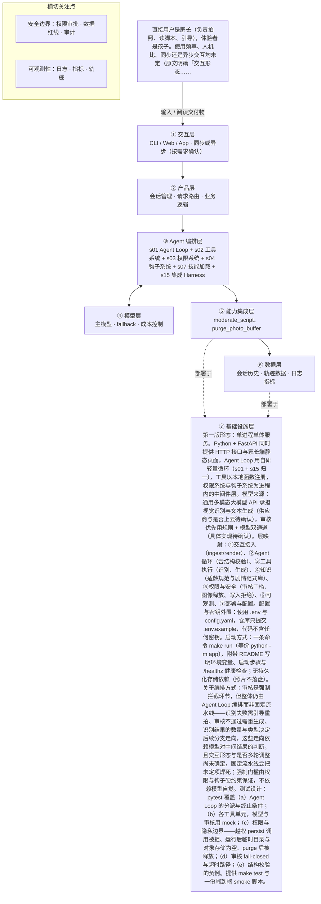

# PRD 推导方案 ——「玩具剧场」

> ⚠️ 本文件是引擎**真实运行产物**，未经人工修改：模型 deepseek-v4-flash，2026-10-27 生成，提示词指纹 `prompts:d311054f9612`。
> 输入为 [evals/forward/toy-theater/input.md](../../evals/forward/toy-theater/input.md)，7 次调用、输入 14903 / 输出 20195 tokens。
> 审稿没有完全通过是正常的：独立审稿本来就该把方案里的矛盾挑出来，这些意见就是你下一轮要回答的问题。

> 状态：方案待确认（审稿未完全通过，见文末审稿意见）（Step 1–4 已完成，Step 5 代码生成需确认后启动）
> 推导引擎：Agent Blueprint · 模型：anthropic

## 产品定位（一句话）

**玩具剧场**：给家长用：拍一张玩具合影，AI 识别玩具并生成亲子可共同演绎的互动剧情脚本，让旧玩具翻新、让家长读懂孩子并一起玩。

## ⚠️ 待确认清单（答不上就是风险点）

1. 产品的可量化成功标准是什么（例如脚本被真正演绎的比例、家长满意度、生成耗时上限）？
2. 孩子的年龄段如何划分（脚本难度与适龄分级依据什么年龄段），家长使用频率大概是多少？
3. 交互形态是什么：一次性生成后阅读、可多轮调整重生成，还是有语音或打印版演绎稿？
4. 一次完整交付的具体形态与流程细节能否确认（脚本长度、是否含道具清单、是否支持换一批玩具重来）？
5. 照片是否上云、用哪个视觉模型或识别服务、是否需要本地端识别，必须调用的外部系统和 API 有哪些？
6. 适龄内容规范和玩具剧情范式库的来源、更新方式与覆盖范围是什么（年龄段分级标准、题材禁区清单由谁定义）？
7. 除暴力恐怖成人危险模仿与照片不保存外，还有什么绝对不能做（玩具品牌与 IP 版权、儿童个人信息留存与删除策略、家长可查看的记录范围）？
8. 失败怎么办：识别不出玩具、生成内容审核不通过、生成超时或模型幻觉时的降级与重试策略是什么？
9. 孩子年龄段未确定，适龄语言难度与认知分级无法定档，直接影响系统提示与知识库检索。
10. 交互形态未定：是否支持重新生成、多轮调整脚本；若支持，需重新评估任务规划（s05）与超时策略。
11. 照片是否上云、是否引入第三方图像服务未定，直接决定隐私声明与授权流程。
12. PRD 未给出可量化成功标准，当前只能用脚本交付成功率、结构完整率、复用比例等替代指标，口径需产品确认。
13. 玩具品牌与 IP 版权边界未提及：脚本中能否出现品牌名、知名角色设定，需法务口径。
14. 儿童个人信息处理边界未提及：匿名会话 id 是否构成个人信息、日志留存期多长。
15. 审核工具自身的准确率与人工兜底机制未定义，fail-closed 下的家长体验需产品决策。
16. 结构校验失败后的重生成次数上限未定。
17. 端到端生成时延阈值未定，原文未给出耗时数据，无法判断是否需要后台任务（s11）。
18. 是否允许家长显式授权保存照片或脚本，以支撑二期的记忆与个性化。
19. 识别置信度的低置信阈值未定，无法确定「一次性列出低置信项」的触发条件。
20. 儿童适龄内容规范的条文来源、维护方与更新频率未定。

## Step 1 · 需求拆解（提取硬事实）

| 维度 | 结论 | 状态 | 出处 |
|---|---|---|---|
| 目标 | 把家长随手拍的玩具合影变成一份可亲子共同演绎的互动剧情脚本（角色分配、场景搭建、分幕、对话、家长引导话术），实现旧玩具翻新、亲子共玩、帮家长读懂孩子。可量化的成功标准输入未给出。 | 待确认 | 家长拍一张玩具合影，AI 识别照片里的玩具，生成一份可以亲子共同演绎的互动剧情脚本（角色分配、场景搭建、分幕、对话、家长引导话术），让旧玩具翻新，也帮家长读懂孩子、一起玩。 |
| 用户 | 直接用户是家长（负责拍照、读脚本、引导），体验者是孩子。使用频率、人机比、同步还是异步交互均未定（原文明确「交互形态……还没定」）。 | 明确 | 直接用户是家长（拍照、读脚本、引导），体验者是孩子。／交互形态……还没定。 |
| 核心闭环 | 家长拍一张玩具合影 → AI 识别照片中的玩具 → 生成一份含角色分配、场景搭建、分幕、对话、家长引导话术的剧情脚本 → 家长带着孩子按脚本演绎。闭环的交互形态（是否多轮调整、是否可重新生成）未定。 | 明确 | 家长拍一张玩具合影，AI 识别照片里的玩具，生成一份可以亲子共同演绎的互动剧情脚本 |
| 交付物 | 文档型交付物：一份互动剧情脚本，包含角色分配、场景搭建、分幕、对话、家长引导话术。 | 明确 | 生成一份可以亲子共同演绎的互动剧情脚本（角色分配、场景搭建、分幕、对话、家长引导话术） |
| 边界 | 绝不生成暴力、恐怖、成人、危险模仿内容；照片涉及隐私，默认不保存；生成内容必须过适龄审核。其余红线（如玩具品牌与 IP 版权、儿童个人信息处理边界）未提及。 | 明确 | 绝不生成暴力、恐怖、成人、危险模仿内容；照片涉及隐私，默认不保存。生成内容必须过适龄审核。 |
| 约束 | 需要「儿童适龄内容规范」和「玩具剧情范式库」两类领域知识作为生成约束；但孩子年龄段、交互形态、照片是否上云均未确定，因此时延、并发、成本、可用模型等工程约束待确认。 | 待确认 | 需要儿童适龄内容规范和玩具剧情范式库这样的领域知识库。／孩子年龄段、交互形态、照片是否上云还没定。 |

## Step 2 · 领域建模（映射 Harness 五要素）

| 要素 | 内容 |
|---|---|
| **工具** | 接收家长拍摄或上传的玩具合影图像输入。；玩具识别能力：从合影中识别出玩具的种类、数量与外观特征，作为角色分配依据。；儿童适龄内容审核工具：对生成的剧情脚本做暴力、恐怖、成人、危险模仿内容的审核拦截。；剧情脚本生成与呈现：输出含角色分配、场景搭建、分幕、对话、家长引导话术的文档给家长阅读。；照片处理链路是否上云、是否引入第三方图像服务未定，待确认。 |
| **知识** | 儿童适龄内容规范：界定暴力、恐怖、成人、危险模仿的边界，作为生成与审核的判定依据。；玩具剧情范式库：提供角色分配、场景搭建、分幕、对话、家长引导话术的结构范式。；孩子年龄段未确定，对应的语言难度与认知水平分级知识待确认。；玩具品类与属性词表，也就是哪些玩具可作角色、可搭什么场景，未给出，待确认。 |
| **观察** | 结构校验：脚本是否齐备角色分配、场景搭建、分幕、对话、家长引导话术五个模块。；审核结果：适龄审核的通过或拦截记录，拦截内容不得呈现给家长。；隐私校验：需能确认照片未被持久化保存，具体校验方式待确认。；家长是否实际带孩子演绎、演绎效果如何，均无定义，待确认。 |
| **行动** | 家长端拍照或从相册选择合影并提交，属于图像上传动作。；生成完成后把剧情脚本以文档形式呈现给家长阅读。；生成流程中调用适龄审核，审核不通过即阻断输出。；是否支持重新生成或多轮调整脚本未定，待确认。 |
| **权限** | 照片默认不保存：禁止写入任何持久存储，除非家长显式授权，默认拒绝。；生成脚本必须经适龄审核通过后才能展示给家长，未过审即拦截。；暴力、恐怖、成人、危险模仿内容一律硬性拒绝生成，无例外。；儿童个人信息处理边界与玩具品牌、IP 版权的授权规则未提及，待确认。 |

## Step 3 · 组件选型（宁可少选）

| 组件 | 选否 | 理由 | 参考 |
|---|---|---|---|
| s01 Agent Loop | ✅ 必选 | 一切基础：循环 + 工具（一切基础，恒选） | s01_agent_loop/README.md |
| s02 工具系统 | ✅ 必选 | 需要调用外部系统/API/数据源（一切基础，恒选） | s02_tool_use/README.md |
| s03 权限系统 | ✅ 必选 | 闭环必然触碰用户上传的玩具照片，且照片涉及儿童与家庭隐私，属敏感数据处理。 | s03_permission/README.md |
| s04 钩子系统 | ✅ 必选 | 原文要求「生成内容必须过适龄审核」，即需要对输出做拦截与合规把关。 | s04_hooks/README.md |
| s05 任务规划 | ❌ 放弃 | 单次交付是一份剧情脚本，识别后一次生成即可，原文没有要求先列计划、逐步推进或汇报进展。 | s05_todo_write/README.md |
| s06 子 Agent | ❌ 放弃 | 输入是单张合影加一次脚本生成，没有上下文爆炸或可并行探索型子任务的描述。 | s06_subagent/README.md |
| s07 技能加载 | ✅ 必选 | 原文明确需要「儿童适龄内容规范和玩具剧情范式库这样的领域知识库」。 | s07_skill_loading/README.md |
| s08 上下文压缩 | ❌ 放弃 | 一次交付就是识别一张合影并产出脚本，原文未提长会话、海量工具输出或日志量大的场景。 | s08_context_compact/README.md |
| s09 记忆系统 | ⏸ 二期 | 「未来希望记住孩子的年龄和偏好玩具做个性化」——原文标注为未来目标，第一版可不做。 | s09_memory/README.md |
| s10 任务系统 | ❌ 放弃 | 闭环是家长单次拍照到产出脚本的一次性任务，原文未提断点续跑或跨天长任务。 | s10_task_system/README.md |
| s11 后台任务 | ❌ 放弃 | 照片识别加脚本生成属秒级到分钟级的常规生成，原文未提耗时数分钟以上需后台执行的操作。 | s11_background_tasks/README.md |
| s12 定时调度 | ❌ 放弃 | 由家长主动拍照触发，原文未提任何定时或周期自动触发需求。 | s12_cron_scheduler/README.md |
| s13 Agent 团队 | ❌ 放弃 | 单家长单次拍照、单人可完成的闭环，原文未提多任务并行或多 Agent 团队。 | s13_agent_teams/README.md |
| s14 MCP 插件 | ❌ 放弃 | 只需视觉识别与文本生成能力，原文未提 MCP、第三方插件或外部工具生态接入。 | s14_mcp_plugin/README.md |
| s15 集成 Harness | ✅ 必选 | 第一版已选 3 个可选组件（s03, s04, s07），需归一到单一循环 | s15_integrated_harness/README.md |
| s16 工作流运行时 | ❌ 放弃 | 原文描述的是「拍照→识别→生成脚本」的产品体验流程，且脚本内容需模型临场创作，不是无需模型决策的固定阶段流水线。 | s16_workflow_runtime/README.md |
| s17 目标闭环 | ⏸ 二期 | 「未来也希望自动判断剧情算不算合格」——原文标注为未来需求，第一版可不做独立评估器。 | s17_goal_loop/README.md |

特征判定依据：

- `destructive_ops` = yes：闭环必然触碰用户上传的玩具照片，且照片涉及儿童与家庭隐私，属敏感数据处理。
- `audit_needed` = yes：原文要求「生成内容必须过适龄审核」，即需要对输出做拦截与合规把关。
- `multi_step` = no：单次交付是一份剧情脚本，识别后一次生成即可，原文没有要求先列计划、逐步推进或汇报进展。
- `context_heavy` = no：输入是单张合影加一次脚本生成，没有上下文爆炸或可并行探索型子任务的描述。
- `large_knowledge` = yes：原文明确需要「儿童适龄内容规范和玩具剧情范式库这样的领域知识库」。
- `long_sessions` = no：一次交付就是识别一张合影并产出脚本，原文未提长会话、海量工具输出或日志量大的场景。
- `cross_session_memory` = later：「未来希望记住孩子的年龄和偏好玩具做个性化」——原文标注为未来目标，第一版可不做。
- `persistent_goals` = no：闭环是家长单次拍照到产出脚本的一次性任务，原文未提断点续跑或跨天长任务。
- `slow_operations` = no：照片识别加脚本生成属秒级到分钟级的常规生成，原文未提耗时数分钟以上需后台执行的操作。
- `scheduled` = no：由家长主动拍照触发，原文未提任何定时或周期自动触发需求。
- `parallel_isolated` = no：单家长单次拍照、单人可完成的闭环，原文未提多任务并行或多 Agent 团队。
- `external_ecosystem` = no：只需视觉识别与文本生成能力，原文未提 MCP、第三方插件或外部工具生态接入。
- `fixed_orchestration` = no：原文描述的是「拍照→识别→生成脚本」的产品体验流程，且脚本内容需模型临场创作，不是无需模型决策的固定阶段流水线。
- `auto_completion` = later：「未来也希望自动判断剧情算不算合格」——原文标注为未来需求，第一版可不做独立评估器。

## Step 4 · 架构设计

### 分层架构图（7 层 + 数据流）



| 层 | 名称 | 回答的问题 | 落地锚点 |
|---|---|---|---|
| ① | 交互层 | 谁在用、怎么用？ | CLI / Web / App / API；同步或异步；人机比 |
| ② | 产品层 | 产品外壳是什么？ | 会话管理、请求路由、账户、业务逻辑 |
| ③ | Agent 编排层 | Harness 如何运转？ | loop、工具分发、hooks、权限、记忆、任务、技能、压缩、子 agent / 团队、目标闭环 |
| ④ | 模型层 | 智能从哪来？ | 主模型、辅助模型、路由、fallback、成本 |
| ⑤ | 能力集成层 | 如何触达外部世界？ | 内部工具、MCP server、知识库、第三方 API |
| ⑥ | 数据层 | 什么需要持久化？ | 记忆、任务、会话历史、轨迹数据、日志指标 |
| ⑦ | 基础设施层 | 如何部署运行？ | 单进程 / 服务 / 团队、沙箱、队列、调度、监控 |

### 工具清单

| 工具 | 输入 | 输出 | 副作用 | 权限 | 归属层 |
|---|---|---|---|---|---|
| `ingest_toy_photo` | 家长端提交的单张玩具合影（拍摄或相册选择），含图像字节与 MIME 类型。 | 会话内的图像内存句柄（handle_id）与图像元信息（尺寸、格式），不返回可持久化的路径。 | 图像仅驻留进程内存缓冲区；不写入磁盘、对象存储或第三方图床；会话结束或 purge_photo_buffer 调用后释放。 | ask | ① |
| `recognize_toys` | 图像内存句柄 handle_id。 | 玩具清单：每项的类别、数量、外观特征（颜色、材质、显著部件）与识别置信度。 | 无持久化写入；是否调用云端视觉服务待确认，若上云需在调用前完成家长授权校验。 | allow | ③ |
| `load_story_knowledge` | 知识库标识（适龄内容规范 / 玩具剧情范式库）与检索关键词（玩具类别、场景类型）。 | 命中的规范条文与剧情结构范式片段（角色分配、场景搭建、分幕、对话、家长引导话术范式）。 | 只读，无写入；加载失败时返回明确的不可用错误码，不返回空结果冒充成功。 | allow | ④ |
| `generate_story_script` | 识别出的玩具清单、知识片段、孩子年龄段（若家长提供；未提供则标注未提供）。 | 结构化脚本草稿：角色分配、场景搭建、分幕、对话、家长引导话术五模块的 JSON。 | 无持久化写入；草稿仅在会话上下文内传递，不直接呈现给家长。 | allow | ③ |
| `validate_script_structure` | 结构化脚本草稿。 | 结构校验结果：五模块是否齐备、字段是否为空、角色是否全部来自识别清单。 | 只读校验，不修改草稿；校验不通过时返回缺失项列表供重生成。 | allow | ② |
| `moderate_script` | 结构化脚本草稿全文。 | 审核结论（pass / block）、命中类别（暴力、恐怖、成人、危险模仿）、结论码。 | 只读审核；审核结论作为呈现的硬门槛，调用失败或超时一律按未通过处理。 | allow | ⑤ |
| `render_script_document` | 通过结构校验且审核结论为 pass 的脚本，以及审核结论码。 | 面向家长的文档型呈现（分模块可读文本）。 | 仅渲染到本次会话的响应中；不缓存、不落盘、不进入日志正文。 | allow | ① |
| `purge_photo_buffer` | 图像内存句柄 handle_id。 | 释放确认（released / not_found）。 | 销毁内存中的图像缓冲区；在呈现完成、失败或超时后都必须调用。 | allow | ⑤ |

### 系统提示词草案

```
你是「玩具剧场」的剧情脚本生成 Agent。身份：面向家长的亲子共玩助手，直接使用者是家长，最终体验者是孩子。
规则：
1. 角色只能取自 recognize_toys 返回的玩具清单，不得虚构未识别到的玩具、数量或外观特征。
2. 脚本必须齐备五个模块：角色分配、场景搭建、分幕、对话、家长引导话术；给孩子的台词要短、具体、能照着演。
3. 质量底线：绝不出现暴力、恐怖、成人、危险模仿内容，不确定时选更保守的表达；脚本必须经 moderate_script 返回 pass 才能呈现，拿不到 pass 一律不输出。
4. 照片只用于本次识别，不保存、不复述照片细节。
5. 识别置信度低的玩具，在脚本末尾一次性列出供家长自行替换，不追问、不做多轮确认。
6. 工具失败或超时，如实告知家长并给出重拍或重试建议，不得用编造内容补位。
工具：ingest_toy_photo 收合影；recognize_toys 识别玩具；load_story_knowledge 读规范与范式；validate_script_structure 校验五模块；moderate_script 适龄审核；render_script_document 呈现；purge_photo_buffer 释放图像。
知识目录：①儿童适龄内容规范；②玩具剧情范式库。
```

### 上下文与记忆策略

会话内为单任务一次性上下文，只保留当前一轮的：图像内存句柄（不保留图像副本）、recognize_toys 的玩具清单、load_story_knowledge 命中的知识片段、脚本草稿、结构校验结果、审核结论码。上下文不跨请求累积：一次合影对应一次上下文，下一次拍照重建。超时或失败后立即调用 purge_photo_buffer 并清空上下文。脚本正文与图像不写入任何外部日志，日志只留结论码与耗时的元数据。跨会话第一版不持久化任何内容：不存照片、不存脚本、不存孩子年龄与偏好（记忆系统为二期，s09），因此每次生成都按「未提供年龄段」处理。

### 安全边界与降级策略

- 适龄审核 moderate_script 调用失败、超时或返回不可解析结论 → fail-closed：不呈现任何脚本，返回「审核未完成，请稍后重试」，禁止先给家长看再补审；重试次数上限待确认。
- 摄影识别 recognize_toys 失败或超时 → 不臆造玩具清单，不进入生成阶段，提示家长重拍或补一张更清晰的合影。
- 模型幻觉（虚构玩具、角色对不上识别清单）→ validate_script_structure 强制校验角色是否全部来自识别清单，不符即回退重生成；重生成仍失败则输出结构化失败提示，不下发脚本。
- 模型幻觉（内容违规）→ 以 moderate_script 结论为准，命中暴力/恐怖/成人/危险模仿即硬拒绝，不提供「改写后再看」的绕行路径。
- 端到端生成超时 → 返回明确超时提示，可附上已完成的识别结果供家长判断，不返回半成品脚本；超时阈值待确认（受孩子年龄段与交互形态未定影响）。
- 越权写盘（照片或脚本被持久化）→ 权限系统对所有持久化写入 hard-deny，即使模型发起 persist 类调用也一律拒绝；日志只记元数据，不记图像与脚本正文，越权尝试记审计事件。
- 知识库 load_story_knowledge 不可用 → 中止生成，不降级为「无规范裸生成」，因为适龄规范是内容底线的判定依据。
- 家长未确认照片处理声明 → ingest_toy_photo 返回 ask 挂起，不进入识别；拒绝则整条链路不启动。

### 可观测性

- 日志：请求日志：request_id、匿名会话 id、各阶段耗时、最终是否呈现（不含图像数据与脚本正文）。；工具调用日志：工具名、入参摘要（图像只记 handle_id 与尺寸，不记内容）、返回码、耗时。；审核日志：审核结论、命中类别、结论码；被拦截正文只记哈希，不记全文。；权限与越权日志：被拒绝的持久化写入尝试、授权缺失导致的挂起与拒绝。；降级日志：失败与降级原因码（识别失败 / 审核不可用 / 结构校验失败 / 超时），用于统计降级分布。
- 指标：脚本交付成功率：通过审核并呈现给家长的次数 / 收到合影的次数（对齐 PRD 目标的核心替代指标）。；结构完整率：五模块齐备且角色全部来自识别清单的脚本占比。；审核拦截率与拦截类别分布：衡量内容红线命中情况，同时作为适龄规范的调优输入。；首次呈现后未复用比例：家长看完未点「再拍一张」也未导出的占比，作为「脚本可用率」的代理指标（依赖前端埋点，事件口径待确认）。；隐私违规计数：持久化写入被拒次数，目标恒为 0；端到端时延 P50 / P95 作为辅助观测。
- 轨迹：按 request_id 记录「收图 → 识别 → 知识加载 → 生成 → 结构校验 → 审核 → 呈现 → 图像释放」的完整步骤序列，每步存工具入参摘要、结论码与耗时，图像只存 handle_id、脚本只存哈希，可回放失败与降级路径。

### 技术栈与部署形态

第一版形态：单进程单体服务。Python + FastAPI 同时提供 HTTP 接口与家长端静态页面，Agent Loop 用自研轻量循环（s01 + s15 归一），工具以本地函数注册，权限系统与钩子系统为进程内的中间件层。模型来源：通用多模态大模型 API 承担视觉识别与文本生成（供应商与是否上云待确认），审核优先用规则 + 模型双通道（具体实现待确认）。层映射：①交互接入（ingest/render）、②Agent 循环（含结构校验）、③工具执行（识别、生成）、④知识（适龄规范与剧情范式库）、⑤权限与安全（审核门槛、图像释放、写入拒绝）、⑥可观测、⑦部署与配置。配置与密钥外置：使用 .env 与 config.yaml，仓库只提交 .env.example，代码不含任何密钥。启动方式：一条命令 make run（等价 python -m app），附带 README 写明环境变量、启动步骤与 /healthz 健康检查；无持久化存储依赖（照片不落盘）。关于编排方式：审核是强制拦截环节，但整体仍由 Agent Loop 编排而非固定流水线——识别失败需引导重拍、审核不通过需重生成、识别结果的数量与类型决定后续分支走向，这些走向依赖模型对中间结果的判断，且交互形态与是否多轮调整尚未确定，固定流水线会把未定项焊死；强制门槛由权限与钩子硬约束保证，不依赖模型自觉。测试设计：pytest 覆盖（a）Agent Loop 的分派与终止条件；（b）各工具单元，模型与审核用 mock；（c）权限与隐私边界——越权 persist 调用被拒、运行后临时目录与对象存储为空、purge 后被释放；（d）审核 fail-closed 与超时路径；（e）结构校验的负例。提供 make test 与一份端到端 smoke 脚本。

## 验收标准对照（可落地 vs demo）

| 标准 | 要求 | 本方案的对应设计 |
|---|---|---|
| 可运行 | 一条命令能起，配置与密钥外置（.env / config） | 第一版形态：单进程单体服务。Python + FastAPI 同时提供 HTTP 接口与家长端静态页面，Agent Loop 用自研轻量循环（s01 + s15 归一），工具以本地函数注册，权限系统与钩子系统为进程内的中间件层。模型来源：通用多模态大模型 API 承担视觉识别与文本生成（供应商与是否上云待确认），审核优先用规则 + 模型双通道（具体实现待确认）。层映射：①交互接入（ingest/render）、②Agent 循环（含结构校验）、③工具执行（识别、生成）、④知识（适龄规范与剧情范式库）、⑤权限与安全（审核门槛、图像释放、写入拒绝）、⑥可观测、⑦部署与配置。配置与密钥外置：使用 .env 与 config.yaml，仓库只提交 .env.example，代码不含任何密钥。启动方式：一条命令 make run（等价 python -m app），附带 README 写明环境变量、启动步骤与 /healthz 健康检查；无持久化存储依赖（照片不落盘）。关于编排方式：审核是强制拦截环节，但整体仍由 Agent Loop 编排而非固定流水线——识别失败需引导重拍、审核不通过需重生成、识别结果的数量与类型决定后续分支走向，这些走向依赖模型对中间结果的判断，且交互形态与是否多轮调整尚未确定，固定流水线会把未定项焊死；强制门槛由权限与钩子硬约束保证，不依赖模型自觉。测试设计：pytest 覆盖（a）Agent Loop 的分派与终止条件；（b）各工具单元，模型与审核用 mock；（c）权限与隐私边界——越权 persist 调用被拒、运行后临时目录与对象存储为空、purge 后被释放；（d）审核 fail-closed 与超时路径；（e）结构校验的负例。提供 make test 与一份端到端 smoke 脚本。 |
| 可容错 | 工具失败、模型幻觉、超时、越权都有明确降级路径 | 适龄审核 moderate_script 调用失败、超时或返回不可解析结论 → fail-closed：不呈现任何脚本，返回「审核未完成，请稍后重试」，禁止先给家长看再补审；重试次数上限待确认。；摄影识别 recognize_toys 失败或超时 → 不臆造玩具清单，不进入生成阶段，提示家长重拍或补一张更清晰的合影。；模型幻觉（虚构玩具、角色对不上识别清单）→ validate_script_structure 强制校验角色是否全部来自识别清单，不符即回退重生成；重生成仍失败则输出结构化失败提示，不下发脚本。 |
| 可观测 | 有日志、有指标、有轨迹数据 | 请求日志：request_id、匿名会话 id、各阶段耗时、最终是否呈现（不含图像数据与脚本正文）。；工具调用日志：工具名、入参摘要（图像只记 handle_id 与尺寸，不记内容）、返回码、耗时。；脚本交付成功率：通过审核并呈现给家长的次数 / 收到合影的次数（对齐 PRD 目标的核心替代指标）。；结构完整率：五模块齐备且角色全部来自识别清单的脚本占比。 |
| 可测试 | 核心循环与工具分派有单测，权限与安全有边界测试 | Step 5 骨架层需附核心循环与权限边界的单测 |
| 可部署 | 有明确的部署形态（单进程 / 服务 / 团队）与启动文档 | 第一版形态：单进程单体服务。Python + FastAPI 同时提供 HTTP 接口与家长端静态页面，Agent Loop 用自研轻量循环（s01 + s15 归一），工具以本地函数注册，权限系统与钩子系统为进程内的中间件层。模型来源：通用多模态大模型 API 承担视觉识别与文本生成（供应商与是否上云待确认），审核优先用规则 + 模型双通道（具体实现待确认）。层映射：①交互接入（ingest/render）、②Agent 循环（含结构校验）、③工具执行（识别、生成）、④知识（适龄规范与剧情范式库）、⑤权限与安全（审核门槛、图像释放、写入拒绝）、⑥可观测、⑦部署与配置。配置与密钥外置：使用 .env 与 config.yaml，仓库只提交 .env.example，代码不含任何密钥。启动方式：一条命令 make run（等价 python -m app），附带 README 写明环境变量、启动步骤与 /healthz 健康检查；无持久化存储依赖（照片不落盘）。关于编排方式：审核是强制拦截环节，但整体仍由 Agent Loop 编排而非固定流水线——识别失败需引导重拍、审核不通过需重生成、识别结果的数量与类型决定后续分支走向，这些走向依赖模型对中间结果的判断，且交互形态与是否多轮调整尚未确定，固定流水线会把未定项焊死；强制门槛由权限与钩子硬约束保证，不依赖模型自觉。测试设计：pytest 覆盖（a）Agent Loop 的分派与终止条件；（b）各工具单元，模型与审核用 mock；（c）权限与隐私边界——越权 persist 调用被拒、运行后临时目录与对象存储为空、purge 后被释放；（d）审核 fail-closed 与超时路径；（e）结构校验的负例。提供 make test 与一份端到端 smoke 脚本。 |
| 可度量 | 有对齐 PRD 的成功指标，并能采集 | 脚本交付成功率：通过审核并呈现给家长的次数 / 收到合影的次数（对齐 PRD 目标的核心替代指标）。；结构完整率：五模块齐备且角色全部来自识别清单的脚本占比。；审核拦截率与拦截类别分布：衡量内容红线命中情况，同时作为适龄规范的调优输入。；首次呈现后未复用比例：家长看完未点「再拍一张」也未导出的占比，作为「脚本可用率」的代理指标（依赖前端埋点，事件口径待确认）。；隐私违规计数：持久化写入被拒次数，目标恒为 0；端到端时延 P50 / P95 作为辅助观测。 |

## 独立审稿意见

- 结论：❌ 未通过（76 / 100），设计稿共 2 版
- 总评：整体完成度较高，六条验收标准基本都有对应设计：一条命令启动、.env 外置、四类安全降级、日志/指标/轨迹、单测与边界测试、单进程部署形态，事实条目也大多带出处并标注待确认。主要问题是 s11 放弃理由编造了原文没有的耗时量级，且与本方案 open_questions 自相矛盾；另有个别选型特征标签与证据不匹配、五要素与工具清单未一一对应、以及在交互形态未定时提前把未定项固定下来。建议至少修正 s11 的结论后，再重新评审。
- [high] components.s11 后台任务：放弃理由写「照片识别加脚本生成属秒级到分钟级的常规生成」，但原始输入完全没有给出任何耗时或性能数据，这属于凭空补足的事实；同一份方案在 open_questions 中又写明「端到端生成时延阈值未定，原文未给出耗时数据，无法判断是否需要后台任务（s11）」，前后自相矛盾。正确做法是把 s11 标为「待确认」，或改为二期再评估。
- [medium] design.system_prompt：规则 5 写「识别置信度低的玩具，在脚本末尾一次性列出供家长自行替换，不追问、不做多轮确认」，但在交互形态和是否支持多轮都「还没定」的前提下，这等于提前固定了「不做多轮确认」这一未定项；方案在 tech_stack_and_deployment 中恰好以「固定流水线会把未定项焊死」为由拒绝工作流运行时，两处立场不一致。
- [medium] components.s03 权限系统：选型证据 feature 填的是 destructive_ops，但方案通篇没有描述任何破坏性操作（照片不落盘、无删除、无外发写入），真正的依据是「敏感图像与儿童隐私，需要 hard-deny 持久化写入」。特征标签与实际证据不匹配，属于选型理由与特征证据不一致。
- [medium] elements.tools / design.tool_list：五要素中的 tools 只列了 4 条实际能力，另加 1 条「照片处理链路是否上云……待确认」，把待确认项混进了工具清单；同时 design.tool_list 中的 purge_photo_buffer、validate_script_structure、render_script_document 在五要素 tools 中没有一一对应的条目（purge 只能勉强挂到 permissions，render 也是）。五要素与工具清单没有做到逐一对应。
- [low] facts.users：value 中出现「人机比」这一原始输入完全未提及的概念，虽然后面标了「未定」，但把未提及的概念写成「未定项」，仍属于超出输入边界的表述，应改为「原文未提及」。
- [low] facts.goal：目标本身在原文中有明确出处，真正缺的只是可量化成功标准，把它整体标为「待确认」会掩盖「目标已明确、指标待定」的区别，建议拆成目标（明确）和成功指标（待确认）两条。
- [low] design.tech_stack_and_deployment：「Python + FastAPI + 单进程单体服务 + 自研轻量循环」这一组选型的理由只写了「第一版形态」，没有对应到输入中的任何特征证据（如团队规模、并发、是否上云均未定），属于工程偏好而非由证据驱动；不过它已被部分交代为待确认，故仅作低级别提示。
- [low] design.observability.metrics：「首次呈现后未复用比例」作为脚本可用率代理指标依赖前端埋点，埋点事件口径标了待确认，但目前没有任何采集方案或降级方案（若无埋点，该指标就不可度量），与「可度量」验收标准的自洽性不足。

## 本次推导消耗

- 模型调用 7 次，输入 14903 tokens，输出 20195 tokens

## 下一步

回答上面的待确认清单，据此修订方案后，再进入 Step 5 代码生成（骨架 → 硬化 → 产品化）。
