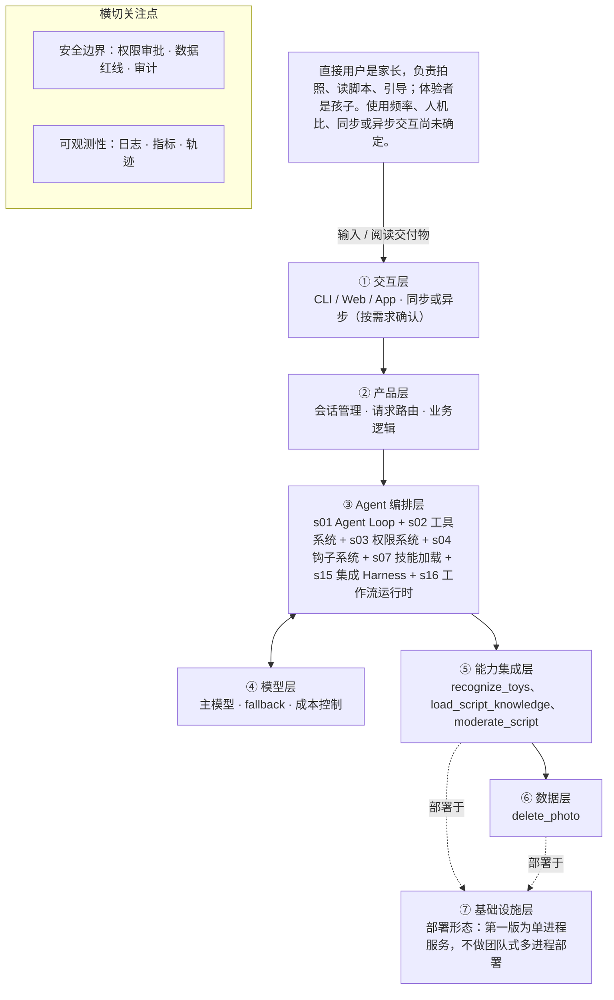

# PRD 推导方案 ——「玩具剧场」

> ⚠️ 本文件是引擎**真实运行产物**，未经人工修改：模型 deepseek-v4-flash，2026-10-31 生成，提示词指纹 `prompts:83651e27e7d5`。
> 输入为 [evals/forward/toy-theater/input.md](../../evals/forward/toy-theater/input.md)，6 次调用、输入 12668 / 输出 20054 tokens。
> 审稿没有完全通过是正常的：独立审稿本来就该把方案里的矛盾挑出来，这些意见就是你下一轮要回答的问题。

> 状态：方案待确认（审稿未完全通过，见文末审稿意见）（Step 1–4 已完成，Step 5 代码生成需确认后启动）
> 推导引擎：Agent Blueprint · 模型：deepseek-v4-flash

## 产品定位（一句话）

**玩具剧场**：给家长用：拍一张玩具合影，就能得到一份适龄、可亲子共同演绎的互动剧情脚本，让旧玩具翻新，也让家长有办法陪孩子一起玩。

## ⚠️ 待确认清单（答不上就是风险点）

**需求问题**：请提出想法的人回答，这几条最要紧。

1. 这个产品要做成什么算成功？请给出一句话的产品目标与可量化的成功标准（例如脚本可用率、家长满意度、单次生成耗时）。
2. 家长使用这个产品的频率如何（每天、每周还是偶尔一次）？交互是同步出结果还是异步等待？一次是一人用还是多人协作？
3. 孩子年龄段是多少？脚本的难度、篇幅、语言复杂度需要按哪个年龄段来适配？
4. 一次完整交付长什么样：从拍照到家长拿着脚本开演，中间是否需要家长确认或修改玩具识别结果？
5. 需要哪些外部动作与外部依赖：玩具识别用哪家视觉能力或模型、有没有调用次数与成本上限、照片是否上云以及保存多久？
6. 儿童适龄内容规范由谁提供、以什么形式提供（文档、规则表还是审核服务）？玩具剧情范式库的来源与更新方式是什么？
7. 绝对不能做的事还有哪些（例如是否允许出现竞争、惩罚、消费引导等情节）？除照片之外是否还涉及其他个人数据？
8. 失败时怎么处理：照片里识别不出玩具、识别结果错、生成内容未通过审核、模型超时的降级与兜底策略分别是什么？
9. 未来个性化记忆要记住哪些字段（孩子年龄、偏好玩具、已演过的剧本），保存多久，家长能否查看与删除？

**方案推导时留下的问题**：多是上面问题的细化，也有写给开发者的备注。先答上面的，这里能答的再补。

10. 测试方案待确认：验收用例清单、是否接入真实模型做回归、覆盖率门槛、由谁验收「可测试」这一条。
11. 配置与凭据管理待确认：密钥用本地 .env 还是密钥管理服务、轮换策略与最小权限范围、三个外部服务的账号归属。
12. 端到端生成耗时目标未定：生成加适龄审核属于多次模型调用的长链路，当前按单进程同步返回设计，若耗时超预期则需重新评估被放弃的 s11 后台任务。
13. 产品成功指标口径待确认：「家长完成一次亲子演绎」「脚本被采纳」「满意度」由什么方式采集（自报、点击还是回访），以及达标阈值。
14. 照片是否上云未定：决定视觉识别与生成走私有部署还是云 API，涉及外部传输审批与计费。
15. 知识资产边界未定：需求事实只点名《儿童适龄内容规范》与《玩具剧情范式库》，五要素中另列的「玩具识别外观特征与类别知识」「边界规则清单」是否需要独立维护、由谁维护，待确认。
16. 脚本本身是否留存供家长回看（与照片不保存策略不同）未确认，影响⑥数据层是否需要引入持久化。
17. 孩子年龄段由家长手填还是由模型根据照片推断，未确认。
18. 需求事实本身的字段状态需拆分：users 标为「明确」但混入了使用频率、人机比、同步或异步交互等未确定项，constraints 标为「待确认」但多数是原文明确结论，建议在需求事实中拆成独立条目后重新定状态。

## Step 1 · 需求拆解（提取硬事实）

| 维度 | 结论 | 状态 | 出处 |
|---|---|---|---|
| 目标 | 识别家长拍摄的玩具合影，生成一份可以亲子共同演绎的互动剧情脚本，让旧玩具翻新，并帮家长读懂孩子、一起玩。 | 明确 | AI 识别照片里的玩具，生成一份可以亲子共同演绎的互动剧情脚本……让旧玩具翻新，也帮家长读懂孩子、一起玩。 |
| 用户 | 直接用户是家长，负责拍照、读脚本、引导；体验者是孩子。使用频率、人机比、同步或异步交互尚未确定。 | 明确 | 直接用户是家长（拍照、读脚本、引导），体验者是孩子。 |
| 核心闭环 | 家长拍一张玩具合影 → AI 识别照片中的玩具 → 生成互动剧情脚本（角色分配、场景搭建、分幕、对话、家长引导话术）→ 家长按脚本引导孩子共同演绎。 | 明确 | 家长拍一张玩具合影，AI 识别照片里的玩具，生成一份可以亲子共同演绎的互动剧情脚本（角色分配、场景搭建、分幕、对话、家长引导话术） |
| 交付物 | 一份文本形态的互动剧情脚本，包含角色分配、场景搭建、分幕、对话、家长引导话术。 | 明确 | 生成一份可以亲子共同演绎的互动剧情脚本（角色分配、场景搭建、分幕、对话、家长引导话术） |
| 边界 | 绝不生成暴力、恐怖、成人、危险模仿内容；照片涉及隐私，默认不保存；生成内容必须通过适龄审核。 | 明确 | 绝不生成暴力、恐怖、成人、危险模仿内容；照片涉及隐私，默认不保存。生成内容必须过适龄审核。 |
| 约束 | 已明确：生成内容必须通过适龄审核；依赖「儿童适龄内容规范」与「玩具剧情范式库」两类领域知识。待确认：时延、并发、成本、可用模型、照片是否上云及保存策略。 | 待确认 | 需要儿童适龄内容规范和玩具剧情范式库这样的领域知识库。……孩子年龄段、交互形态、照片是否上云还没定。 |

## Step 2 · 领域建模（映射 Harness 五要素）

| 要素 | 内容 |
|---|---|
| **工具** | 调用视觉识别能力，输入家长拍摄的玩具合影，输出照片中被识别出的玩具清单与各自外观特征。；调用文本大模型，输入玩具清单与家长、孩子相关上下文，输出互动剧情脚本全文。；调用儿童适龄内容审核能力，对生成脚本做逐段审核并返回通过或拦截结果。；按「默认不保存」策略在生成结束后触发照片删除动作，不进行持久化存储。 |
| **知识** | 儿童适龄内容规范：用于约束脚本的题材、语言与情节尺度，判定内容是否适龄。；玩具剧情范式库：提供角色分配、场景搭建、分幕、对话、家长引导话术的脚本结构范式。；玩具识别所需的外观特征与玩具类别知识，用于把照片中的物体转成可命名、可分配角色的玩具。；边界规则清单：绝不生成暴力、恐怖、成人、危险模仿内容。 |
| **观察** | 核对识别结果与照片中实际出现的玩具是否一一对应，确认没有漏识或错识。；按脚本必备结构逐项检查产物是否包含角色分配、场景搭建、分幕、对话、家长引导话术五个部分。；记录适龄审核的返回结果，保留通过或拦截的判定用于确认内容合规。；确认照片在脚本生成后被删除、未落盘保存，以此验证隐私策略生效。 |
| **行动** | 家长拍照上传照片的动作在家长侧界面完成，照片作为脚本生成的唯一输入。；脚本以文本形态交付给家长阅读，由家长照着念和引导孩子演绎。；脚本生成任务由后台服务编排，串联识别、生成、审核三个步骤后返回最终文本。；审核不通过时，将拦截结果回传至家长侧并给出可重试或调整的提示。 |
| **权限** | 照片涉及隐私，默认不保存；任何持久化存储照片的动作都需要单独审批。；脚本输出前必须通过适龄审核，未通过审核的内容默认拒绝下发。；暴力、恐怖、成人、危险模仿内容一律默认拒绝生成与输出。；待确认：照片是否上云、可用模型与并发成本尚未确定，涉及外部传输与计费的动作暂按需审批处理。 |

## Step 3 · 组件选型（宁可少选）

| 组件 | 选否 | 理由 | 参考 |
|---|---|---|---|
| s01 Agent Loop | ✅ 必选 | 一切基础：循环 + 工具（一切基础，恒选） | s01_agent_loop/README.md |
| s02 工具系统 | ✅ 必选 | 需要调用外部系统/API/数据源（一切基础，恒选） | s02_tool_use/README.md |
| s03 权限系统 | ✅ 必选 | 处理家长拍摄的家庭与玩具照片，属于用户隐私数据，原文写明「照片涉及隐私，默认不保存」。 | s03_permission/README.md |
| s04 钩子系统 | ✅ 必选 | 原文要求「生成内容必须过适龄审核」，也就是需要对内容做合规拦截与校验。 | s04_hooks/README.md |
| s05 任务规划 | ❌ 放弃 | 单次交付是一个固定序列：拍照、识别、生成脚本，不需要先列计划、逐步推进并汇报进展。 | s05_todo_write/README.md |
| s06 子 Agent | ❌ 放弃 | 闭环是处理一张照片并产出单份脚本，没有会出现上下文爆炸的子任务，也没有可并行的探索型子任务。 | s06_subagent/README.md |
| s07 技能加载 | ✅ 必选 | 原文明确「需要儿童适龄内容规范和玩具剧情范式库这样的领域知识库」。 | s07_skill_loading/README.md |
| s08 上下文压缩 | ❌ 放弃 | 产品形态是拍一次照、出一份脚本的单次交付，原文未提及长会话或大体积工具输出。 | s08_context_compact/README.md |
| s09 记忆系统 | ⏸ 二期 | 原文「未来希望记住孩子的年龄和偏好玩具做个性化」，属于后续能力。 | s09_memory/README.md |
| s10 任务系统 | ❌ 放弃 | 单次同步闭环，拍完照就出脚本，无需目标持久化与断点续跑。 | s10_task_system/README.md |
| s11 后台任务 | ❌ 放弃 | 闭环为拍照后即时生成一份剧情脚本，原文未提及分钟级以上的慢操作。 | s11_background_tasks/README.md |
| s12 定时调度 | ❌ 放弃 | 由家长主动拍照触发，原文未提及任何定时自动触发需求。 | s12_cron_scheduler/README.md |
| s13 Agent 团队 | ❌ 放弃 | 面向单个家长、单次一张照片、单份脚本，不涉及多任务并行与隔离工作区。 | s13_agent_teams/README.md |
| s14 MCP 插件 | ❌ 放弃 | 闭环只包含照片识别与脚本生成，原文未提及 MCP、第三方插件等外部工具生态。 | s14_mcp_plugin/README.md |
| s15 集成 Harness | ✅ 必选 | 第一版已选 4 个可选组件（s03, s04, s07, s16），需归一到单一循环 | s15_integrated_harness/README.md |
| s16 工作流运行时 | ✅ 必选 | 原文把流程写成固定阶段序列「拍一张玩具合影 → AI 识别照片里的玩具 → 生成互动剧情脚本」，各阶段无需模型临场决定流程走向。 | s16_workflow_runtime/README.md |
| s17 目标闭环 | ⏸ 二期 | 原文「未来也希望自动判断剧情算不算合格」，属于后续能力。 | s17_goal_loop/README.md |

特征判定依据：

- `destructive_ops` = yes：处理家长拍摄的家庭与玩具照片，属于用户隐私数据，原文写明「照片涉及隐私，默认不保存」。
- `audit_needed` = yes：原文要求「生成内容必须过适龄审核」，也就是需要对内容做合规拦截与校验。
- `multi_step` = no：单次交付是一个固定序列：拍照、识别、生成脚本，不需要先列计划、逐步推进并汇报进展。
- `context_heavy` = no：闭环是处理一张照片并产出单份脚本，没有会出现上下文爆炸的子任务，也没有可并行的探索型子任务。
- `large_knowledge` = yes：原文明确「需要儿童适龄内容规范和玩具剧情范式库这样的领域知识库」。
- `long_sessions` = no：产品形态是拍一次照、出一份脚本的单次交付，原文未提及长会话或大体积工具输出。
- `cross_session_memory` = later：原文「未来希望记住孩子的年龄和偏好玩具做个性化」，属于后续能力。
- `persistent_goals` = no：单次同步闭环，拍完照就出脚本，无需目标持久化与断点续跑。
- `slow_operations` = no：闭环为拍照后即时生成一份剧情脚本，原文未提及分钟级以上的慢操作。
- `scheduled` = no：由家长主动拍照触发，原文未提及任何定时自动触发需求。
- `parallel_isolated` = no：面向单个家长、单次一张照片、单份脚本，不涉及多任务并行与隔离工作区。
- `external_ecosystem` = no：闭环只包含照片识别与脚本生成，原文未提及 MCP、第三方插件等外部工具生态。
- `fixed_orchestration` = yes：原文把流程写成固定阶段序列「拍一张玩具合影 → AI 识别照片里的玩具 → 生成互动剧情脚本」，各阶段无需模型临场决定流程走向。
- `auto_completion` = later：原文「未来也希望自动判断剧情算不算合格」，属于后续能力。

## Step 4 · 架构设计

### 分层架构图（7 层 + 数据流）



| 层 | 名称 | 回答的问题 | 落地锚点 |
|---|---|---|---|
| ① | 交互层 | 谁在用、怎么用？ | CLI / Web / App / API；同步或异步；人机比 |
| ② | 产品层 | 产品外壳是什么？ | 会话管理、请求路由、账户、业务逻辑 |
| ③ | Agent 编排层 | Harness 如何运转？ | loop、工具分发、hooks、权限、记忆、任务、技能、压缩、子 agent / 团队、目标闭环 |
| ④ | 模型层 | 智能从哪来？ | 主模型、辅助模型、路由、fallback、成本 |
| ⑤ | 能力集成层 | 如何触达外部世界？ | 内部工具、MCP server、知识库、第三方 API |
| ⑥ | 数据层 | 什么需要持久化？ | 记忆、任务、会话历史、轨迹数据、日志指标 |
| ⑦ | 基础设施层 | 如何部署运行？ | 单进程 / 服务 / 团队、沙箱、队列、调度、监控 |

### 工具清单

| 工具 | 输入 | 输出 | 副作用 | 权限 | 归属层 |
|---|---|---|---|---|---|
| `recognize_toys` | 家长上传的一张玩具合影（仅在内存/临时缓冲中传递，不落盘） | 识别出的玩具清单：每个玩具的名称与外观特征；若无法确定则返回「未识别成功」标记 | 照片只在请求生命周期内存在于内存与临时缓冲，识别结束即丢弃；不写入任何持久化存储 | allow | ⑤能力集成层 |
| `ask_parent_to_confirm_toys` | 识别出的玩具清单 | 家长确认或修正后的玩具清单（作为后续生成的唯一角色来源） | 在①交互层阻塞等待家长操作；超时未确认则不进入生成 | allow | ①交互层 |
| `load_script_knowledge` | 当前请求所需的知识主题（脚本结构范式、适龄尺度） | 《玩具剧情范式库》中角色分配、场景搭建、分幕、对话、家长引导话术的结构范式；《儿童适龄内容规范》中的题材与语言尺度条款 | 只读加载，不写入知识库，不改动任何数据 | allow | ⑤能力集成层 |
| `generate_script` | 家长确认后的玩具清单、家长已提供的孩子年龄段等信息、加载到的范式与适龄规范 | 包含角色分配、场景搭建、分幕、对话、家长引导话术五部分的互动剧情脚本文本 | 仅返回文本，不持久化脚本；不得在输出中出现照片画面细节 | allow | ④模型层 |
| `moderate_script` | 生成的脚本全文 | 逐段审核结果：通过 / 拦截，以及被拦截的段落定位与原因类别 | 无写入；审核结论作为交付的前置凭证，未取得凭证的脚本一律不得下发 | allow | ⑤能力集成层 |
| `deliver_script` | 已通过适龄审核的脚本全文与审核凭证 | 在家长侧界面渲染的可阅读文本，供家长照着念与引导 | 无审核凭证或凭证不匹配时拒绝渲染；不缓存未过审内容 | allow | ①交互层 |
| `delete_photo` | 本次请求关联的照片临时缓冲句柄 | 删除结果（成功 / 失败及失败原因） | 不可逆地清空内存与临时缓冲中的照片副本；删除属于隐私默认策略的执行动作，不是持久化写入，因此不需要审批；在成功、失败、超时、异常所有分支中都必须执行 | allow | ⑥数据层 |

### 系统提示词草案

```
你是「玩具剧场」的剧情脚本助手，服务对象是家长，体验者是孩子。
身份与任务：根据家长拍摄的玩具合影（经识别并由家长确认的玩具清单），生成一份可以亲子共同演绎的互动剧情脚本。
规则：
1. 脚本必须包含五个部分：角色分配、场景搭建、分幕、对话、家长引导话术，缺一不可。
2. 角色只能来自家长确认过的玩具清单，不得新增照片中不存在的玩具；不得虚构孩子的姓名、年龄等信息，孩子年龄段等未提供的信息缺失时先询问家长。
3. 绝不生成暴力、恐怖、成人、危险模仿内容。
4. 脚本必须通过适龄审核后才能交付；审核不通过就改写重试，不得绕过审核，不得自行宣布通过。
5. 照片涉及隐私，默认不保存；不请求照片与脚本之外的个人信息，不在输出中复述照片画面细节。
工具：recognize_toys 识别玩具；ask_parent_to_confirm_toys 请家长确认清单；load_script_knowledge 加载领域知识；generate_script 生成脚本；moderate_script 适龄审核；deliver_script 交付给家长；delete_photo 删除照片。
知识目录：《儿童适龄内容规范》《玩具剧情范式库》；其他知识条目待确认。
```

### 上下文与记忆策略

会话内以单次请求为一个上下文单元：进入上下文的是家长确认后的玩具清单、家长主动提供的孩子年龄段等信息、本次选用的范式模板、上一版被拦截的原因（只保留原因类别，不保留被拦截全文）；照片原始数据不进入上下文，只保留识别摘要，请求结束随上下文一起释放。本版不做上下文压缩，因为交付形态是拍一次照出一份脚本的单次交付，原文未提及长会话。跨会话默认不持久化任何内容，脚本与照片均不落盘；记忆系统列为二期，届时只持久化孩子年龄段与偏好玩具用于个性化，须家长授权，且照片始终不持久化，脚本是否留存供家长回看仍待确认。

### 安全边界与降级策略

- 视觉识别工具失败或报错 → 不做任何猜测性补全，返回「未识别成功」，请家长重拍或手动填写玩具名称，最多自动重试 1 次，并记录失败码与耗时。
- 识别清单与照片实际玩具可能不一致（Agent 无法自行比对原图）→ 一律先调用 ask_parent_to_confirm_toys 把清单交家长勾选与修正，家长确认前不进入生成；家长超时未确认则终止本次请求。
- 模型幻觉：脚本出现确认清单之外的玩具，或五部分结构缺项 → 生成后由结构校验逐项检查五部分齐全，且所有角色名必须落在确认清单内；不合格自动重生成 1 次，仍不合格则降级为范式模板脚本并提示家长。
- 适龄审核不通过 → 拦截原文不下发，仅回传「本次生成未通过适龄审核」与原因类别，用更温和的范式重生成 1 次，仍不通过则终止并提示家长调整。
- 端到端超时 → 设置单次请求总时限（具体数值待确认），超时即中止后续步骤、丢弃中间产物并清理照片缓冲，返回可重试提示，不返回半成品脚本。
- 越权请求：试图把照片上传外传或持久化保存 → 权限系统直接 deny 并记录拒绝日志，不发起任何网络出站；对应边界测试：构造带上传/落盘参数的工具调用，断言返回 deny 且无出站请求。
- 越权请求：试图绕过适龄审核直接下发，或索要暴力、恐怖、成人、危险模仿情节 → 审核凭证校验与边界规则前置拒绝，返回 deny 且不产生内容；对应边界测试覆盖「跳过审核直接调 deliver_script」「直接索要违规情节」两类用例。
- 照片删除在所有分支执行 → delete_photo 恒为 allow、不需审批（审批只针对「持久化保存照片」这类写入动作），以 finally 语义保证成功、失败、超时、异常四条路径都执行；删除失败则记录告警并按「不保存」策略上报，测试中在每个分支结束后断言临时缓冲为空。

### 可观测性

- 日志：每个请求记录 trace_id、各阶段（识别、家长确认、生成、审核、交付、删除）的进入与结束时间及耗时；记录识别到的玩具数量与是否被家长修正，不记录照片内容本身（只记尺寸与哈希）；记录适龄审核结果与命中原因类别，以及重生成次数；记录权限拒绝事件与拒绝原因（外传照片、跳过审核、违规情节请求）；记录照片删除动作的执行结果，失败时单独告警
- 指标：系统侧：脚本一次生成并通过审核的成功率、端到端时延 P95、审核拦截率、照片删除成功率；产品侧（口径待确认）：家长按脚本实际完成一次亲子演绎的比例；产品侧（口径待确认）：脚本被家长采纳与申请重生成的比例；产品侧（口径待确认）：家长对脚本的满意度评分与复玩率
- 轨迹：按 trace_id 串起一次请求的完整轨迹，逐步记录工具名、入参摘要（照片只记尺寸与哈希、不记内容）、出参摘要、耗时与判定结果，会话结束后脚本可留档但照片不留，轨迹仅用于排障与效果复盘。

### 技术栈与部署形态

部署形态：第一版为单进程服务，不做团队式多进程部署。①交互层（拍照上传、玩具清单确认、脚本展示页）与③Agent 编排层（Agent Loop + 工作流运行时 + 权限钩子 + 审核钩子）在同一进程内，按固定序列驱动：识别 → 家长确认 → 生成 → 审核 → 交付 → 删除。语言与运行环境：Python 3.11+，Web 框架 FastAPI，前端为最简页面；运行环境为单机容器或本机，需可访问所选的视觉识别、文本生成、内容审核三个服务。分层落地：②产品层存放脚本五要素结构与范式模板；④模型层承载脚本生成并对供应商做可替换抽象；⑤能力集成层接视觉识别、审核服务与知识库加载；⑥数据层只有请求级临时缓冲与删除动作，无照片持久化；⑦基础设施层提供配置、日志、健康检查 /healthz。模型来源：视觉识别与文本大模型的具体供应商与版本待确认，全部通过 Provider 接口 + 环境变量切换。一条命令启动：填好 .env 后执行 make run（等价于 python -m app），依赖安装为 pip install -r requirements.txt，README 中写明前置依赖、启动命令、健康检查地址与常见启动错误。配置与密钥全部外置，不写死在代码里：.env / config.yaml 提供 VISION_PROVIDER、VISION_ENDPOINT、VISION_API_KEY、LLM_PROVIDER、LLM_MODEL、LLM_API_KEY、MODERATION_PROVIDER、MODERATION_API_KEY、REQUEST_TIMEOUT_S、PHOTO_RETENTION=memory，仓库内提供 .env.example，真实密钥不入库。测试与可测试性：pytest 单元测试覆盖核心循环与工具分派，用 fake provider 断言调用顺序为识别→确认→生成→审核→交付→删除、且审核未通过时 deliver_script 不被调用；边界测试覆盖「越权外传照片」「跳过审核直接下发」「索要违规情节」三类请求，断言返回 deny、无出站网络、无内容产出；隐私测试在成功、失败、超时、异常四个分支后断言临时缓冲为空。测试与真实模型分离，make test 一条命令跑完，CI 使用 fake provider。

## 验收标准对照（可落地 vs demo）

| 标准 | 要求 | 本方案的对应设计 |
|---|---|---|
| 可运行 | 一条命令能起，配置与密钥外置（.env / config） | 部署形态：第一版为单进程服务，不做团队式多进程部署 |
| 可容错 | 工具失败、模型幻觉、超时、越权都有明确降级路径 | 视觉识别工具失败或报错 → 不做任何猜测性补全，返回「未识别成功」，请家长重拍或手动填写玩具名称，最多自动重试 1 次，并记录失败码与耗时。；识别清单与照片实际玩具可能不一致（Agent 无法自行比对原图）→ 一律先调用 ask_parent_to_confirm_toys 把清单交家长勾选与修正，家长确认前不进入生成；家长超时未确认则终止本次请求。；模型幻觉：脚本出现确认清单之外的玩具，或五部分结构缺项 → 生成后由结构校验逐项检查五部分齐全，且所有角色名必须落在确认清单内；不合格自动重生成 1 次，仍不合格则降级为范式模板脚本并提示家长。 |
| 可观测 | 有日志、有指标、有轨迹数据 | 每个请求记录 trace_id、各阶段（识别、家长确认、生成、审核、交付、删除）的进入与结束时间及耗时；记录识别到的玩具数量与是否被家长修正，不记录照片内容本身（只记尺寸与哈希）；系统侧：脚本一次生成并通过审核的成功率、端到端时延 P95、审核拦截率、照片删除成功率；产品侧（口径待确认）：家长按脚本实际完成一次亲子演绎的比例 |
| 可测试 | 核心循环与工具分派有单测，权限与安全有边界测试 | Step 5 骨架层需附核心循环与权限边界的单测 |
| 可部署 | 有明确的部署形态（单进程 / 服务 / 团队）与启动文档 | 见上文「技术栈与部署形态」 |
| 可度量 | 有对齐 PRD 的成功指标，并能采集 | 系统侧：脚本一次生成并通过审核的成功率、端到端时延 P95、审核拦截率、照片删除成功率；产品侧（口径待确认）：家长按脚本实际完成一次亲子演绎的比例；产品侧（口径待确认）：脚本被家长采纳与申请重生成的比例；产品侧（口径待确认）：家长对脚本的满意度评分与复玩率 |

## 独立审稿意见

- 结论：❌ 未通过（70 / 100），设计稿共 2 版
- 总评：整体质量较高：六条验收标准基本都有对应设计，安全降级完整覆盖工具失败、模型幻觉、超时、越权四类，组件取舍的理由也基本能对上原文证据，未点名的知识条目和未定的指标口径都主动进了待确认清单。主要问题是安全策略把「照片外传」一刀切 deny，与必须调用外部视觉识别服务直接矛盾，属于会让方案跑不起来的硬伤；其次是擅自把「家长确认玩具清单」写成阻塞环节改动了闭环、generate_script 不落在五要素内、脚本留存两处自相矛盾，以及 facts 里 users／constraints 的状态与内容不一致。修掉这些后可以放行。
- [high] design.security_and_degradation（越权请求：照片外传）：安全降级把「把照片上传外传或持久化保存」一律判为越权，权限系统直接 deny，且不发起任何网络出站；但 tech_stack_and_deployment 写明运行环境「需可访问所选的视觉识别、文本生成、内容审核三个服务」，recognize_toys 也依赖外部视觉识别能力。按当前写法，识别步骤本身就会被自己的权限策略拦死，两者互相矛盾。应区分「向已授权的视觉服务商传输（是否允许取决于照片是否上云的结论，目前待确认）」与「未授权外传／持久化」，并把前者标注为待确认，而不是一刀切 deny。
- [medium] design.tool_list 与 elements：ask_parent_to_confirm_toys 被设为阻塞步骤，未确认就不进入生成、超时即终止，这使得核心闭环从原文的「拍照→识别→生成→演绎」变成「拍照→识别→家长确认→生成→演绎」。原文只说「交互形态还没定」，并未提及确认环节，五要素的 action 清单里也没有这一条，方案也未把它标为设计假设／待确认。这属于对闭环的实质性改写却未标注出来源。
- [medium] design.tool_list（generate_script）：generate_script 标注在「④模型层」，本质是模型自身能力，不落在五要素（工具／知识／观察／行动接口／权限）的任何一条里，与「每个工具都能对应到五要素某一条」的验收标准不符；把它当工具也会引出「模型调用自己」的分派歧义。建议要么从工具清单移出、作为模型层能力单独描述，要么说明它对应哪一要素。
- [medium] design.context_memory_strategy 与 design.observability.trajectory：两处对脚本留存的表述冲突：context_memory_strategy 写「跨会话默认不持久化任何内容，脚本与照片均不落盘」，trajectory 却写「会话结束后脚本可留档」。脚本是否留存本身是 open_questions 里的待确认项，正文不应先给出两个互相矛盾的确定结论；应统一为待确认，并说明两种选择各自对⑥数据层的影响。
- [medium] facts.users / facts.constraints：users 状态标为「明确」，但其 value 里混入了「使用频率、人机比、同步或异步交互尚未确定」；constraints 标为「待确认」，可其中多数内容（适龄审核、两类知识库）是原文明确结论。方案已在 open_questions 第 9 条自己点出这个问题，但 facts 正文没有修正，状态与内容仍不自洽，影响后续按 facts 追溯依据。
- [medium] design.observability.metrics：「可度量」一条要求成功指标能采集，但目前三条产品侧指标全部标注「口径待确认」，采集方式（自报／点击／回访）与达标阈值均未定，实际上无法验收「可度量」。虽未编造，但该条目前不成立，应在方案里给出至少一个第一版可采集的替代指标（如脚本交付成功率、重生成率已可作为可用代理），或明确把「可度量」列为未达标项。
- [low] components.s15 集成 Harness：选型理由写「第一版已选 4 个可选组件（s03, s04, s07, s16）」，但 s16 在同一张表里被标为「必选」，可选组件计数与归类前后不一致；且该理由是对其他组件选择的元描述，不是来自原文的特征证据。
- [low] design.observability.logs：日志中记录照片「尺寸与哈希」，哈希属于可关联的图片指纹，与「照片涉及隐私、默认不保存」的最小化原则存在张力，也未在待确认清单中说明其必要性与保存期限。建议只记尺寸／类型，或明确哈希仅用于排障且有留存期。
- [low] design.tool_list（recognize_toys 的降级）：识别失败后「请家长手动填写玩具名称」是一个新增的输入形态，与「孩子年龄段、交互形态、照片是否上云还没定」中的交互形态未定相冲突，也未标为待确认或备选方案。

## 本次推导消耗

- 模型调用 6 次，输入 12668 tokens，输出 20054 tokens

## 下一步

回答上面的待确认清单，据此修订方案后，再进入 Step 5 代码生成（骨架 → 硬化 → 产品化）。
