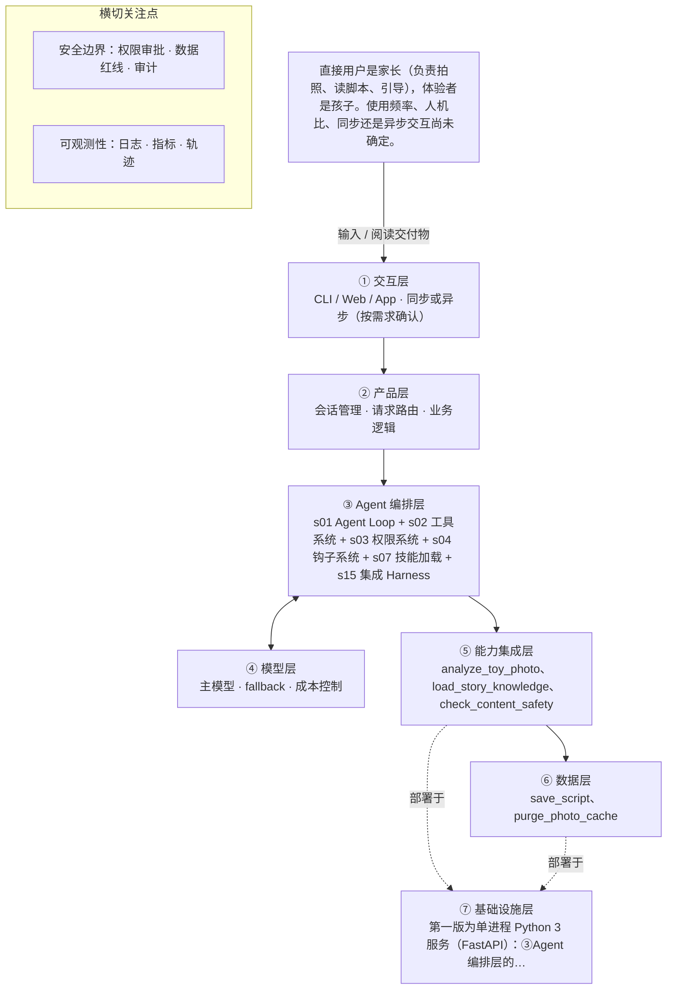

# PRD 推导方案 ——「玩具剧场」

> ⚠️ 本文件是引擎**真实运行产物**，未经人工修改：模型 deepseek-v4-flash，2026-10-31 生成，提示词指纹 `prompts:33eb7aba77d0`。
> 输入为 [evals/forward/toy-theater/input.md](../../evals/forward/toy-theater/input.md)，11 次调用、输入 27150 / 输出 39566 tokens，另有 47872 tokens 命中缓存。
> 审稿没有完全通过是正常的：独立审稿本来就该把方案里的矛盾挑出来，这些意见就是你下一轮要回答的问题。

> 状态：方案待确认（审稿未完全通过，见文末审稿意见）（Step 1–4 已完成，Step 5 代码生成需确认后启动）
> 推导引擎：Agent Blueprint · 模型：deepseek-v4-flash
> 领域建模与架构设计由 agent 完成：可查组件说明，交卷前用规则自检（工具与选型一致、四类降级场景齐全等）。

## 产品定位（一句话）

**玩具剧场**：给家长用：拍一张玩具合影，AI 识别玩具并生成可亲子共演的互动剧情脚本，让旧玩具翻新，也帮家长读懂孩子、一起玩。

## ⚠️ 待确认清单（答不上就是风险点）

**需求问题**：请提出想法的人回答，这几条最要紧。

1. 这个产品要达成什么、怎样算做成？请给出一句话目标，以及可量化的成功标准（如脚本可用率、亲子共演时长、复用次数）。
2. 目标孩子的年龄段是多少？家长的使用频率大概是每周几次？交互是同步一次性出稿，还是异步稍后取结果？
3. 一次完整交付长什么样？请确认脚本需要固定包含哪些部分（角色、场景、分幕、对话、引导话术），以及是否有篇幅或分幕数量要求。
4. 需要什么外部动作或系统调用？除拍照上传与内容生成外，是否要导出、打印、分享给其他家长、推送到消息应用？
5. 除儿童适龄内容规范和玩具剧情范式库，还需要哪些领域知识？这两份知识以什么形式提供（文档、规则表、示例库），由谁维护、如何更新？
6. 什么绝对不能做？除暴力、恐怖、成人、危险模仿内容外，是否还禁止涉及品牌/版权玩具形象、宗教、医疗建议等？儿童照片是否允许上云、保留多久？
7. 失败怎么办？照片识别不出玩具、识别错玩具、生成脚本不合规被拦、模型超时或越权时，分别怎么降级（重拍、手动填玩具名、换题材重生成、人工复核）？
8. 怎么算成功并可度量？请给出指标口径与目标值，例如脚本一次可用率、审核拦截率、平均出稿时延、单次生成成本上限。

**方案推导时留下的问题**：多是上面问题的细化，也有写给开发者的备注。先答上面的，这里能答的再补。

9. 孩子年龄段与适龄档位如何划分（原始输入明确未定）；「最严格适龄档」的具体判定口径需产品确认（假设，待确认）。
10. 照片是否上云、用哪家多模态模型尚未确定，直接决定 ⑤能力集成层的适配器与隐私方案。
11. 交互形态（App、小程序、Web 单页）未定，影响 ①交互层的确认与追问体验。
12. 成功指标定义未给出：脚本可用率、亲子共演时长、复用率的统计口径与阈值（假设，待确认）。
13. 适龄审核由内置规则还是第三方审核服务承担、被拦内容是否需要人工复核，输入未给。
14. 脚本保存的载体与账号体系未定（家庭账号或纯本地保存）。
15. 「帮家长读懂孩子」的落地形态未给，是否需要家长反馈或观察记录入口待确认。

## Step 1 · 需求拆解（提取硬事实）

| 维度 | 结论 | 状态 | 出处 |
|---|---|---|---|
| 目标 | 家长拍一张玩具合影，AI 识别照片中的玩具，生成一份亲子可共同演绎的互动剧情脚本，让旧玩具翻新，并帮家长读懂孩子、一起玩。可量化的成功标准（如脚本可用率、亲子共演时长、复用率）输入未给出。 | 待确认 | 家长拍一张玩具合影，AI 识别照片里的玩具，生成一份可以亲子共同演绎的互动剧情脚本（角色分配、场景搭建、分幕、对话、家长引导话术），让旧玩具翻新，也帮家长读懂孩子、一起玩。 |
| 用户 | 直接用户是家长（负责拍照、读脚本、引导），体验者是孩子。使用频率、人机比、同步还是异步交互尚未确定。 | 待确认 | 直接用户是家长（拍照、读脚本、引导），体验者是孩子。；孩子年龄段、交互形态、照片是否上云还没定。 |
| 核心闭环 | 家长拍摄一张玩具合影 → AI 识别照片里的玩具 → 生成一份互动剧情脚本（角色分配、场景搭建、分幕、对话、家长引导话术）→ 家长带孩子照着脚本演绎。 | 明确 | 家长拍一张玩具合影，AI 识别照片里的玩具，生成一份可以亲子共同演绎的互动剧情脚本（角色分配、场景搭建、分幕、对话、家长引导话术） |
| 交付物 | 一份文本/文档形态的互动剧情脚本，包含：角色分配、场景搭建、分幕、对话、家长引导话术。 | 明确 | 生成一份可以亲子共同演绎的互动剧情脚本（角色分配、场景搭建、分幕、对话、家长引导话术） |
| 边界 | 绝不生成暴力、恐怖、成人、危险模仿内容；照片涉及隐私，默认不保存；生成内容必须过适龄审核。 | 明确 | 绝不生成暴力、恐怖、成人、危险模仿内容；照片涉及隐私，默认不保存。生成内容必须过适龄审核。 |
| 约束 | 需要儿童适龄内容规范、玩具剧情范式库这类领域知识；孩子年龄段未定，直接影响适龄标准；交互形态未定；照片是否上云未定，直接影响隐私方案；时延、并发、成本、可用模型输入未给出。 | 待确认 | 需要儿童适龄内容规范和玩具剧情范式库这样的领域知识库。；孩子年龄段、交互形态、照片是否上云还没定。 |

## Step 2 · 领域建模（映射 Harness 五要素）

| 要素 | 内容 |
|---|---|
| **工具** | analyze_toy_photo：把家长本轮拍摄的玩具合影交给视觉识别能力，返回玩具清单（名称、外观特征、数量、可担任角色），照片只在处理期存在于临时缓存。；load_story_knowledge：按需从儿童适龄内容规范与玩具剧情范式库读取条目，返回目标年龄段的内容红线与分幕、对话、家长引导话术模板。；check_content_safety：把脚本正文与目标年龄段送适龄审核，返回 pass 或 block 及命中的规范条目。；rewrite_scene：按家长指定的幕号与改写要求（如「第三幕太紧张」）重写该幕，重写结果必须重新过审。；save_script：家长显式确认后把脚本正文写入家庭脚本库，默认不落盘、不保存照片。；purge_photo_cache：清理本轮的临时图像缓存文件，返回删除数量与残留数量。 |
| **知识** | 儿童适龄内容规范：按年龄段划分的内容红线与允许表达范围（年龄段与档位划分待确认）。；玩具剧情范式库：角色分配、场景搭建、分幕结构、对话写法、家长引导话术的可复用范式。；产品红线清单：暴力、恐怖、成人、危险模仿四类禁止内容的判定条目，供生成与审核共用。；脚本交付格式规范：角色分配、场景搭建、分幕、对话、家长引导话术五段结构及其字段要求。 |
| **观察** | 识别结果回显：analyze_toy_photo 返回的玩具清单先展示给家长确认或补充，确认后才进入生成。；审核判定：check_content_safety 返回 pass 或 block 及命中条目编号，block 时界面上不展示脚本正文。；出稿自检：脚本五段是否齐备、角色名是否全部落在识别清单内，任一不满足则不出稿。；清理回执：purge_photo_cache 返回已删除文件数与残留数，残留非零时在界面提示家长。；工具调用轨迹：每次工具调用的入参摘要、耗时与权限决策写入会话轨迹，图像只记尺寸与哈希前缀。 |
| **行动** | 家长在会话界面一次性提交合影，并勾选是否同意图像参与处理，脚本以卡片形式在界面返回。；家长对某一幕提出改写要求，由 rewrite_scene 局部重写并重新过适龄审核后再展示。；家长点击确认后由 save_script 落盘保存脚本，未确认则本轮结束即丢弃。；会话结束时由 purge_photo_cache 清理本轮临时图像缓存。 |
| **权限** | 默认拒绝：家长未显式同意前，照片不得外发给任何第三方模型服务（照片是否上云仍待确认）。；默认拒绝：照片与脚本默认不落盘，save_script 必须家长二次确认后才执行，重复调用按未确认处理。；默认拒绝：check_content_safety 未 pass 的脚本一律不返回给家长（fail closed），只说明被拦截与改写方向。；禁止：不得读取设备相册中本轮合影以外的照片，不得采集孩子真实姓名、学校、住址等身份信息。；禁止：不得生成暴力、恐怖、成人、危险模仿内容，命中即拦截并记录审计日志。；需要审批：除 purge_photo_cache 清理本轮临时产物外，任何删除或覆写家庭存储的动作都需家长手动确认。 |

## Step 3 · 组件选型（宁可少选）

| 组件 | 选否 | 理由 | 参考 |
|---|---|---|---|
| s01 Agent Loop | ✅ 必选 | 一切基础：循环 + 工具（一切基础，恒选） | s01_agent_loop/README.md |
| s02 工具系统 | ✅ 必选 | 需要调用外部系统/API/数据源（一切基础，恒选） | s02_tool_use/README.md |
| s03 权限系统 | ✅ 必选 | 产品必然要读取家长拍摄的含儿童生活场景的玩具合影，属隐私/敏感数据，原文也明确「照片涉及隐私，默认不保存」。 | s03_permission/README.md |
| s04 钩子系统 | ✅ 必选 | 原文要求「生成内容必须过适龄审核」，即需要对生成结果做合规拦截与记录。 | s04_hooks/README.md |
| s05 任务规划 | ❌ 放弃 | 闭环仅为一次拍照、一次识别、一次出稿，交付物是一份脚本，没有列计划、逐步推进、汇报进展的多轮要求。 | s05_todo_write/README.md |
| s06 子 Agent | ❌ 放弃 | 输入是单张玩具合影，输出是一份剧情脚本，没有可并行探索的子任务或上下文爆炸风险。 | s06_subagent/README.md |
| s07 技能加载 | ✅ 必选 | 原文明确「需要儿童适龄内容规范和玩具剧情范式库这样的领域知识库」。 | s07_skill_loading/README.md |
| s08 上下文压缩 | ❌ 放弃 | 单次拍照出稿的短闭环，原文未提及长会话、大日志或大量工具输出。 | s08_context_compact/README.md |
| s09 记忆系统 | ⏸ 二期 | 原文「未来希望记住孩子的年龄和偏好玩具做个性化」，第一版可不做。 | s09_memory/README.md |
| s10 任务系统 | ❌ 放弃 | 单次拍照即产出脚本，原文未提及目标持久化或断点续跑。 | s10_task_system/README.md |
| s11 后台任务 | ❌ 放弃 | 识别加生成脚本属秒级到分钟级内的同步响应，原文未提及需数分钟以上的慢操作。 | s11_background_tasks/README.md |
| s12 定时调度 | ❌ 放弃 | 由家长拍照即时触发，原文未提及定时自动触发。 | s12_cron_scheduler/README.md |
| s13 Agent 团队 | ❌ 放弃 | 面向单个家庭的一次性出稿，原文未提及多任务并行或隔离工作区。 | s13_agent_teams/README.md |
| s14 MCP 插件 | ❌ 放弃 | 闭环只依赖模型自身的图像识别与文本生成能力，原文未提及 MCP 或第三方插件生态。 | s14_mcp_plugin/README.md |
| s15 集成 Harness | ✅ 必选 | 第一版已选 3 个可选组件（s03, s04, s07），需归一到单一循环 | s15_integrated_harness/README.md |
| s16 工作流运行时 | ❌ 放弃 | 「拍照→识别→生成脚本」属产品体验描述，且识别与脚本生成需模型临场判断，不是无模型决策的固定阶段流水线。 | s16_workflow_runtime/README.md |
| s17 目标闭环 | ⏸ 二期 | 原文「未来也希望自动判断剧情算不算合格」，第一版可不做独立评估器。 | s17_goal_loop/README.md |

特征判定依据：

- `destructive_ops` = yes：产品必然要读取家长拍摄的含儿童生活场景的玩具合影，属隐私/敏感数据，原文也明确「照片涉及隐私，默认不保存」。
- `audit_needed` = yes：原文要求「生成内容必须过适龄审核」，即需要对生成结果做合规拦截与记录。
- `multi_step` = no：闭环仅为一次拍照、一次识别、一次出稿，交付物是一份脚本，没有列计划、逐步推进、汇报进展的多轮要求。
- `context_heavy` = no：输入是单张玩具合影，输出是一份剧情脚本，没有可并行探索的子任务或上下文爆炸风险。
- `large_knowledge` = yes：原文明确「需要儿童适龄内容规范和玩具剧情范式库这样的领域知识库」。
- `long_sessions` = no：单次拍照出稿的短闭环，原文未提及长会话、大日志或大量工具输出。
- `cross_session_memory` = later：原文「未来希望记住孩子的年龄和偏好玩具做个性化」，第一版可不做。
- `persistent_goals` = no：单次拍照即产出脚本，原文未提及目标持久化或断点续跑。
- `slow_operations` = no：识别加生成脚本属秒级到分钟级内的同步响应，原文未提及需数分钟以上的慢操作。
- `scheduled` = no：由家长拍照即时触发，原文未提及定时自动触发。
- `parallel_isolated` = no：面向单个家庭的一次性出稿，原文未提及多任务并行或隔离工作区。
- `external_ecosystem` = no：闭环只依赖模型自身的图像识别与文本生成能力，原文未提及 MCP 或第三方插件生态。
- `fixed_orchestration` = no：「拍照→识别→生成脚本」属产品体验描述，且识别与脚本生成需模型临场判断，不是无模型决策的固定阶段流水线。
- `auto_completion` = later：原文「未来也希望自动判断剧情算不算合格」，第一版可不做独立评估器。

## Step 4 · 架构设计

### 分层架构图（7 层 + 数据流）



| 层 | 名称 | 回答的问题 | 落地锚点 |
|---|---|---|---|
| ① | 交互层 | 谁在用、怎么用？ | CLI / Web / App / API；同步或异步；人机比 |
| ② | 产品层 | 产品外壳是什么？ | 会话管理、请求路由、账户、业务逻辑 |
| ③ | Agent 编排层 | Harness 如何运转？ | loop、工具分发、hooks、权限、记忆、任务、技能、压缩、子 agent / 团队、目标闭环 |
| ④ | 模型层 | 智能从哪来？ | 主模型、辅助模型、路由、fallback、成本 |
| ⑤ | 能力集成层 | 如何触达外部世界？ | 内部工具、MCP server、知识库、第三方 API |
| ⑥ | 数据层 | 什么需要持久化？ | 记忆、任务、会话历史、轨迹数据、日志指标 |
| ⑦ | 基础设施层 | 如何部署运行？ | 单进程 / 服务 / 团队、沙箱、队列、调度、监控 |

### 工具清单

| 工具 | 输入 | 输出 | 副作用 | 权限 | 归属层 |
|---|---|---|---|---|---|
| `analyze_toy_photo` | 本轮合影的临时图像引用（不落持久化路径）、家长补充的口述说明 | 玩具清单 JSON：名称、外观特征、数量、可担任角色、识别置信度 | 无持久化写入；图像仅在本轮临时缓存中处理，处理完等待清理 | ask | ⑤能力集成层 |
| `load_story_knowledge` | 目标年龄段、剧情主题或需要的规范条目 id | 适龄内容规范条目、玩具剧情范式模板（角色分配、分幕、对话、引导话术） | 只读，无副作用 | allow | ⑤能力集成层 |
| `check_content_safety` | 脚本正文、目标年龄段（缺失时按最严格档）、红线清单版本 | 判定 pass 或 block、命中的规范条目编号、修改建议 | 只写一条脱敏审核记录（判定与条目编号，不含被拦正文），不改动任何家庭数据，故无需家长确认 | allow | ⑤能力集成层 |
| `rewrite_scene` | 当前脚本草稿、目标幕号、家长改写要求 | 重写后的该幕文本，附「需重新过审」标记 | 只更新会话内脚本草稿的该幕版本，不覆盖已审核通过的其他幕，会话结束即丢弃，可由家长随时推翻 | allow | ③Agent 编排层 |
| `save_script` | 脚本正文、家长确认标记、家长自填的年龄段与玩具名 | 脚本 id 与保存时间；未确认时返回拒绝原因 | 写入家庭脚本库（持久化），可重复调用但幂等 | ask | ⑥数据层 |
| `purge_photo_cache` | 本轮 session_id 与临时缓存目录 | 已删除文件数、残留文件数 | 只删除本轮临时目录内的图像文件，不碰持久化数据；产品默认就不保存照片，因此不需要家长确认，但不得删临时目录以外的任何文件 | allow | ⑥数据层 |

### 系统提示词草案

```
你是「玩具剧场」的亲子剧情编剧，直接用户是家长，体验者是孩子。任务：根据合影识别出的玩具清单，产出家长能照着带孩子演的脚本，固定含角色分配、场景搭建、分幕、对话、家长引导话术五段。
规则：
1. 红线：绝不生成暴力、恐怖、成人、危险模仿内容，拿不准就换成更温和的表达。
2. 角色与道具只能来自 analyze_toy_photo 的清单，不得虚构照片里没有的玩具。
3. 生成前用 load_story_knowledge 取适龄规范与剧情范式库；年龄段未知按最严格适龄档生成，并在开头标注「年龄段未确认，按最严格档生成」。
4. 正文必须先过 check_content_safety，未通过只说明拦截原因，不输出正文。
5. 家长要改某一幕用 rewrite_scene，改完重新过审。
6. 家长确认后才调用 save_script；本轮结束调用 purge_photo_cache 清理临时照片。
7. 不追问孩子真实姓名与学校，照片默认不保存。
知识目录：儿童适龄内容规范、玩具剧情范式库、产品红线清单、脚本交付格式规范。
```

### 上下文与记忆策略

会话内保留：本轮图像临时引用（不把二进制放上下文）、analyze_toy_photo 的结构化清单、已加载知识条目的 id、脚本草稿与各幕版本、每次审核判定与命中条目。上下文只带识别清单与五段脚本，不重复贴范式库全文，需要时按条目再取。跨会话默认不持久化，会话结束全部丢弃；只有家长确认 save_script 后落盘脚本正文与家长自填的年龄段、玩具名，不存图像、不存孩子身份信息。记住年龄与偏好玩具做个性化属二期（s09 记忆系统），第一版不做。

### 安全边界与降级策略

- 视觉识别失败或超时 → 提示家长重拍或改为口述玩具清单，禁止根据照片以外的信息猜测玩具名称。
- 模型幻觉：脚本出现识别清单里没有的玩具或角色 → 出稿前做角色名比对，不一致原地重生成；连续不一致则只返回清单并说明原因。
- check_content_safety 不可用或超时 → fail closed：只返回玩具清单与稍后重试提示，绝不返回未经审核的脚本正文。
- 整体出稿超时 → 先返回已完成的玩具清单加一个简化版单幕脚本；该简化脚本同样必须先过 check_content_safety，未过审则只返回玩具清单。
- 家长未确认时 save_script 被重复调用 → 工具层拒绝并保持幂等，返回「未确认不落盘」，同时在轨迹里记一次越权尝试。
- 越权调用（读本轮以外的相册、删除非临时文件、把照片外发给未获批模型服务）→ 在工具执行前由权限闸门直接 deny，记审计日志并告知家长。
- 审核拦截后家长要求继续 → 不展示被拦内容，只能换题材由 rewrite_scene 重写并重新过审。

### 可观测性

- 日志：工具调用入参摘要与耗时，图像只记尺寸与哈希前缀，不记二进制或 base64。；权限决策结果（allow/ask/deny）与越权尝试明细，含被拦原因。；check_content_safety 判定与命中条目编号，被拦正文不写入日志。；save_script 落盘记录（脚本 id、时间）与 purge_photo_cache 的删除数、残留数。；错误堆栈脱敏后记录，禁止出现原图数据与孩子个人信息的明文。
- 指标：出稿成功率与审核一次通过率（按年龄段分档统计）。；端到端耗时 P50/P95，分段记识别、生成、审核耗时。；单幕重写率（rewrite_scene 调用次数 / 出稿次数）与家长放弃率。；临时图像清除成功率与残留数（目标为每轮残留 0，具体口径待确认）。；PRD 指标过渡采集：脚本可用率、亲子共演时长、复用率口径尚未定义，先采代理指标——脚本五段完整率、save_script 保存率、同家庭重复出稿次数；口径确认后接入正式指标。
- 轨迹：以 session_id 为键按序记录家长输入摘要、每次工具调用的名称与返回摘要、权限决策、审核判定与最终脚本版本，全程脱敏、不含图像二进制，供回放与人工复核。

### 技术栈与部署形态

第一版为单进程 Python 3 服务（FastAPI）：③Agent 编排层的 Agent Loop 与 ⑥数据层的临时图像缓存、脚本库在同一进程内；①交互层是一个单页前端，先由同一进程静态托管（是否分离部署待确认）；⑤能力集成层把视觉识别、知识库读取、适龄审核都做成可替换适配器；④模型层的模型来源待确认——原始输入尚未确定「照片是否上云」，因此代码按「默认不外发、需家长显式同意」实现，开关 PHOTO_CLOUD_UPLOAD 默认 false，供应商通过 MODEL_PROVIDER 适配层切换。配置与密钥全部外置：项目根目录 .env 提供 MODEL_PROVIDER、MODEL_BASE_URL、MODEL_API_KEY、PHOTO_CLOUD_UPLOAD、TMP_PHOTO_DIR，代码只用 os.environ 读取，不进仓库。启动：pip install -r requirements.txt && uvicorn app:app --host 0.0.0.0 --port 8000；健康检查 GET /healthz 返回 200 与各适配器就绪状态；README 交付环境变量清单、模型供应商切换步骤、健康检查与单页前端托管说明。

### 测试设计

- 核心循环单测：固定照片 fixture 加 mock 模型，断言调用顺序为 analyze_toy_photo → load_story_knowledge → check_content_safety → 出稿，且脚本五段齐备。
- 工具分派单测：拍照出稿、局部重写、保存、结束会话四类请求分别落到 rewrite_scene、save_script、purge_photo_cache 等对应工具，意图不明时不调用任何有副作用工具。
- 红线拦截测试：注入暴力、恐怖、成人、危险模仿样本，断言 check_content_safety 拦截且界面不出现脚本正文；断言年龄段缺失时按最严格档判定。
- 隐私测试：断言日志、轨迹、错误堆栈中不出现原图二进制或 base64，也不出现孩子年龄段、偏好玩具等个人信息明文；断言未确认时重复调用 save_script 被拒且保持幂等。
- 降级测试：审核服务超时只返回玩具清单；整体超时时返回的简化单幕脚本同样经过审核，未过审则只返回清单。
- 权限测试：越权请求（读本轮以外照片、删非临时文件、未获同意外发照片）一律在工具执行前 deny 并留审计日志。

## 验收标准对照（可落地 vs demo）

| 标准 | 要求 | 本方案的对应设计 |
|---|---|---|
| 可运行 | 一条命令能起，配置与密钥外置（.env / config） | 第一版为单进程 Python 3 服务（FastAPI）：③Agent 编排层的 Agent Loop 与 ⑥数据层的临时图像缓存、脚本库在同一进程内；①交互层… |
| 可容错 | 工具失败、模型幻觉、超时、越权都有明确降级路径 | 视觉识别失败或超时 → 提示家长重拍或改为口述玩具清单，禁止根据照片以外的信息猜测玩具名称。；模型幻觉：脚本出现识别清单里没有的玩具或角色 → 出稿前做角色名比对，不一致原地重生成；连续不一致则只返回清单并说明原因。；check_content_safety 不可用或超时 → fail closed：只返回玩具清单与稍后重试提示，绝不返回未经审核的脚本正文。 |
| 可观测 | 有日志、有指标、有轨迹数据 | 工具调用入参摘要与耗时，图像只记尺寸与哈希前缀，不记二进制或 base64。；权限决策结果（allow/ask/deny）与越权尝试明细，含被拦原因。；出稿成功率与审核一次通过率（按年龄段分档统计）。；端到端耗时 P50/P95，分段记识别、生成、审核耗时。 |
| 可测试 | 核心循环与工具分派有单测，权限与安全有边界测试 | 核心循环单测：固定照片 fixture 加 mock 模型，断言调用顺序为 analyze_toy_photo → load_story_knowledge → check_content_safety → 出稿，且脚本五段齐备。；工具分派单测：拍照出稿、局部重写、保存、结束会话四类请求分别落到 rewrite_scene、save_script、purge_photo_cache 等对应工具，意图不明时不调用任何有副作用工具。；红线拦截测试：注入暴力、恐怖、成人、危险模仿样本，断言 check_content_safety 拦截且界面不出现脚本正文；断言年龄段缺失时按最严格档判定。；隐私测试：断言日志、轨迹、错误堆栈中不出现原图二进制或 base64，也不出现孩子年龄段、偏好玩具等个人信息明文；断言未确认时重复调用 save_script 被拒且保持幂等。；降级测试：审核服务超时只返回玩具清单；整体超时时返回的简化单幕脚本同样经过审核，未过审则只返回清单。；权限测试：越权请求（读本轮以外照片、删非临时文件、未获同意外发照片）一律在工具执行前 deny 并留审计日志。 |
| 可部署 | 有明确的部署形态（单进程 / 服务 / 团队）与启动文档 | 见上文「技术栈与部署形态」 |
| 可度量 | 有对齐 PRD 的成功指标，并能采集 | 出稿成功率与审核一次通过率（按年龄段分档统计）。；端到端耗时 P50/P95，分段记识别、生成、审核耗时。；单幕重写率（rewrite_scene 调用次数 / 出稿次数）与家长放弃率。；临时图像清除成功率与残留数（目标为每轮残留 0，具体口径待确认）。；PRD 指标过渡采集：脚本可用率、亲子共演时长、复用率口径尚未定义，先采代理指标——脚本五段完整率、save_script 保存率、同家庭重复出稿次数；口径确认后接入正式指标。 |

## 独立审稿意见

- 结论：❌ 未通过（78 / 100），设计稿共 2 版
- 总评：六条验收标准基本都有对应设计：启动命令与 .env 外置、四类降级路径、日志/指标/轨迹、单测与边界测试清单、单进程部署形态都在，整体结构完整、待确认项列得比较诚实。主要问题是一处关键编造——用「秒级到分钟级同步响应」这一输入未给的时延结论去支撑后台任务选型，与自身 constraints 自相矛盾；另有一处对照片内容形态的编造，以及识别清单确认环节、审核强制闸门、默认不外发时的识别可用性三处设计缺口。
- [high] components / s11 后台任务：「放弃」理由写成「识别加生成脚本属秒级到分钟级内的同步响应」，但原始输入完全没有给时延或性能数据，方案自身 facts.constraints 也明确写了「时延未给出」，属于用编造的约束支撑选型决策。应改为「时延与目标响应时间待确认，暂按同步路径设计」。
- [medium] components / s03 权限系统：理由中写「读取家长拍摄的含儿童生活场景的玩具合影」，原文只说「玩具合影」，从未提及画面中出现儿童或生活场景，属于对用户数据形态的编造。应以原文「照片涉及隐私，默认不保存」为依据改写。
- [medium] elements.observation 与 design.action / tool_list：elements.observation 写「识别清单先展示给家长确认或补充，确认后才进入生成」，但 design.action 只写「一次性提交合影…脚本以卡片形式返回」，analyze_toy_photo 的 permission=ask 也无法承担这个确认回话；观察点与行动接口没有对齐，确认环节在设计中缺落点。
- [medium] design.security_and_degradation / components s04：「正文必须先过 check_content_safety」仅靠 system_prompt 规则约束，而审核本身是模型可自主调用的工具，存在被跳过或先出稿后审核的可能；s04 钩子系统的选型理由说要「拦截与记录」，但设计里没有说明 harness 代码层的强制闸门（出稿前断言式拦截）挂在哪里。fail closed 的可靠性未被设计保证。
- [medium] design.tech_stack_and_deployment：隐私侧要求「默认不外发照片、PHOTO_CLOUD_UPLOAD 默认 false」，但识别能力本身依赖多模态模型；方案没有说明默认路径下本地识别是否可行、不可行时默认配置能否跑通，只把问题列进了 open_questions。这会使「可运行」这条验收标准在默认配置下存在无法落地的风险。
- [low] design.tool_list / rewrite_scene：rewrite_scene 的 layer 标为「③Agent 编排层」，与其他工具统一落在能力集成层/数据层的口径不一致；重写实质是一次模型生成加工具封装，层级标注混乱会影响后续工具注册位置的理解。
- [low] facts.goal / facts.users：两条都整条标为「待确认」，但其中的目标描述与用户角色在原文有明确出处，真正缺的只是量化成功标准与交互形态/使用频率。整条标待确认会把「已明确」的部分也一并降级，建议拆分事实条目。
- [low] design.observability.metrics：「临时图像清除成功率与残留数（目标为每轮残留 0）」中的「0」是自定阈值，原文未给任何质量目标；虽标了待确认，但更像是把内部假设写成了指标目标，建议明确标为假设。
- [low] design.tech_stack_and_deployment：FastAPI、单进程、单页前端属于输入未给的技术选择，方案只在括号里对分离部署标了待确认，技术栈本身未标为假设。这些选择本身可以成立，但需要与「输入无技术约束」的事实区分开。

## 本次推导消耗

- 模型调用 11 次，输入 27150 tokens，输出 39566 tokens，另有 47872 tokens 命中缓存（按 1/10 计入上限）

## 下一步

回答上面的待确认清单，据此修订方案后，再进入 Step 5 代码生成（骨架 → 硬化 → 产品化）。
