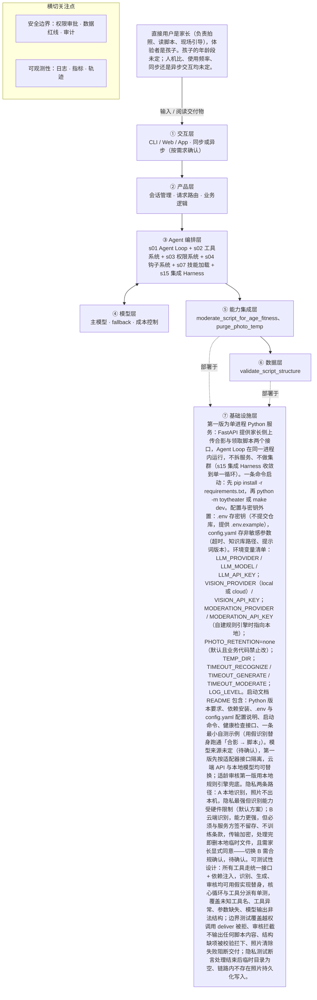

# PRD 推导方案 ——「玩具剧场」

> ⚠️ 本文件是引擎**真实运行产物**，未经人工修改：模型 deepseek-v4-flash，2026-10-20 生成，提示词指纹 `prompts:1190623d74ab`。
> 输入为 [evals/forward/toy-theater/input.md](../../evals/forward/toy-theater/input.md)，6 次调用、输入 13831 / 输出 24388 tokens。
> 审稿没有完全通过是正常的：独立审稿本来就该把方案里的矛盾挑出来，这些意见就是你下一轮要回答的问题。

> 状态：方案待确认（Step 1–4 已完成，Step 5 代码生成需确认后启动）
> 推导引擎：Agent Blueprint · 模型：anthropic

## 产品定位（一句话）

**玩具剧场**：给家长用：拍一张玩具合影，换回一份可亲子共演的互动剧情脚本，解决旧玩具闲置、家长不知道怎么陪孩子玩的痛点，同时帮家长读懂孩子。

## ⚠️ 待确认清单（答不上就是风险点）

1. 产品目标要怎样算做成？请给出可度量指标，例如脚本生成成功率、家长实际开演率、家长满意度、单次成本或时延上限。
2. 目标孩子的年龄段是多少？家长使用频率大概如何？交互是同步等待结果还是异步稍后取？
3. 交互形态是什么？小程序、App、网页、智能音箱还是其他？是家长单端使用，还是家长与孩子各持一端？
4. 照片是否上云？保存在哪里、保存多久、由谁可访问，需要满足哪些隐私合规要求（如儿童个人信息保护）？
5. 玩具识别靠什么能力实现？是用多模态模型直接识别，还是需要接入外部图像识别 API 或自建词表？
6. 适龄审核由谁执行？模型自审、独立审核模型、外部内容安全服务，还是人工抽检？不合规时是重写、降级还是拒答？
7. 脚本的形态与篇幅有什么要求？几幕、多少字、是否需要可打印卡片，是否允许家长指定主题或让孩子参与改编？
8. 失败怎么兜底？识别不出玩具、识别错玩具、生成超时、生成内容被判不合规时，分别返回什么？
9. 「帮家长读懂孩子」要如何体现？是否需要在脚本里加入观察提示或演出后的亲子提问环节？
10. 儿童适龄内容规范和玩具剧情范式库现在是否已有现成素材？规模、格式、由谁维护？
11. 使用哪个模型、图像识别能力从哪来未定，直接决定走本地识别（A 路径）还是云端识别（B 路径）
12. 照片若必须上云，服务方的留存与不训练条款如何取得、如何验证，未定
13. 孩子年龄段分档与对应适龄标准未定，当前「通用适龄档」的具体取值待确认
14. 家长引导话术背后的育儿或共演方法输入未说明，话术质量缺少判据
15. 脚本能否重生成、家长能否修改、输出载体（纯文本 / 卡片 / 可打印稿）未定
16. 「帮家长读懂孩子」的可量化成功标准输入未给，现用代理指标，阈值与采集方式（问卷、回访频次）待定
17. 时延与并发要求未定；组件 s11（后台任务）放弃理由中「秒级到分钟内」无输入出处，时延确认后需复核是否改为必选
18. 组件 s17 选型证据「自动判断剧情算不算合格」更接近自动评测或质量判定器，与 auto_completion 特征不完全匹配，二期需重新核对
19. 组件 s03 特征标为 destructive_ops，但主风险是敏感数据读取而非破坏性写入，真正破坏性动作是 purge_photo_temp；已按「敏感读取防护 + 唯一清除动作」实现，建议同步修正标签
20. 需求事实 constraints 的状态应拆分为「明确：必须内置儿童适龄内容规范与玩具剧情范式库」与「待确认：模型、识别来源、时延并发、单次成本、是否上云」，以保溯源精度
21. 生成内容能否对外分享给家庭以外的人未说明，当前默认拒绝，需产品确认

## Step 1 · 需求拆解（提取硬事实）

| 维度 | 结论 | 状态 | 出处 |
|---|---|---|---|
| 目标 | 把一张玩具合影转成一份可亲子共同演绎的互动剧情脚本（角色分配、场景搭建、分幕、对话、家长引导话术），让旧玩具翻新、帮家长读懂孩子并一起玩。可量化的成功标准输入未给出。 | 明确 | 家长拍一张玩具合影，AI 识别照片里的玩具，生成一份可以亲子共同演绎的互动剧情脚本（角色分配、场景搭建、分幕、对话、家长引导话术），让旧玩具翻新，也帮家长读懂孩子、一起玩。 |
| 用户 | 直接用户是家长（负责拍照、读脚本、现场引导），体验者是孩子。孩子的年龄段未定；人机比、使用频率、同步还是异步交互均未定。 | 明确 | 直接用户是家长（拍照、读脚本、引导），体验者是孩子。孩子年龄段、交互形态、照片是否上云还没定。 |
| 核心闭环 | 家长拍玩具合影并提交 → AI 识别照片中的玩具 → 生成互动剧情脚本（角色分配、场景搭建、分幕、对话、家长引导话术）→ 家长照着脚本与孩子现场共演。脚本如何回传、能否重生成、家长能否修改，输入未说明。 | 明确 | 家长拍一张玩具合影，AI 识别照片里的玩具，生成一份可以亲子共同演绎的互动剧情脚本（角色分配、场景搭建、分幕、对话、家长引导话术） |
| 交付物 | 一份文本形态的互动剧情脚本，最小内容集为：角色分配、场景搭建、分幕、对话、家长引导话术。输出载体（纯文本、卡片、可打印稿）未定。 | 明确 | 生成一份可以亲子共同演绎的互动剧情脚本（角色分配、场景搭建、分幕、对话、家长引导话术） |
| 边界 | 三条硬红线：1）绝不生成暴力、恐怖、成人、危险模仿内容；2）照片涉及隐私，默认不保存；3）生成内容必须过适龄审核。除此之外的红线（如能否对外发送内容、能否留存孩子个人信息）未说明。 | 明确 | 绝不生成暴力、恐怖、成人、危险模仿内容；照片涉及隐私，默认不保存。生成内容必须过适龄审核。 |
| 约束 | 已知约束：必须内置儿童适龄内容规范和玩具剧情范式库这类领域知识；生成内容需经适龄审核。未定：使用哪个模型、图像识别能力从哪来、时延与并发要求、单次成本上限、照片是否上云及对应合规要求。 | 待确认 | 需要儿童适龄内容规范和玩具剧情范式库这样的领域知识库。孩子年龄段、交互形态、照片是否上云还没定。 |

## Step 2 · 领域建模（映射 Harness 五要素）

| 要素 | 内容 |
|---|---|
| **工具** | 图像识别：从家长提交的玩具合影中识别出画面里的玩具，作为角色分配与场景搭建的输入；具体识别能力来源输入未定，待确认。；脚本生成模型调用：根据识别出的玩具，产出包含角色分配、场景搭建、分幕、对话、家长引导话术五部分内容的文本互动剧情脚本；使用哪个模型输入未定，待确认。；适龄内容审核能力：对生成脚本做适龄审核，未通过不得交付；审核能力来源输入未定，待确认。；脚本回传给家长的输出通道：输入只说明生成脚本，回传载体（纯文本、卡片、可打印稿）未定，待确认。；玩具剧情范式库的检索与匹配，用于按识别到的玩具套用剧情结构，库的形态与存放方式输入未定，待确认。 |
| **知识** | 儿童适龄内容规范：用于约束生成内容的适龄边界，是输入明确要求内置的领域知识库。；玩具剧情范式库：提供把玩具转成剧情结构的范式，是输入明确要求内置的领域知识库。；脚本结构规范：交付物最小内容集为角色分配、场景搭建、分幕、对话、家长引导话术，来自交付物定义。；家长引导话术的知识来源：用于生成面向家长的现场引导话术，话术背后的育儿或共演方法输入未说明，待确认。；孩子年龄段分档与对应适龄标准：输入明确孩子年龄段未定，故该知识的分档规则待确认。 |
| **观察** | 适龄审核结果：每条生成脚本必须有审核通过或拦截的结论，未通过不得交付给家长。；脚本结构完整性校验：检查输出是否覆盖角色分配、场景搭建、分幕、对话、家长引导话术五项最小内容。；照片留存状态核查：依据「照片默认不保存」红线，需能确认照片在处理后未被落盘留存。；玩具识别结果核对：识别出的玩具有哪些、是否与合影一致，是后续角色分配可解释的前提；具体核对方式待确认。；亲子共演效果与「帮家长读懂孩子」的达成度：输入未给出可量化成功标准，度量方式待确认。 |
| **行动** | 家长拍照并提交合影：以家长侧界面动作发起，输入未定交互形态与是否上云，待确认。；识别与生成以服务端流程执行：照片进入识别、脚本生成、适龄审核再到输出的链路，具体以 API 或 CLI 形态执行输入未说明，待确认。；脚本以文本形态交付给家长阅读，载体形式待确认。；家长按脚本与孩子线下现场共演：属于线下人工动作，系统不介入，也不产生系统侧写入动作。；内容被审核判定违规时的拒答或改写动作：拦截并不输出，具体是拒答还是重生成输入未定，待确认。 |
| **权限** | 默认拒绝：照片涉及隐私，默认不保存，不做任何形式的留存或复用。；硬性禁止生成：暴力、恐怖、成人、危险模仿内容一律不生成，无例外。；发布前强制审批：生成内容必须通过适龄审核后才可交付给家长，未过审不得输出。；孩子个人信息（含年龄段、姓名等）的收集与留存：输入未说明是否允许，默认按不允许处理，待确认。；生成内容能否对外发送或分享给家庭以外的人：输入未说明，默认拒绝，待确认。；照片是否上云及对应合规要求未定，在上云方案确认前，默认按不留存、不外传处理，待确认。 |

## Step 3 · 组件选型（宁可少选）

| 组件 | 选否 | 理由 | 参考 |
|---|---|---|---|
| s01 Agent Loop | ✅ 必选 | 一切基础：循环 + 工具（一切基础，恒选） | s01_agent_loop/README.md |
| s02 工具系统 | ✅ 必选 | 需要调用外部系统/API/数据源（一切基础，恒选） | s02_tool_use/README.md |
| s03 权限系统 | ✅ 必选 | 照片涉及隐私，默认不保存——处理的是家庭与儿童相关的隐私图像数据，属于敏感数据操作。 | s03_permission/README.md |
| s04 钩子系统 | ✅ 必选 | 生成内容必须过适龄审核，天然需要审核与拦截环节。 | s04_hooks/README.md |
| s05 任务规划 | ❌ 放弃 | 闭环是拍一张照片直接产出一份脚本，没有先列计划、多轮推进、汇报进展的描述。 | s05_todo_write/README.md |
| s06 子 Agent | ❌ 放弃 | 单张玩具合影、单份脚本，输入里没有任何上下文膨胀或并行探索型子任务。 | s06_subagent/README.md |
| s07 技能加载 | ✅ 必选 | 原文明确需要儿童适龄内容规范和玩具剧情范式库这样的领域知识库。 | s07_skill_loading/README.md |
| s08 上下文压缩 | ❌ 放弃 | 一次拍照出一次脚本，属短会话，输入未提长会话或大体量工具输出。 | s08_context_compact/README.md |
| s09 记忆系统 | ⏸ 二期 | 未来希望记住孩子的年龄和偏好玩具做个性化。 | s09_memory/README.md |
| s10 任务系统 | ❌ 放弃 | 单次生成即交付，输入未提断点续跑或目标持久化。 | s10_task_system/README.md |
| s11 后台任务 | ❌ 放弃 | 闭环内只有图像识别与脚本生成，均属秒级到分钟内的同步动作，输入未提慢操作。 | s11_background_tasks/README.md |
| s12 定时调度 | ❌ 放弃 | 由家长拍照触发，输入未提任何定时自动触发。 | s12_cron_scheduler/README.md |
| s13 Agent 团队 | ❌ 放弃 | 单人单次单脚本的产品形态，不涉及多任务并行与隔离工作区。 | s13_agent_teams/README.md |
| s14 MCP 插件 | ❌ 放弃 | 输入未提 MCP、第三方插件或外部工具生态接入需求。 | s14_mcp_plugin/README.md |
| s15 集成 Harness | ✅ 必选 | 第一版已选 3 个可选组件（s03, s04, s07），需归一到单一循环 | s15_integrated_harness/README.md |
| s16 工作流运行时 | ❌ 放弃 | 输入描述的是产品体验（拍照、读脚本、亲子共演），并非把流程写成无需模型临场决策的固定阶段序列。 | s16_workflow_runtime/README.md |
| s17 目标闭环 | ⏸ 二期 | 未来也希望自动判断剧情算不算合格。 | s17_goal_loop/README.md |

特征判定依据：

- `destructive_ops` = yes：照片涉及隐私，默认不保存——处理的是家庭与儿童相关的隐私图像数据，属于敏感数据操作。
- `audit_needed` = yes：生成内容必须过适龄审核，天然需要审核与拦截环节。
- `multi_step` = no：闭环是拍一张照片直接产出一份脚本，没有先列计划、多轮推进、汇报进展的描述。
- `context_heavy` = no：单张玩具合影、单份脚本，输入里没有任何上下文膨胀或并行探索型子任务。
- `large_knowledge` = yes：原文明确需要儿童适龄内容规范和玩具剧情范式库这样的领域知识库。
- `long_sessions` = no：一次拍照出一次脚本，属短会话，输入未提长会话或大体量工具输出。
- `cross_session_memory` = later：未来希望记住孩子的年龄和偏好玩具做个性化。
- `persistent_goals` = no：单次生成即交付，输入未提断点续跑或目标持久化。
- `slow_operations` = no：闭环内只有图像识别与脚本生成，均属秒级到分钟内的同步动作，输入未提慢操作。
- `scheduled` = no：由家长拍照触发，输入未提任何定时自动触发。
- `parallel_isolated` = no：单人单次单脚本的产品形态，不涉及多任务并行与隔离工作区。
- `external_ecosystem` = no：输入未提 MCP、第三方插件或外部工具生态接入需求。
- `fixed_orchestration` = no：输入描述的是产品体验（拍照、读脚本、亲子共演），并非把流程写成无需模型临场决策的固定阶段序列。
- `auto_completion` = later：未来也希望自动判断剧情算不算合格。

## Step 4 · 架构设计

### 分层架构图（7 层 + 数据流）



| 层 | 名称 | 回答的问题 | 落地锚点 |
|---|---|---|---|
| ① | 交互层 | 谁在用、怎么用？ | CLI / Web / App / API；同步或异步；人机比 |
| ② | 产品层 | 产品外壳是什么？ | 会话管理、请求路由、账户、业务逻辑 |
| ③ | Agent 编排层 | Harness 如何运转？ | loop、工具分发、hooks、权限、记忆、任务、技能、压缩、子 agent / 团队、目标闭环 |
| ④ | 模型层 | 智能从哪来？ | 主模型、辅助模型、路由、fallback、成本 |
| ⑤ | 能力集成层 | 如何触达外部世界？ | 内部工具、MCP server、知识库、第三方 API |
| ⑥ | 数据层 | 什么需要持久化？ | 记忆、任务、会话历史、轨迹数据、日志指标 |
| ⑦ | 基础设施层 | 如何部署运行？ | 单进程 / 服务 / 团队、沙箱、队列、调度、监控 |

### 工具清单

| 工具 | 输入 | 输出 | 副作用 | 权限 | 归属层 |
|---|---|---|---|---|---|
| `recognize_toys_from_photo` | 家长提交的玩具合影，以会话内临时图像引用（temp_ref + 会话 id）形式传入，不传持久化地址 | 玩具清单：每项的粗略类别、颜色、显著特征与识别置信度，以及本次使用的识别通道（本地 / 云端）；清单中不得包含人脸与孩子个人信息 | 只读，不写入任何持久化存储；临时图像与派生缩略图在识别返回后交由 purge_photo_temp 清除 | allow | ③ |
| `retrieve_story_pattern` | 玩具清单、可选年龄段档位（未定档时用通用适龄档） | 匹配到的剧情范式：分幕骨架、冲突与转折模板、家长引导话术要点；无命中时返回空并标记未命中 | 只读本地知识库，无写入；未命中的缺口写入知识库补库清单 | allow | ④ |
| `generate_interactive_script` | 玩具清单、剧情范式、五项最小内容集约束、适龄内容规范摘要 | 脚本草稿，结构化五段：角色分配、场景搭建、分幕、对话、家长引导话术 | 仅写入会话内存，不落盘、不写数据库；草稿正文不进日志 | allow | ② |
| `validate_script_structure` | 脚本草稿，以及识别得到的玩具清单（用于核对角色是否越出清单范围） | 结构校验结论：五项是否齐全、缺失字段清单、角色与玩具清单一致性核对结果 | 无写入，仅返回结论；不通过时不产生任何交付物 | allow | ⑥ |
| `moderate_script_for_age_fitness` | 脚本草稿全文（含对话与家长引导话术） | 通过 / 拦截结论、命中的红线类别（暴力、恐怖、成人、危险模仿）与理由 | 审核结论与命中类别写入审计日志，只记结论与脚本哈希，不记正文、不涉及照片 | allow | ⑤ |
| `deliver_script_to_parent` | 已通过适龄审核且结构校验通过的脚本与双通过凭证 | 交付凭证与家长侧可读的脚本内容（第一版为纯文本，载体形态待确认） | 全链路唯一的对外发送动作；缺任一凭证即拒绝执行，拒绝行为记审计 | ask | ① |
| `purge_photo_temp` | 会话 id 与临时图像引用 | 清除结果：成功 / 失败，并回读校验临时路径与缩略图已不存在 | 不可逆删除临时照片与派生文件；这是本产品唯一的破坏性动作，正常路径与异常路径均强制执行，失败即告警并阻断交付 | allow | ⑤ |

### 系统提示词草案

```
你是「玩具剧场」的亲子共演脚本生成器。职责：读懂玩具合影里的玩具，把它们变成家长能照着演、孩子能参与的分幕互动剧情脚本。
硬边界：1）不生成暴力、恐怖、成人、危险模仿内容，危险桥段改写为安全表达；2）照片默认不保存、不复用、不外传，你只接收识别后的玩具清单，不接触原始图像；3）不收集、不推测孩子姓名、学校等个人信息，年龄段未知时用通用适龄档；4）输出须同时覆盖角色分配、场景搭建、分幕、对话、家长引导话术五项；5）不确定的写「待确认」，不编造玩具细节。
工具：recognize_toys_from_photo（识别玩具）、retrieve_story_pattern（取剧情范式）、generate_interactive_script（出草稿）、validate_script_structure（校验五项与角色一致性）、moderate_script_for_age_fitness（适龄审核）、purge_photo_temp（清除临时照片）、deliver_script_to_parent（交付，须审核与校验双通过）。
知识目录：儿童适龄内容规范、玩具剧情范式库、脚本结构规范、家长引导话术方法（待确认）、年龄段分档标准（待确认）。
```

### 上下文与记忆策略

一次会话对应一次拍照与一次生成，上下文只保留四类：临时图像引用（只存引用不存内容）、玩具清单、匹配到的剧情范式、脚本草稿与审核 / 校验结论。因属短会话且输入无长会话证据，不启用上下文压缩（s08 放弃）。会话结束时清空内存中的草稿与清单，并强制调用 purge_photo_temp 清除临时图像。跨会话不做持久化（s09 列为二期）：二期若做个性化，只持久化家长显式同意的年龄段档位与偏好玩具类别，不存照片、不存脚本正文、不存孩子姓名等个人信息。

### 安全边界与降级策略

- 图像识别失败或返回空结果 → 不猜测补全，提示家长换一张光线更好的合影，最多重试两次，仍失败则礼貌终止并明确说明本次未生成脚本
- 剧情范式库检索无命中 → 降级到内置通用剧情骨架，脚本中标注「通用模板」，并记录缺口用于补库
- 模型幻觉：脚本出现合影外的玩具或编造的玩具细节 → 交付前强制做角色与玩具清单一致性核对，不一致回退重生成；两次仍不一致则把该角色改为泛化称谓，不输出具体玩具名
- 模型幻觉：写出危险模仿动作 → 适龄审核命中即拦截，不交付；第一版固定策略为按审核理由改写重生成一次，仍不过则拒答并告知家长换一组玩具再试，绝不部分输出
- 超时 → 识别、生成、审核、交付每步设独立超时上限（数值待压测确认），超时即中止并提示稍后重试；异常中止路径同样执行 purge_photo_temp
- 越权 → 模型试图跳过审核或结构校验直接调用 deliver_script_to_parent、试图读取原始照片或对外发送内容，权限层默认拒绝并要求双通过凭证，缺失即拒绝并记一条越权审计
- 照片清除失败 → 视为最高级别故障：阻断交付、告警、记录临时路径供人工清理，本次会话不再复用该文件
- 家长侧重复提交或并发 → 会话强隔离，每个会话独立临时目录与独立草稿，不共享识别结果与脚本

### 可观测性

- 日志：会话轨迹日志：会话 id、玩具识别结果摘要（不含照片）、识别通道、各步耗时、最终交付或拒答状态；审核日志：审核结论、命中红线类别、重生成次数，只记脚本哈希不记正文；照片生命周期日志：临时文件创建、清除执行、清除回读校验结果；越权与拦截日志：被权限层拒绝的工具调用与参数摘要；版本日志：模型名、提示词版本、知识库版本，用于回归定位
- 指标：共演完成率：交付脚本后家长自报「已和孩子完整演过一次」的比例（第一版用交付后一次性问卷采集，为目标对齐指标，阈值待确认）；家长读懂孩子自评：演完后 1 到 5 分打分「我更了解孩子怎么玩、怎么想」，以及相对上一次的变化；旧玩具复用率：同一家庭再次为同一批旧玩具生成脚本的比例，或首次生成后 7 天内再次拍照提交的比例，用于验证旧玩具翻新；工程质量指标：适龄审核拦截率、五项结构完整率、端到端时延、照片清除成功率
- 轨迹：按会话记一条可回放轨迹：提交 → 识别 → 范式检索 → 生成 → 结构校验 → 适龄审核 →（通过 / 重生成 / 拒答）→ 清除临时照片 → 交付，每步记工具名、入参摘要（照片只记会话内临时引用 id，不记内容）、出参摘要、耗时与通过与否，整条轨迹不含原始图像。

### 技术栈与部署形态

第一版为单进程 Python 服务：FastAPI 提供家长侧上传合影与领取脚本两个接口，Agent Loop 在同一进程内运行，不拆服务、不做集群（s15 集成 Harness 收敛到单一循环）。一条命令启动：先 pip install -r requirements.txt，再 python -m toytheater 或 make dev。配置与密钥外置：.env 存密钥（不提交仓库，提供 .env.example），config.yaml 存非敏感参数（超时、知识库路径、提示词版本）。环境变量清单：LLM_PROVIDER / LLM_MODEL / LLM_API_KEY；VISION_PROVIDER（local 或 cloud）/ VISION_API_KEY；MODERATION_PROVIDER / MODERATION_API_KEY（自建规则引擎时指向本地）；PHOTO_RETENTION=none（默认且业务代码禁止改）；TEMP_DIR；TIMEOUT_RECOGNIZE / TIMEOUT_GENERATE / TIMEOUT_MODERATE；LOG_LEVEL。启动文档 README 包含：Python 版本要求、依赖安装、.env 与 config.yaml 配置说明、启动命令、健康检查接口、一条最小自测示例（用假识别替身跑通「合影 → 脚本」）。模型来源未定（待确认），第一版先按适配器接口隔离，云端 API 与本地模型均可替换；适龄审核第一版用本地规则引擎兜底。隐私两条路径：A 本地识别，照片不出本机，隐私最强但识别能力受硬件限制（默认方案）；B 云端识别，能力更强，但必须与服务方签不留存、不训练条款，传输加密，处理完即删本地临时文件，且需家长显式同意——切换 B 需合规确认，待确认。可测试性设计：所有工具走统一接口 + 依赖注入，识别、生成、审核均可用假实现替身，核心循环与工具分派有单测，覆盖未知工具名、工具异常、参数缺失、模型输出非法结构；边界测试覆盖越权调用 deliver 被拒、审核拦截不输出任何脚本内容、结构缺项被校验拦下、照片清除失败阻断交付；隐私测试断言处理结束后临时目录为空、链路内不存在照片持久化写入。

## 验收标准对照（可落地 vs demo）

| 标准 | 要求 | 本方案的对应设计 |
|---|---|---|
| 可运行 | 一条命令能起，配置与密钥外置（.env / config） | 第一版为单进程 Python 服务：FastAPI 提供家长侧上传合影与领取脚本两个接口，Agent Loop 在同一进程内运行，不拆服务、不做集群（s15 集成 Harness 收敛到单一循环）。一条命令启动：先 pip install -r requirements.txt，再 python -m toytheater 或 make dev。配置与密钥外置：.env 存密钥（不提交仓库，提供 .env.example），config.yaml 存非敏感参数（超时、知识库路径、提示词版本）。环境变量清单：LLM_PROVIDER / LLM_MODEL / LLM_API_KEY；VISION_PROVIDER（local 或 cloud）/ VISION_API_KEY；MODERATION_PROVIDER / MODERATION_API_KEY（自建规则引擎时指向本地）；PHOTO_RETENTION=none（默认且业务代码禁止改）；TEMP_DIR；TIMEOUT_RECOGNIZE / TIMEOUT_GENERATE / TIMEOUT_MODERATE；LOG_LEVEL。启动文档 README 包含：Python 版本要求、依赖安装、.env 与 config.yaml 配置说明、启动命令、健康检查接口、一条最小自测示例（用假识别替身跑通「合影 → 脚本」）。模型来源未定（待确认），第一版先按适配器接口隔离，云端 API 与本地模型均可替换；适龄审核第一版用本地规则引擎兜底。隐私两条路径：A 本地识别，照片不出本机，隐私最强但识别能力受硬件限制（默认方案）；B 云端识别，能力更强，但必须与服务方签不留存、不训练条款，传输加密，处理完即删本地临时文件，且需家长显式同意——切换 B 需合规确认，待确认。可测试性设计：所有工具走统一接口 + 依赖注入，识别、生成、审核均可用假实现替身，核心循环与工具分派有单测，覆盖未知工具名、工具异常、参数缺失、模型输出非法结构；边界测试覆盖越权调用 deliver 被拒、审核拦截不输出任何脚本内容、结构缺项被校验拦下、照片清除失败阻断交付；隐私测试断言处理结束后临时目录为空、链路内不存在照片持久化写入。 |
| 可容错 | 工具失败、模型幻觉、超时、越权都有明确降级路径 | 图像识别失败或返回空结果 → 不猜测补全，提示家长换一张光线更好的合影，最多重试两次，仍失败则礼貌终止并明确说明本次未生成脚本；剧情范式库检索无命中 → 降级到内置通用剧情骨架，脚本中标注「通用模板」，并记录缺口用于补库；模型幻觉：脚本出现合影外的玩具或编造的玩具细节 → 交付前强制做角色与玩具清单一致性核对，不一致回退重生成；两次仍不一致则把该角色改为泛化称谓，不输出具体玩具名 |
| 可观测 | 有日志、有指标、有轨迹数据 | 会话轨迹日志：会话 id、玩具识别结果摘要（不含照片）、识别通道、各步耗时、最终交付或拒答状态；审核日志：审核结论、命中红线类别、重生成次数，只记脚本哈希不记正文；共演完成率：交付脚本后家长自报「已和孩子完整演过一次」的比例（第一版用交付后一次性问卷采集，为目标对齐指标，阈值待确认）；家长读懂孩子自评：演完后 1 到 5 分打分「我更了解孩子怎么玩、怎么想」，以及相对上一次的变化 |
| 可测试 | 核心循环与工具分派有单测，权限与安全有边界测试 | Step 5 骨架层需附核心循环与权限边界的单测 |
| 可部署 | 有明确的部署形态（单进程 / 服务 / 团队）与启动文档 | 第一版为单进程 Python 服务：FastAPI 提供家长侧上传合影与领取脚本两个接口，Agent Loop 在同一进程内运行，不拆服务、不做集群（s15 集成 Harness 收敛到单一循环）。一条命令启动：先 pip install -r requirements.txt，再 python -m toytheater 或 make dev。配置与密钥外置：.env 存密钥（不提交仓库，提供 .env.example），config.yaml 存非敏感参数（超时、知识库路径、提示词版本）。环境变量清单：LLM_PROVIDER / LLM_MODEL / LLM_API_KEY；VISION_PROVIDER（local 或 cloud）/ VISION_API_KEY；MODERATION_PROVIDER / MODERATION_API_KEY（自建规则引擎时指向本地）；PHOTO_RETENTION=none（默认且业务代码禁止改）；TEMP_DIR；TIMEOUT_RECOGNIZE / TIMEOUT_GENERATE / TIMEOUT_MODERATE；LOG_LEVEL。启动文档 README 包含：Python 版本要求、依赖安装、.env 与 config.yaml 配置说明、启动命令、健康检查接口、一条最小自测示例（用假识别替身跑通「合影 → 脚本」）。模型来源未定（待确认），第一版先按适配器接口隔离，云端 API 与本地模型均可替换；适龄审核第一版用本地规则引擎兜底。隐私两条路径：A 本地识别，照片不出本机，隐私最强但识别能力受硬件限制（默认方案）；B 云端识别，能力更强，但必须与服务方签不留存、不训练条款，传输加密，处理完即删本地临时文件，且需家长显式同意——切换 B 需合规确认，待确认。可测试性设计：所有工具走统一接口 + 依赖注入，识别、生成、审核均可用假实现替身，核心循环与工具分派有单测，覆盖未知工具名、工具异常、参数缺失、模型输出非法结构；边界测试覆盖越权调用 deliver 被拒、审核拦截不输出任何脚本内容、结构缺项被校验拦下、照片清除失败阻断交付；隐私测试断言处理结束后临时目录为空、链路内不存在照片持久化写入。 |
| 可度量 | 有对齐 PRD 的成功指标，并能采集 | 共演完成率：交付脚本后家长自报「已和孩子完整演过一次」的比例（第一版用交付后一次性问卷采集，为目标对齐指标，阈值待确认）；家长读懂孩子自评：演完后 1 到 5 分打分「我更了解孩子怎么玩、怎么想」，以及相对上一次的变化；旧玩具复用率：同一家庭再次为同一批旧玩具生成脚本的比例，或首次生成后 7 天内再次拍照提交的比例，用于验证旧玩具翻新；工程质量指标：适龄审核拦截率、五项结构完整率、端到端时延、照片清除成功率 |

## 独立审稿意见

- 结论：✅ 通过（86 / 100），设计稿共 2 版
- 总评：这份方案对原始输入的溯源总体扎实，六条验收标准基本都有对应设计：可运行（单进程 FastAPI、一条命令、.env 与 config.yaml 外置）、可容错（工具失败、模型幻觉、超时、越权四类均给降级路径，另加照片清除失败与并发）、可观测（日志、指标、会话轨迹齐备且明确不记照片与正文）、可测试（单测、边界测试、隐私测试三层）、可部署（单进程形态与启动文档清单）。主要短板有三处：若干组件选型理由（s11 时延、s03 特征标签、s17 特征匹配）带有未经标注的推断，方案虽在 open_questions 中自陈，但组件表本身尚未修正；产品成功指标全为自拟代理指标且问卷采集链路没有落地设计，「可度量」目前偏口头；facts 中 constraints 与 core_loop 的状态标注没有拆分明确项与待确认项。以上问题都不构成方向性错误，可在定稿时逐条收敛，故判为通过。
- [medium] components.s11：放弃「后台任务」的理由写「均属秒级到分钟内的同步动作」，但原始输入从未给出识别与生成的时延量级，属于无出处的断言；方案虽在 open_questions 第 7 条自陈，但组件 reason 字段本身未标注「待确认」。
- [medium] components.s03：权限系统的选型证据标为 destructive_ops，但本产品的主要风险是儿童隐私图像的敏感读取，而不是破坏性写入；真正具破坏性的动作是 purge_photo_temp。选型理由与特征标签不一致，方案已在 open_questions 承认，但组件表未修正。
- [medium] components.s17：「自动判断剧情算不算合格」更接近质量评测器或校验器，与 auto_completion（目标达成自动判定）特征并不吻合，二期的选型证据与特征证据存在错位。
- [medium] observability.metrics：三项产品指标（共演完成率、家长读懂孩子自评、旧玩具复用率）都是方案自拟的代理指标，输入未给出任何可量化成功标准；且「交付后一次性问卷」的采集链路在可运行设计中没有任何实现位置（没有问卷接口、存储与回收方式），「可度量」中的「能采集」目前只是口头陈述。
- [low] facts.constraints：status 整体标为「待确认」，但其中「必须内置儿童适龄内容规范与玩具剧情范式库」是输入中的明确事实，与模型来源、时延并发、是否上云等真正的待确认项混在同一状态里，削弱了溯源精度（方案已在 open_questions 第 10 条自陈，但 facts 本身未拆分）。
- [low] facts.core_loop：status 标为「明确」，但 value 内部同时包含「脚本如何回传、能否重生成、家长能否修改，输入未说明」这类待确认内容，单条事实混用两种状态，未拆分。
- [low] design.tech_stack_and_deployment：声称「一条命令能起」，但实际给的是 pip install -r requirements.txt 再 python -m toytheater 两步，只有 make dev 勉强算一条命令；且 make dev 与模块入口的关系未说明，验收标准里的「一条命令」证据不够干净。
- [low] observability.metrics：「首次生成后 7 天内再次拍照提交」中的 7 天窗口是自定数值，输入无依据也未标「待确认」，属于口径上的小断言未标注。
- [low] elements.tools 与 design.tool_list：五要素的 tools 列了 5 项、design.tool_list 有 7 个工具，validate_script_structure 与 purge_photo_temp 在 elements.tools 中没有独立条目（分别落在 observation 与 permissions）；虽仍可追溯到五要素某一条，但两处清单粒度不一致，阅读时容易误判有工具无出处。

## 本次推导消耗

- 模型调用 6 次，输入 13831 tokens，输出 24388 tokens

## 下一步

回答上面的待确认清单，据此修订方案后，再进入 Step 5 代码生成（骨架 → 硬化 → 产品化）。
